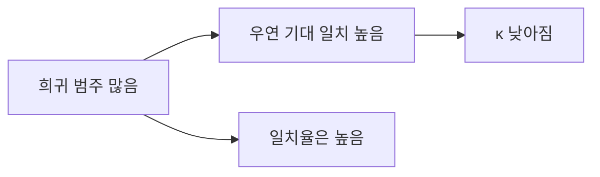
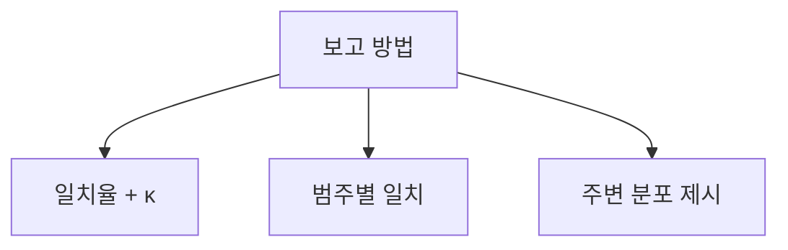

# kappa의 유병률 문제

> 일치율이 94%로 높은데도 kappa는 0.37밖에 안 나오는 현상. 희귀 범주(예: 불량 5%)가 많은 데이터에서는 우연 일치 몫 자체가 커서 kappa가 낮게 나온다.

## 쉽게 말하면
시험 문제의 95%가 "아니오"가 정답이면 아무 생각 없이 "아니오"만 찍어도 점수가 높다. 그래서 우연 몫을 빼고 나면 실력으로 인정되는 부분이 작아 보인다.

## 자세히
출처는 위키백과 "Cohen's kappa"(열람, 2차 출처)다.
- **분포에 의존**: kappa는 일치 자체만이 아니라 범주 분포에도 의존한다. 범주가 균등할수록 kappa가 높고, 두 평가자의 주변 분포가 비대칭이면 더 높아진다. 편향은 kappa가 작을 때 더 중요하다. 문서는 Bakeman 등의 결론을 인용해 "어떤 한 kappa 값도 보편적으로 받아들일 수 없다"고 전한다.
- **범주 수 영향**: 정확도 85%의 관찰자와 균등한 코드에서 kappa는 범주 2, 3, 5, 10개일 때 0.49, 0.60, 0.66, 0.69.
- **일치율이 높아도 낮거나 음수**: 문서의 2×2 예에서 16건 중 불일치 2건(일치율 87.5%)인데도 κ ≈ −0.07이 나오는 경우가 있고, 이는 기준선이 주변 합계에 묶이기 때문이다. 수량 불일치와 할당 불일치를 따로 보고하면 더 유익하다고 한다.
- **희귀 범주**: 희귀 범주에서 kappa가 일치를 과소평가한다는 지적도 있어 지나치게 보수적이라는 시각이 있다.

## 직접 계산한 가상 예시
100건, 불량 양성 약 5%인 상황에서 두 평가자(A, B)를 비교했다(a=둘 다 양성, b=A만 양성, c=B만 양성, d=둘 다 음성).

| 사례 | a | b | c | d | 일치율 | 우연 기대 일치 | κ |
|---|---|---|---|---|---|---|---|
| 편중(불량 5%) | 2 | 3 | 3 | 92 | 94% | 90.5% | 0.37 |
| 균형(50:50) | 45 | 5 | 5 | 45 | 90% | 50% | 0.80 |

→ 일치율은 편중 사례(94%)가 균형 사례(90%)보다 높지만 κ는 0.37 대 0.80으로 반대다. 우연 기대 일치가 편중 사례에서 90.5%로 높기 때문이다. 이 숫자는 스크립트로 확인했다.
- **실무 대응(해석)**: 일치율과 κ를 함께 보고하고, 범주별 일치(예: 양성 일치율)와 주변 분포를 같이 제시한다. 희귀 범주를 중심으로 평가할 때는 범주별 지표를 쓰거나 Krippendorff's alpha 같은 대안도 비교한다.

## 그림으로 보기

## 예시
- 사기 거래 라벨링(사기 1%): 두 평가자 일치율 98%인데 κ가 낮다면 분포 때문일 수 있으니 사기 건의 일치만 따로 본다.
- 교육 실습: 위 두 사례를 스프레드시트로 계산해 일치율과 κ가 어떻게 달라지는지 확인.

## 헷갈리는 것과 비교
| 개념 | 차이 |
|---|---|
| κ 유병률 문제 | 분포가 편중이면 κ가 낮게 나옴 |
| 단순 일치율 | 우연 보정 없음, 편중에서 부풀려짐 |
| [코헨 카파](#cohens-kappa) | 문제의 대상 지표 |
| [가중 kappa](#weighted-kappa) | 등급 간 거리를 반영 |

## 더 읽을거리
- [Wikipedia: Cohen's kappa](https://en.wikipedia.org/wiki/Cohen%27s_kappa) — 한계와 해석(열람, 2차 출처)
