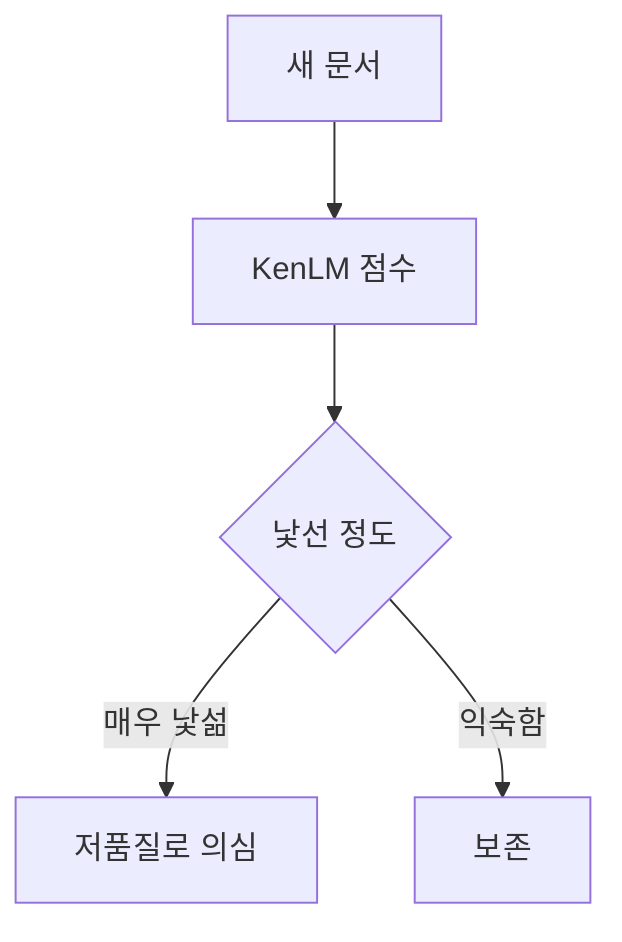

# KenLM

> 빠르고 작게 N-그램 언어 모델을 학습·조회하는 C++ 라이브러리(파이썬 모듈 포함). 데이터 필터링에서는 문서가 위키백과 같은 좋은 글과 얼마나 닮았는지 퍼플렉서티로 재는 데 쓰인다.

## 쉽게 말하면
"이 단어 다음에는 보통 이 단어가 온다"는 빈도표를 아주 빠르게 만들고 찾아보는 사전이다. 이 사전으로 새 문서를 읽혀 보면 "이 글이 평소 글과 얼마나 낯설게 느껴지는지"가 점수로 나온다.

## 자세히
(공식 GitHub README를 직접 열어 확인.)
- 제작: Kenneth Heafield. 설명 문구는 "Faster and Smaller Language Model Queries".
- **조회 구조 2종**: probing(해시 테이블, 가장 빠르나 메모리 많음), trie(비트 패킹, 메모리 적고 약간 느림). 확률은 log10.
- **학습 `lmplz`**: 수정 Kneser-Ney 스무딩, 가지치기 없는 모델 추정, 디스크 기반으로 메모리 한도 지정 가능.
- **`build_binary`**: ARPA를 mmap 이진 형식으로 변환. **`filter`**: 조회될 일 없는 항목 제거.
- **설치**: CMake(`cmake .. && make`), pip(GitHub 아카이브), vcpkg. Linux·macOS 등 지원. `MAX_ORDER` 환경변수로 최대 n-gram 차수 지정.
- **Python**: `kenlm.Model("x.arpa").score("문장", bos=True, eos=True)`.
- **라이선스**: 저장소에 LGPL-2.1, GPL-3.0 표기(사용 전 확인 필요).
- 데이터 파이프라인에서는 [CCNet](#ccnet)이 문서 퍼플렉서티 계산에 N-그램 모델을 쓴다고 알려져 있다(CCNet 초록에는 위키백과 같은 고품질 말뭉치와의 유사성 필터만 명시. 구체 구현은 논문 본문에서 확인 필요).

## 그림으로 보기



## 예시
```python
import kenlm
m = kenlm.Model("wiki.arpa")
print(m.score("인공지능은 컴퓨터가 학습하는 기술이다.", bos=True, eos=True))
```
- 교육 활용: 신경망이 아닌 "통계 사전"도 필터에 충분히 쓸모 있다는 사례.

## 헷갈리는 것과 비교
| 개념 | 차이 |
|---|---|
| KenLM | N-그램 LM 도구(빠름·가벼움) |
| 신경망 LM(GPT 등) | 문맥을 길게 보지만 무겁고 느림 |
| [퍼플렉서티](#perplexity-basics) | KenLM이 내놓는 점수의 종류 |

## 더 읽을거리
- [kpu/kenlm (GitHub)](https://github.com/kpu/kenlm) — 기능·설치·라이선스.
