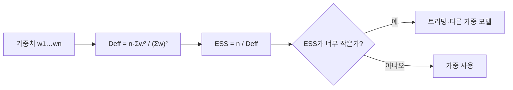
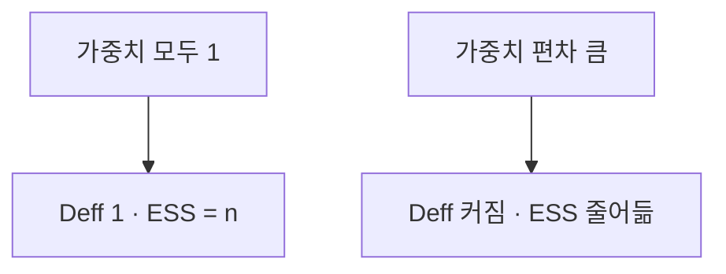

# Kish 설계 효과

> 가중치를 쓰면 편향은 줄지만 **가중치가 들쭉날쭉할수록 추정의 분산이 커진다**. Kish 설계 효과(Deff)는 그 분산 증가를 가중치만으로 근사해 재는 지표이고, 유효 표본 크기(ESS)는 "가중 뒤 실질적으로 몇 명 분의 정보인가"를 알려 준다.

## 쉽게 말하면
100명을 조사했는데 그중 한 명의 응답에 가중치를 50배 줬다면, 사실상 그 한 명이 결과를 좌우하므로 "100명 조사"가 아니라 "몇 명 조사"에 가깝다. 설계 효과는 이 "실질 인원 감소"를 숫자로 만든 것이다.

## 자세히
(Meta 연구진의 `balance` 패키지 논문 arXiv 2307.06024의 가중치 진단 절과 부록 C를 PDF에서 직접 읽었다.)
- **설계 효과 일반 정의(논문)**: 가중 추정량의 분산을 (복원 없는) 단순 무작위 표본에서 기대되는 분산으로 나눈 비. 가중치가 평균 추정의 분산에 얼마나 영향을 주는지 평가한다.
- **Kish의 공식(식 9)**: **Deff = n · Σ wᵢ² / (Σ wᵢ)²** (n은 표본 크기). 논문은 이것이 가중치와 결과 변수가 상관 없다는 가정, 곧 "haphazard weights" 하에서 평균 추정에 대한 설계 효과로 널리 쓰인다고 설명한다. 평균과 제곱평균으로 쓰면 Deff = mean(w²) / mean(w)².
- **유효 표본 크기 비율(식 10)**: ESSP = 1 / Deff. **유효 표본 크기(식 11)**: n_eff = ESS = n / Deff. 작은 ESS는 가중치가 추정의 변동성을 키웠다는 뜻이며 원하는 정밀도를 위해 더 큰 실제 표본이 필요할 수 있다.
- **계산 예(위 공식으로 직접 계산한 예시)**: 네 명의 가중치가 1, 1, 1, 5라면 Σw=8, Σw²=28, n=4 → Deff = 4×28/64 = 1.75, ESS = 4/1.75 ≈ 2.29. 모두 가중치가 같으면 Deff=1, ESS=n.
- **가중치 분포를 함께 본다(논문)**: 합이 표본 크기가 되도록 정규화(wᵢ* = wᵢ / w̄)하면 1에서 멀수록 정보량이 많고 적음을 뜻한다. 사분위수, 가중치가 2 초과·0.5 미만인 비율, KDE로 다봉 분포를 확인한다. 극단적으로 큰 가중치가 몇 개 있다면 대안 가중 모델이나 **가중치 트리밍**(상한으로 자르되 평균·합을 유지)을 고려한다. 패키지는 자동 트리밍을 제공한다고 논문이 적는다.
- **한계**: Deff는 가중치만 보는 근사로 가중치와 결과 변수의 상관이 있으면 달라진다. 이 글은 논문이 말한 범위만 옮긴 것이며 다른 추정량에 대한 설계 효과는 다루지 않았다.

## 그림으로 보기



## 예시
```python
import numpy as np
w = np.array([1, 1, 1, 5], dtype=float)
deff = len(w) * (w**2).sum() / w.sum()**2   # 1.75
ess = len(w) / deff                          # 약 2.29
```
- 교육 소재: "응답 1000명에 가중치를 줬더니 실질 표본이 300명" 같은 사례로 가중의 대가를 설명.

## 헷갈리는 것과 비교
| 개념 | 차이 |
|---|---|
| Kish 설계 효과 | 가중치 편차로 인한 분산 증가 근사 |
| 유효 표본 크기 | n/Deff, 실질 정보량 |
| [사후 층화 가중](#post-stratification-weights) | 이런 가중치를 만드는 방법 |
| [가중치 트리밍](#weight-trimming) | Deff를 낮추려는 후처리 |

## 더 읽을거리
- [balance: a Python package for balancing biased data samples (arXiv 2307.06024)](https://arxiv.org/pdf/2307.06024) — Kish 설계 효과·ESS·가중치 진단(PDF 직접 읽음).
