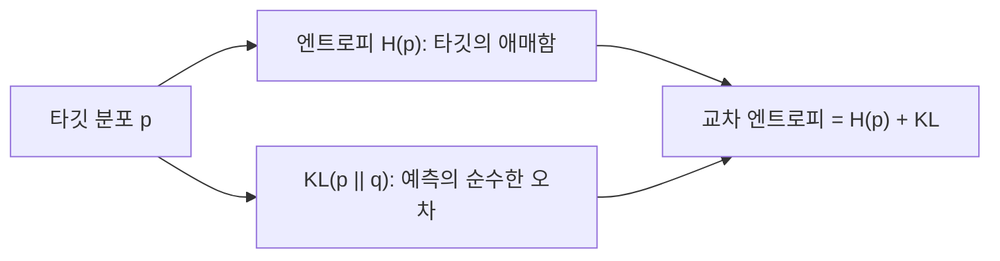
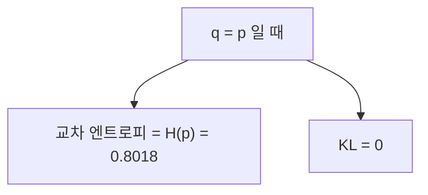

# KL 발산과 교차 엔트로피

> 정답이 "확률 분포"(소프트 타깃)일 때, 교차 엔트로피의 최솟값은 0이 아니라 **타깃의 엔트로피**다. KL 발산은 그 엔트로피를 뺀 값이라 최솟값이 0이다. 두 손실은 **기울기가 같아** 학습 결과는 똑같다.

## 쉽게 말하면
시험의 정답이 "70%는 A, 20%는 B, 10%는 C"처럼 애매한 문제라면 완벽한 답안을 써도 감점이 0점이 되지 않는다(문제 자체가 애매해서 남는 점수). 교차 엔트로피는 이 애매함까지 포함한 점수이고, KL은 애매함을 뺀 "순수하게 틀린 정도"이다.

## 자세히
- **관계식**(Wikipedia 확인): H(p, q) = H(p) + KL(p‖q). H(p)는 타깃 p만으로 정해지는 값이라 q가 바뀔 때 두 손실은 **상수 차이**다. 교차 엔트로피의 최솟값은 q=p일 때 H(p)(깁스 부등식).
- **직접 계산**(타깃 p = [0.7, 0.2, 0.1], 자연로그, 예측 q를 바꿔 가며):

| 예측 q | 교차 엔트로피 | KL | 차이(CE−KL) |
|---|---|---|---|
| [0.7, 0.2, 0.1] (완벽) | **0.8018** | **0.0000** | 0.8018 = H(p) |
| [0.6, 0.3, 0.1] | 0.8286 | 0.0268 | 0.8018 |
| [0.9, 0.05, 0.05] | 0.9725 | 0.1707 | 0.8018 |
| [1/3, 1/3, 1/3] | 1.0986 | 0.2968 | 0.8018 |

- 해석: 완벽한 예측을 해도 교차 엔트로피는 0.8018이다. 학습 곡선에서 "손실이 0.8 아래로 안 내려간다"고 불안해할 필요가 없다. KL로 보면 0에 도달한다.
- **PyTorch 확인**(직접 실행): q=[0.6,0.3,0.1]에서 소프트 타깃 교차 엔트로피 0.8286, `F.kl_div`(batchmean) 0.0268이 위 표와 같았고, 로짓에 대한 **기울기도 `allclose`로 같았다**. 그래서 소프트 타깃 학습에서 어느 쪽을 써도 최적화 경로가 같다. 주의: `kl_div`는 입력이 로그확률, 타깃이 확률이어야 한다.
- **쓰임**: 라벨 스무딩·MixUp·지식 증류처럼 타깃이 확률 분포인 학습에서 손실 값의 해석에 이 차이가 중요하다. 하드 라벨(원-핫)에서는 H(p)=0이라 두 손실이 같다.

## 그림으로 보기



## 예시
```python
loss_ce = -(target_probs * F.log_softmax(logits, -1)).sum(-1).mean()
loss_kl = F.kl_div(F.log_softmax(logits, -1), target_probs, reduction="batchmean")
```
- 라벨 스무딩 0.1 학습에서 손실이 0.1~0.3 아래로 안 내려가는 것은 정상.
- 교육: 표의 네 줄을 손으로 계산해 보고 "차이가 항상 0.8018"임을 확인.

## 헷갈리는 것과 비교
| 개념 | 차이 |
|---|---|
| 교차 엔트로피 | 타깃의 엔트로피를 포함, 최솟값 H(p) |
| KL 발산 | 엔트로피를 뺀 값, 최솟값 0 |
| 엔트로피 | 분포 하나의 불확실성 |
| [소프트 라벨 손실](#soft-label-loss) | 이 손실들을 쓰는 맥락 |

## 더 읽을거리
- [Cross-entropy — Wikipedia](https://en.wikipedia.org/wiki/Cross-entropy) — H(p,q)=H(p)+KL, 최솟값(열어 확인).
- [PyTorch kl_div 문서](https://docs.pytorch.org/docs/stable/generated/torch.nn.functional.kl_div.html) — 입력은 로그확률, 타깃은 확률(페이지 본문은 읽지 못했고 위 코드를 직접 실행해 확인).
