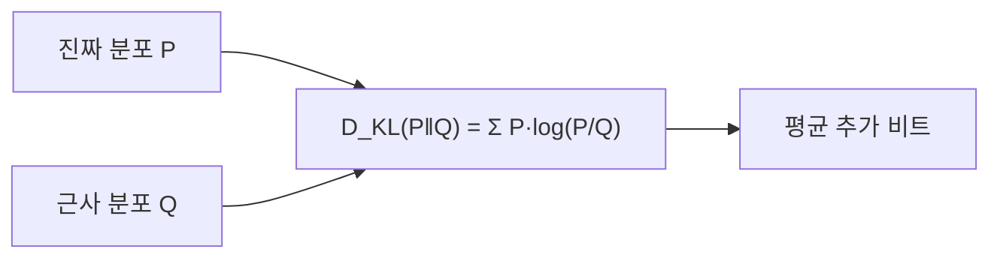
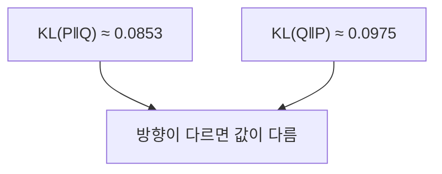

# KL 발산

> 진짜 분포 P를 근사 분포 Q로 대신 쓸 때 **평균적으로 얼마나 더 놀라게(비트가 더 들게) 되는지**를 재는 지표다. 0 이상이고 P와 Q가 같을 때만 0이며, **비대칭**이라 거리(metric)는 아니다.

## 쉽게 말하면
외국어 사전(근사 분포 Q)으로 실제 모국어 문장(P)을 해석할 때 얼마나 자주 "이 단어가 이렇게 쓰일 줄이야" 하고 놀라는가를 평균 낸 값이다. 사전이 실제와 같으면 놀랄 일이 없어 0이다. 반대로 실제 언어를 사전으로 쓰는 경우(Q→P)는 놀라는 정도가 달라 값이 다르다.

## 자세히
(Wikipedia "Kullback–Leibler divergence" 문서를 직접 읽고, 문서의 예와 이 지도의 가상 분포를 파이썬으로 계산해 확인했다. 문서 본문 일부(마지막 약 1.6만 자)는 읽지 못했다.)
- **정의(이산)**: **D_KL(P‖Q) = Σₓ P(x) · log( P(x) / Q(x) )**.
- **해석(문서)**: Q를 쓸 때의 **기대 초과 놀람(expected excess surprisal)**, 즉 Q에 최적화된 부호로 P에서 나온 표본을 인코딩할 때 드는 **평균 추가 비트 수**.
- **성질(문서)**: ① **음수가 없다**(Gibbs 부등식), P와 Q가 같을 때만 0 ② **비대칭** — 일반적으로 D_KL(P‖Q) ≠ D_KL(Q‖P) ③ 삼각 부등식을 만족하지 않아 거리가 아니라 **발산** ④ 대칭화한 형태는 Jeffreys 발산이라 부른다.
- **절대 연속성(문서)**: Q(x)=0이면 P(x)=0이어야 정의된다. 아니면 보통 +∞로 정의한다. P(x)=0인 항은 x·log x → 0이라 0으로 기여한다.
- **문서의 예를 직접 계산해 확인**: P는 이항분포 N=2, p=0.4로 P(0), P(1), P(2) = 9/25, 12/25, 4/25, Q는 {0,1,2}에서 균등(각 1/3). 자연로그(nat)로 **D_KL(P‖Q) ≈ 0.0853**, **D_KL(Q‖P) ≈ 0.0975**가 나와 문서와 같다. 밑 2로는 각각 약 0.1231, 0.1406비트. 방향에 따라 값이 다른 것이 비대칭이다.
- **0 확률 칸의 문제(직접 계산)**: 앞선 글의 가상 분포 P=[0.6, 0.3, 0.0, 0.1], Q=[0.5, 0.3436, 0.0064, 0.15]에서 KL(P‖Q)는 약 0.0406비트로 계산되지만 **KL(Q‖P)는 P가 0인 칸에서 Q가 0이 아니어서 무한대**(구현에서 0 나눗셈)다. 이런 이유로 분포 변화 감지에서는 대칭이고 유한한 [젠슨-섀넌 발산](#jensen-shannon-divergence)이 자주 쓰인다.
- **쓰임(일반)**: 모델 손실(교차 엔트로피에서 KL이 나타남), 분포 비교, 정보 이득 등. 이 글의 출처만으로는 각 용도를 확인하지 않았다.

## 그림으로 보기



## 예시
```python
import math
P = [9/25, 12/25, 4/25]; Q = [1/3]*3
kl = lambda p, q: sum(a*math.log(a/b) for a, b in zip(p, q) if a > 0)
kl(P, Q)   # 0.0853
kl(Q, P)   # 0.0975
```
- 교육 소재: 두 방향 값이 왜 다른지 사전 비유로 토론.

## 헷갈리는 것과 비교
| 개념 | 대칭 | 유계 | 비고 |
|---|---|---|---|
| KL 발산 | 아니오 | 아니오 | 0 확률 칸에서 무한 가능 |
| [젠슨-섀넌 발산](#jensen-shannon-divergence) | 예 | 예 | KL을 평균 분포로 평활화 |
| Jeffreys 발산 | 예 | 아니오 | KL의 대칭화(문서) |
| [L∞ 거리](#l-infinity-norm-categorical) | 예 | 예 | 가장 큰 범주별 차이 |

## 더 읽을거리
- [Kullback–Leibler divergence (Wikipedia)](https://en.wikipedia.org/wiki/Kullback%E2%80%93Leibler_divergence) — 정의·성질·이항 예(직접 읽음, 일부 미열람).
- [Jensen–Shannon divergence (Wikipedia)](https://en.wikipedia.org/wiki/Jensen%E2%80%93Shannon_divergence) — KL과의 비교(앞서 읽음).
