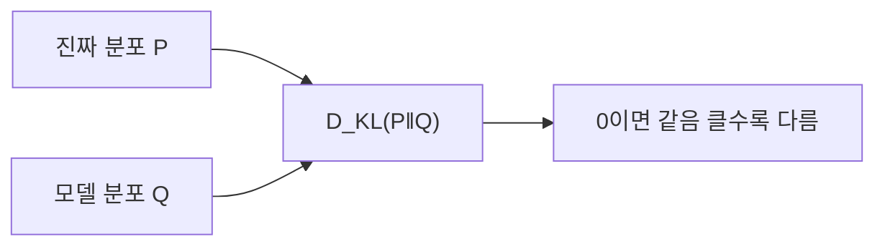
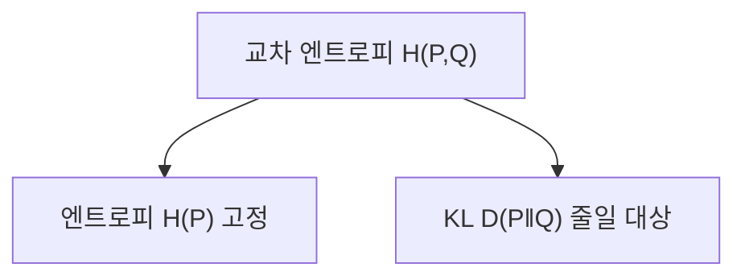

# KL 발산

> 확률분포 Q가 진짜 분포 P와 얼마나 다른지 재는 값. 0이면 같고, 클수록 다르다.

## 쉽게 말하면
동네 날씨 예보가 실제 날씨와 얼마나 어긋나는지를 "놀람의 평균"으로 재는 것이다. 예보(Q)가 틀려 실제(P)에 자주 놀랄수록 값이 커진다.

## 자세히
- 식(이산): `D_KL(P‖Q) = Σ P(x) log(P(x)/Q(x))`. P 아래에서의 로그 비율 평균이다.
- **항상 0 이상**(Gibbs 부등식), P=Q일 때만 0.
- **비대칭**: D(P‖Q) ≠ D(Q‖P). 거리(metric)가 아니고 삼각부등식도 안 맞는다.
- **교차 엔트로피와의 관계**: `H(P,Q) = H(P) + D_KL(P‖Q)`. 정답 분포 H(P)는 고정이므로 교차 엔트로피를 줄이는 것 = KL을 줄이는 것([교차 엔트로피](#cross-entropy)).
- 머신러닝에서: 변분 추론/VAE의 손실에 쓰이는 정규화 항(가우시안 대 표준정규의 닫힌 형태가 흔하다, Wikipedia). 또한 일반적으로 파인튜닝 때 원 모델에서 너무 멀어지지 않도록 KL 페널티를 넣는 기법에도 쓰인다(이 부분은 위 출처로는 확인하지 못한 일반 지식).

## 그림으로 보기

## 예시
- 정답 (0.5, 0.5) vs 모델 (0.9, 0.1): KL>0. 모델이 (0.5,0.5)가 되면 0.
- 두 버전 모델의 토큰 확률 분포가 얼마나 달라졌는지 비교.

## 헷갈리는 것과 비교
| 개념 | 차이 |
|---|---|
| KL 발산 | 두 분포의 차이, 비대칭 |
| 교차 엔트로피 | 정답 엔트로피까지 포함한 값 |
| 유클리드 거리 | 대칭 거리 |

## 더 읽을거리
- [Kullback–Leibler divergence — Wikipedia](https://en.wikipedia.org/wiki/Kullback%E2%80%93Leibler_divergence) — 정의·성질.
