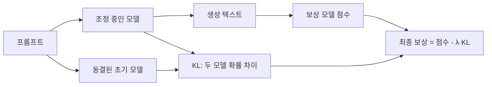

# 파인튜닝의 KL 페널티

> RLHF 같은 강화학습 파인튜닝에서, 조정 중인 모델이 원래(초기) 모델의 출력 분포에서 너무 멀어지지 않도록 보상에서 KL 발산을 빼는 항이다.

## 쉽게 말하면
시험 점수(보상)만 보고 공부하면 채점 요령만 익혀 이상한 답안을 쓰게 된다. "원래 문체에서 크게 벗어나면 감점"이라는 규칙을 두면 점수도 올리되 말은 멀쩡하게 유지된다. 그 감점이 KL 페널티다.

## 자세히
- Hugging Face의 RLHF 설명 기준: 생성된 텍스트마다 RL 정책과 동결된 초기 모델의 토큰별 확률분포를 비교해 [KL 발산](#kl-divergence)을 샘플링으로 근사한다.
- 최종 보상: r = r_θ − λ·r_KL. r_θ는 선호 모델(보상 모델)의 점수, λ는 페널티 세기.
- 목적: 한 번의 배치에서 정책이 너무 크게 변하지 않게 하고, 보상 모델을 속이는 의미 없는 문장(reward hacking)을 막는다.
- λ가 크면 보수적이라 개선이 작고, 작으면 보상은 오르지만 품질이 무너질 위험이 있다.
- [PPO](#ppo) 기반 [RLHF](#rlhf)에서 쓰이고, [DPO](#dpo)에서는 기준 모델 대비 로그 비율 형태로 같은 취지가 손실에 들어 있다(DPO 쪽 세부는 해당 노드 참고).

## 그림으로 보기

## 예시
- 보상 모델이 긴 답을 좋아하면 모델이 장황해지는데, KL 페널티가 원래 말투에서의 이탈을 제한한다.
- 학습 로그에서 KL 값이 급증하면 λ를 올리거나 학습률을 낮춘다.

## 헷갈리는 것과 비교
| 개념 | 차이 |
| --- | --- |
| [KL 발산](#kl-divergence) | 두 분포 차이를 재는 일반 도구 |
| KL 페널티 | 그것을 RL 보상에 뺀 정규화 항 |
| [RLHF](#rlhf) | 이 페널티를 쓰는 전체 학습 틀 |

## 더 읽을거리
- [Illustrating RLHF (Hugging Face)](https://huggingface.co/blog/rlhf) — 보상 식과 KL 페널티 설명
