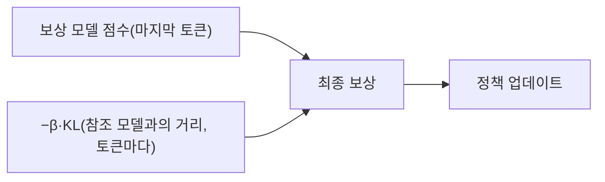
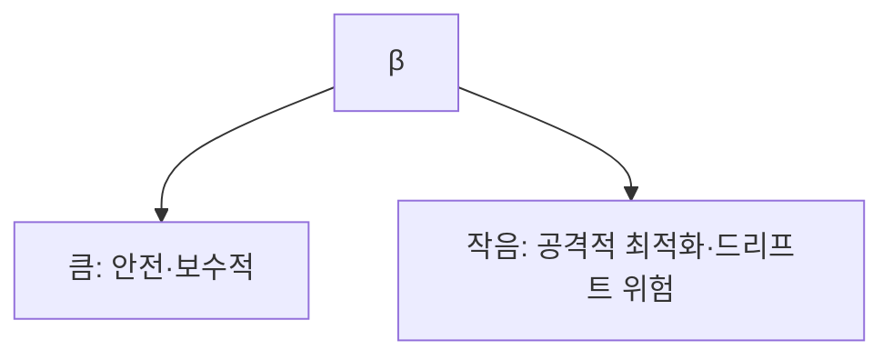

# KL 페널티

> 강화학습 기반 정렬(RLHF)에서 정책이 **출발점(참조 모델)에서 너무 멀어지지 않도록 보상에서 빼는 항.** 보상 모델 점수만 쫓다가 이상한 방향으로 드리프트하는 것을 막는다.

## 쉽게 말하면
줄을 단 개를 산책시키는 것과 같다. 흥미로운 곳으로 가도 되지만 줄(페널티)이 주인(참조 모델)에게서 너무 멀리 가는 것을 막는다.

## 자세히
(검색 요약 기준, 1차 논문 본문은 열람하지 않았다.)
- 형태: 토큰별 보상이 `r̂_t = r_t^RM + β·r_t^KL` 꼴이다. 보상 모델은 마지막 토큰에 **희소한 점수**만 주지만 KL 항은 **토큰마다 조밀**하다. 참조 모델 π_ref는 보통 **시작 체크포인트**이고 β ≥ 0이 페널티 계수다. InstructGPT는 보상에서 `β·log(π_θ/π_ref)`를 뺀 값으로 학습한다고 요약된다.
- 의미(신뢰 영역 관점): 정책은 보상을 높일 수 있지만 **참조 정책이 가능성 낮게 보던 응답의 확률을 올리는 만큼 대가**를 치른다.
- β의 역할: **큰 β**는 드리프트를 강하게 억제, **작은 β**는 더 공격적인 보상 최적화를 허용한다.
- **PPO-ptx**: PPO 목적에 보조 항을 더한 것으로, 결합 손실은 `L^RL + γ·L^PTX`(γ가 균형). Safe RLHF 부록은 사전학습 데이터에 접근할 수 없어 PTX 손실에 SFT 데이터를 썼다고 한다. PTX 항의 목적 설명은 검색 결과가 충분하지 않았다.
- 연결: Gao 외(2022, arXiv 2210.10760, 초록 읽음)는 RL 설정의 KL 페널티가 보상 과최적화 관계에 영향을 주는 변수라고 조사했다([보상 과최적화](#reward-overoptimization)).
- 주의: 한 LoRA 기반 PPO 보고는 이 항을 제거해도 AlpacaFarm 평가에서 성능이 해치지 않았다고 했고, 검증 가능한 보상에서는 논거가 약해진다는 의견도 있다([RLVR](#rl-verifiable-rewards)).

## 그림으로 보기

## 예시
- 정렬 중인 모델이 특정 어투만 반복하려 할 때 KL 페널티가 원래 모델의 분포에서 크게 벗어난 만큼 점수를 깎음.
- 교육: 개 줄 비유로 β를 키우고 줄이는 효과를 토론.

## 헷갈리는 것과 비교
| 개념 | 차이 |
|---|---|
| KL 페널티 | 참조 모델에서 멀어짐에 비용 |
| PPO-ptx | 사전학습식 손실을 섞어 능력 유지 |
| [DPO](#dpo) | 별도 RL 없이 직접 정책 최적화 |

## 더 읽을거리
- [KL penalties and reference models (Prime Intellect)](https://primeintellect.ai/rl-glossary/kl-penalty) — 용어 설명(검색 결과 확인).
- [Safe RLHF](https://arxiv.org/pdf/2310.12773) — PTX 사용 사례(검색 결과 확인).
