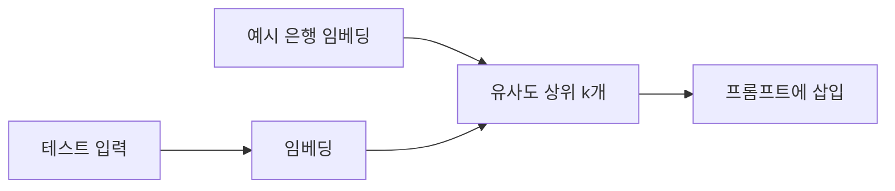

# kNN 예시 검색

> 테스트 입력과 **임베딩 유사도가 가까운 예시를 골라** few-shot 프롬프트에 넣는 방식이다. 쉽고 널리 쓰이지만 표면 특징에 속을 수 있다.

## 쉽게 말하면
신입에게 사례집을 보여 줄 때, 지금 일과 *문장이 닮은* 사례부터 찾아 주는 것이다. 문장이 닮아도 풀이가 다르면 도움이 안 된다.

## 자세히
(Skill-KNN 논문의 서론·배경을 직접 읽었다. KATE 등 개별 방법의 원문은 열지 않았다.)
- **절차(논문 설명)**: 입력과 후보 예시를 임베딩해 **가장 유사한 예시를 선택**(임베딩 기반 few-shot 선택). 다양한 과제에 쉽게 적용된다.
- **한계(논문)**: 과제와 무관한 **표면 언어 특징**에 편향될 수 있다. 의미 파싱에서는 같은 개체를 가진 예시만 찾는 식이다. 필요한 것은 같은 *기술*을 담은 예시다. → [Skill-KNN](#skill-knn).
- **임베딩 미세조정 접근(논문 언급)**: Rubin 외 2022 등은 과제별 임베딩 모델을 학습하지만 과제마다 학습·저장해야 하고 예시 은행이 바뀌면 재학습해야 해 실용적이기 어렵다고 논문이 지적한다.
- **주의(해석)**: 유사도 상위 k개가 서로 거의 같은 예시이면 다양성이 없다([MMR](#mmr-diversity)).

## 그림으로 보기

## 예시
- 고객 문의 분류 프롬프트에 최근접 예시 4개를 넣어 정확도를 비교(제안). 실제로 몇 개가 좋은지는 직접 비교한다.

## 헷갈리는 것과 비교
| 개념 | 차이 |
|---|---|
| kNN 검색 | 원문 임베딩 유사도 |
| [Skill-KNN](#skill-knn) | 기술 설명 임베딩 |
| [순서 민감성](#example-order-sensitivity) | 선택한 뒤 순서에 따른 성능 변동 |

## 더 읽을거리
- [An et al. (2023) — Skill-KNN](https://arxiv.org/abs/2305.14210) — 직접 읽음.
