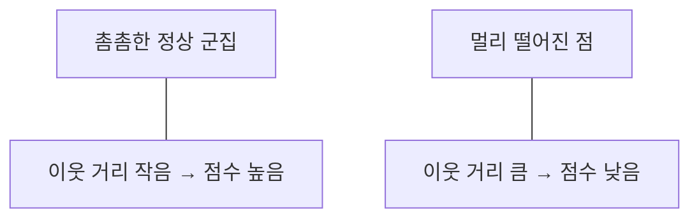

# kNN 이상치 점수

> kNN 이상치 점수는 각 샘플에서 가장 가까운 K개 이웃까지 거리의 평균을 구하고, 멀수록 이상치로 보는 점수다. 모델 없이 특징 벡터(임베딩)만 있으면 계산할 수 있다.

## 쉽게 말하면
교실에서 친구들과 가까이 앉은 학생은 평범하고, 가장 가까운 친구도 멀리 있는 학생은 혼자 떨어진 학생이다. 각자 가장 가까운 K명까지의 평균 거리를 재서 그 값이 크면 "외톨이"로 표시한다.

## 자세히
- **계산(cleanlab 문서)**: 샘플의 점수는 특징 공간에서 K개 최근접 이웃까지의 평균 거리에 바탕을 둔다. 거리가 크면 비정형이므로 점수가 낮아진다. 거리는 `exp(-거리 × t)`로 유사도로 바꿔 [0, 1] 범위로 만든다. 0에 가까우면 이상치, 높으면 데이터 분포에 잘 맞는다.
- **기본값(문서)**: `k`는 `knn.n_neighbors` 또는 지정이 없으면 10, `t`는 1. 점수가 전부 1 근처에 몰리면 `t`를 키운다(순위는 그대로). 거리 지표는 특징이 3개 초과면 코사인, 아니면 유클리드가 기본이다([코사인 vs 유클리드](#cosine-vs-euclidean-distance)).
- **직접 해 본 작은 실험(순수 Python, 2차원 정규분포 500개 + 일부러 떨어뜨린 점 3개 (6,6), (-5,7), (0,-8))**: 정상 점의 평균 이웃 거리는 K=1일 때 0.10, K=10일 때 0.25였다. 떨어진 3점은 K=1에서 5.1~5.7, K=10에서 5.8~6.1로 20배 이상 컸다. 점수 exp(-d)로는 0.002~0.006이다. 이 데이터에서 세 점은 모두 점수 하위 3개 안에 들었다(작은 합성 데이터라 일반화는 금물).
- **K 선택(해석)**: K가 너무 작으면 서로 붙어 있는 이상치 두세 개가 이웃 때문에 정상처럼 보인다(K=1에서 이웃이 같은 이상 군집이면 거리가 짧다). K를 키우면 작은 군집 이상치도 잡히지만 작은 정상 군집이 이상으로 오인될 수 있다.
- **쓰임(해석)**: 라벨 오류 정리 단계에서는 라벨과 무관하게 "이 샘플은 학습 분포에서 떨어져 있다"를 보는 보조 신호로 쓴다. 서비스 중 입력 감시는 [OOD 탐지](#out-of-distribution-detection)로 이어진다.

## 그림으로 보기

## 예시
- 문서 임베딩 1만 개에서 K=10 점수로 하위 50개를 뽑아 보면 빈 문서·다른 언어 문서·깨진 텍스트가 모인다.
- 코드 예(문서 사용법): `OutOfDistribution(params={"k": 10}).fit_score(features=X)`로 점수를 얻고 가장 낮은 것부터 검토한다.
- 교육 활용: 점 몇 개를 종이에 찍고 K=1, K=3으로 이웃 거리를 손으로 재서 점수가 어떻게 달라지는지 비교한다.

## 헷갈리는 것과 비교
| 개념 | 차이 |
| --- | --- |
| kNN 이상치 점수 | 특징 공간에서 이웃까지 거리 |
| 예측 확률 기반 점수 | 분류기 불확실성(엔트로피 등)에서 계산 |
| [OOD 탐지](#out-of-distribution-detection) | 서비스 중 입력이 학습 분포 밖인지 판정 |
| [코사인 vs 유클리드](#cosine-vs-euclidean-distance) | 거리 지표 선택 |

## 더 읽을거리
- [cleanlab outlier 문서](https://docs.cleanlab.ai/stable/cleanlab/outlier.html) — OutOfDistribution의 k, t, 점수 의미
