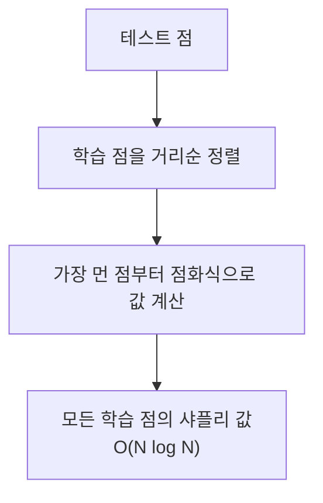
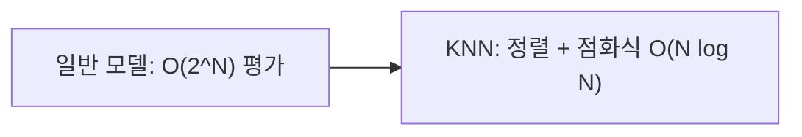

# KNN-Shapley

> **K-최근접 이웃(KNN) 분류기에서는 샤플리 데이터 가치를 정렬 한 번과 간단한 점화식으로 정확히** 계산할 수 있다는 결과다(Jia et al. 2019). 일반 모델에서 지수 시간이 걸리는 계산이 O(N log N)으로 줄어든다.

## 쉽게 말하면
각 학습 데이터가 "이 테스트 점의 정답을 맞히는 데" 기여한 정도를 매기려면 보통은 모든 부분집합을 상상해야 한다. KNN은 "가까운 K개가 투표"하는 단순한 규칙이라, 가까운 순서로 줄을 세우면 뒤에서부터 차례로 값을 구할 수 있다.

## 자세히
- **논문 주장(arXiv 1908.08619 초록 확인)**: 일반 효용에서 샤플리는 모델 평가 O(2^N)이 필요하지만, **가중치 없는 KNN 분류기·회귀기**에서는 정확한 샤플리 값을 모든 N개 점에 대해 **O(N log N)**에 계산한다. LSH 기반 근사(ε, δ)는 부선형 복잡도를 갖는다고 한다. 정확한 알고리즘은 최대 1,000만 점까지 돌아가고 기준 근사 대비 최대 세 자릿수 빠르다고 보고한다. 확장으로 가중 KNN, 큐레이터별 군집 데이터를 다룬다.
- **효용 정의(직접 구현에서 사용)**: 테스트 점 하나에 대해 부분집합 S에서 가장 가까운 K개 중 정답 라벨이 맞는 개수 ÷ K.
- **정렬 후 점화식**: 학습 점을 테스트 점까지 거리 오름차순으로 정렬하고, 맨 먼 점부터 `s_N = match_N / N`, 이어서 `s_i = s_{i+1} + (match_i − match_{i+1}) / K · min(K, i) / i`로 계산한다(`match`는 라벨이 정답과 같으면 1, 순위 i는 1부터). 여러 테스트 점이면 점수를 평균한다. 이 점화식은 직접 구현해 아래처럼 정확 계산과 대조해 확인했다(논문 본문의 정확한 형태는 미열람).
- **직접 검증(학습 10개, K=3, 테스트 점 1개, 라벨 일부 오염, 부분집합 전부를 열거한 정확 샤플리와 비교)**: 값이 **정확히 일치**(최대 절대 차이 6e-16). 거리순 라벨 일치 패턴 `1 0 1 1 1 1 0 0 1 0`에서 가까운데 틀린 점은 값이 낮고(예: −0.1806, −0.0139) 가까이서 맞는 점은 높다(0.1528). **값의 합 0.6667 = 전체 효용 U(전체)**로 효율성도 확인.
- **속도(직접 측정, 테스트 점 1개)**: 열거 정확 계산은 N=9에서 0.05초(N이 늘면 지수적으로 폭증), 점화식은 N=9에서 0.00005초, N=1,000에서 0.001초, **N=100,000에서 0.051초**(Python 반복문, 정렬 제외 시간 포함 여부 주의). 큰 데이터에서도 현실적이다.
- **쓰임**: 임베딩(특징) 공간에서 KNN을 대리 모델로 삼아 대규모 데이터의 가치를 빠르게 매기고 낮은 값을 [오라벨 후보](#data-valuation-for-label-noise)로 검토. 임베딩 모델이 바뀌면 값이 달라진다.
- **한계**: KNN 효용에 한정, 실제로 쓰는 모델(신경망 등)의 가치와 다를 수 있다. 특징 공간의 품질과 K에 의존. 테스트 점 수가 많으면 계산이 곱해진다. 낮은 값은 후보일 뿐 [자동 삭제](#auto-delete-risk) 금지.

## 그림으로 보기



## 예시
```python
order = np.argsort(np.linalg.norm(Xtr - x_test, axis=1))
match = (ytr[order] == y_test).astype(float)
s = np.zeros(N); s[-1] = match[-1] / N
for i in range(N - 2, -1, -1):
    s[i] = s[i + 1] + (match[i] - match[i + 1]) / K * min(K, i + 1) / (i + 1)
value = np.empty(N); value[order] = s
```
- 문서 임베딩 100만 개의 데이터 가치를 빠르게 계산해 하위 1,000개를 사람이 검토.
- 교육: 문제 구조(가까운 이웃 투표)를 이용해 지수 계산을 다항 계산으로 줄이는 알고리즘 사고의 예.

## 헷갈리는 것과 비교
| 개념 | 차이 |
|---|---|
| KNN-Shapley | KNN 효용에서 정확·빠른 샤플리 |
| [TMC-Shapley](#tmc-shapley) | 일반 모델의 몬테카를로 근사 |
| [Leave-one-out 가치](#leave-one-out-value) | 한 점 제거 효과만 봄 |
| KNN 분류 | 가까운 K개 다수결 예측 |

## 더 읽을거리
- [Efficient Task-Specific Data Valuation for Nearest Neighbor Algorithms (arXiv 1908.08619)](https://arxiv.org/abs/1908.08619) — O(N log N) 정확 알고리즘과 LSH 근사(초록 확인).
- [Data Shapley (arXiv 1904.02868)](https://arxiv.org/abs/1904.02868) — 샤플리 데이터 가치 개념(초록 확인).
