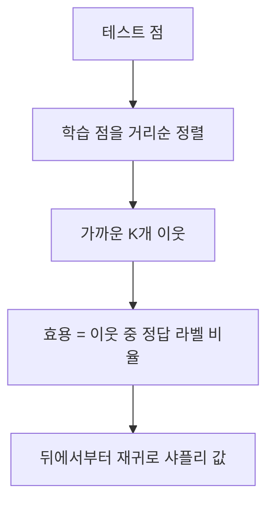
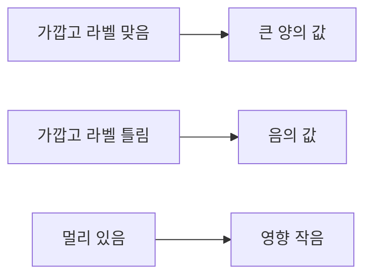

# KNN 효용 함수

> K-최근접 이웃(KNN) 분류기의 **효용 함수**: 학습 부분집합 S에서 테스트 점에 가장 가까운 K개 이웃 중 **정답 라벨과 같은 이웃의 비율**. K=1이면 테스트 정확도와 같다. 이 단순한 구조 덕분에 샤플리 값을 정확히, 빠르게 계산할 수 있다.

## 쉽게 말하면
새 문제의 이웃 K명에게 "정답이 뭐라고 생각해?"를 물어 정답과 같은 답을 낸 비율이 점수다. 학습 데이터가 바뀌면 "가까운 K명"의 구성만 바뀌므로 점 하나의 영향이 단순하게 정리된다.

## 자세히
(Jia 외, "Efficient Task-Specific Data Valuation for Nearest Neighbor Algorithms", arXiv 1908.08619 본문 확인)
- **정의**: 테스트 점 (x_test, y_test)과 학습 부분집합 S에 대해 ν(S) = (1/K) Σ_{k=1}^{min(K,|S|)} 1[y_{α_k(S)} = y_test], α_k(S)는 x_test에 k번째로 가까운 S의 점. 논문은 이를 "KNN이 각 테스트 점에 올바른 라벨을 줄 **가능성이 높아지는 정도**"로 설명하고 **K=1이면 테스트 정확도와 같다**고 한다. 여러 테스트 점이면 각 점의 값의 평균.
- **점 하나를 더할 때의 변화(증명 과정)**: 새 점은 **K번째 이웃을 밀어낼 때만** 효용을 바꾼다. 따라서 이웃 안에 들어올 때 ν(S∪{i}) − ν(S) = (1/K)(1[yᵢ=y_test] − 1[y_K=y_test]). 이웃 K 안에 못 들면 변화 0. 이 "구간별 효용 차이 성질" 때문에 인접한 두 점의 샤플리 값 차이가 닫힌 형식으로 정리된다.
- **정확 계산 알고리즘(논문 알고리즘 1)**: 테스트 점에 가까운 순으로 학습 점을 정렬(α₁…α_N)한 뒤
  - 가장 먼 점: s_{α_N} = 1[y_{α_N}=y_test] / N
  - 그다음 i = N−1 → 1: s_{α_i} = s_{α_{i+1}} + (1[y_{α_i}=y_test] − 1[y_{α_{i+1}}=y_test]) / K · min(K, i) / i
  테스트 점당 **정렬 한 번**이라 O(N log N) — 일반 효용의 정확 계산 O(2^N)·근사 O(N log N 평가)에 비해 지수적으로 빠르다.
- **직접 검증(순수 파이썬, N=7, K=3)**: 무작위 1차원 점·이진 라벨로 5,040개 순열 전수 샤플리와 위 재귀식을 비교하니 **최대 오차 6×10⁻¹⁵(동일)**. 가까운 순서 (거리 순위 1~7)의 값: 0.2595(정답 라벨, 1위), −0.0738(오답), −0.0738(오답), −0.0738(오답), 0.1762(정답), −0.0238(오답), 0.1429(정답). 합 = 0.3333 = ν(전체) = 1/3(효율성). 순위 1의 정답 점이 가장 값이 크고, 같은 라벨이라도 멀수록 몫이 줄지 않고 **자기보다 가까운 점들에 따라** 달라진다.
- **직관**: 가깝고 라벨이 맞는 점은 큰 양수, 가깝지만 라벨이 틀린 점은 음수(오라벨·방해). 먼 점은 이웃 안에 들 확률이 낮아 영향이 작다.
- **한계**: KNN 모델·선택한 거리(특징 공간)에 종속. 실제 모델이 신경망이면 KNN은 **대리 모델**이다([임베딩 공간 가치 평가](#embedding-space-valuation)). 가중 KNN은 복잡도가 커진다([가중 KNN 샤플리](#weighted-knn-shapley)).

## 그림으로 보기



## 예시
```python
def knn_shapley(dist_order, correct, K):
    # dist_order: 테스트 점에 가까운 순서의 인덱스, correct[i] = 1[y_i == y_test]
    N = len(dist_order); s = {}
    s[dist_order[-1]] = correct[dist_order[-1]] / N
    for r in range(N - 1, 0, -1):                 # r = 순위(1-index)
        a, b = dist_order[r - 1], dist_order[r]
        s[a] = s[b] + (correct[a] - correct[b]) / K * min(K, r) / r
    return s
```
- 테스트 점이 여러 개면 위 값을 테스트 점마다 구해 평균한다.

## 헷갈리는 것과 비교
| 개념 | 설명 |
|---|---|
| KNN 효용 | 이웃 K개 중 정답 비율 |
| 테스트 정확도 | K=1일 때와 동일 |
| 일반 샤플리 | 효용 구조 제한 없음, 매우 비쌈 |
| KNN-Shapley | 이 효용에 한해 O(N log N) 정확 계산 |

## 더 읽을거리
- [Efficient Task-Specific Data Valuation for Nearest Neighbor Algorithms (arXiv 1908.08619)](https://arxiv.org/abs/1908.08619) — 정의·정리 1·알고리즘 1(PDF 본문 확인). 7점 검증은 이 글의 직접 계산.
