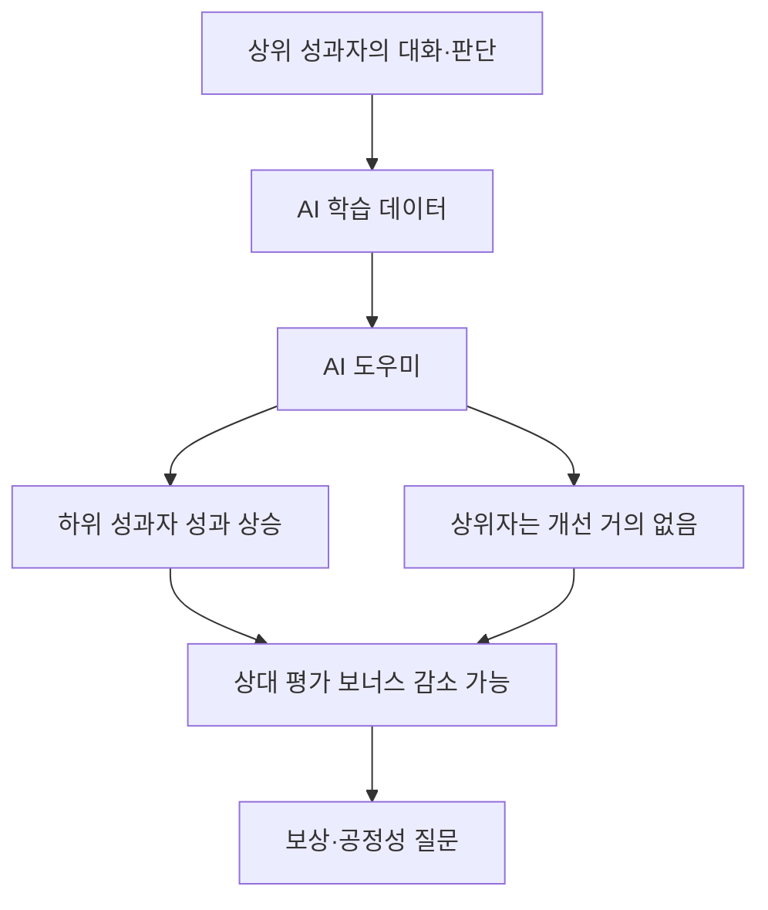

# 숙련자 기여 보상

> 최고 성과자의 대화·판단이 AI 학습 데이터가 될 때, 그들이 얻는 이득이 적거나 오히려 손해일 수 있다는 공정성 문제와 보상 설계 질문.

## 쉽게 말하면
장인이 쌓은 요령을 녹화해서 신입 교육 AI를 만들면 신입은 빨라지지만 장인의 상대적 우위는 사라진다. 그 지식을 내놓은 대가를 누가 어떻게 치러야 할까?

## 자세히
출처: NBER 31161 본문(직접 확인).
- **저자들의 지적**: 연구 대상 회사에서 최고 성과자들이 AI 학습에 쓰인 예시를 많이 제공하지만 본인 생산성 개선은 거의 없다. 보너스가 다른 상담사 성과 대비로 계산되는 관행에서는 오히려 보수가 줄 수도 있다. 그래서 AI에 데이터를 제공하는 직원, 특히 상위 성과자를 어떻게 보상할지 질문이 생긴다고 논문이 명시한다.
- **쟁점**: ① 업무 중 생성된 데이터의 소유 ② 학습에 쓰는 데 대한 동의 ③ 개인 기여 추적·보상 방법 ④ 상대 평가 체계에서의 불이익.
- **가능한 설계 방향(일반 제안, 논문 결론 아님)**: 학습 데이터 기여 인센티브, 상대 평가 대신 절대 기준, 멘토·교육자 역할 보상, 데이터 사용 고지·옵트아웃.
- **관련 법·계약**: 직원 데이터 활용은 노동계약·개인정보 규정과 얽힌다(국가별로 다름, 이 글에서 확인하지 않음).
- 확인되지 않은 부분: 이 논문은 보상 방식을 제안하지 않고 문제를 제기한다.

## 그림으로 보기

## 예시
- 콜센터: 우수 상담 사례 1,000건을 학습에 쓰려면 사전 동의 + "AI 코칭 사례 제공자" 수당 신설을 검토.
- 평가 체계 개편: 팀 전체 해결률 기준 보너스로 전환해 지식 공유 유인을 만든다.

## 헷갈리는 것과 비교
| 개념 | 차이 |
|---|---|
| 데이터 기여 보상 | 학습 데이터 제공자에 대한 대가 |
| 저작권 | 창작물 보호(다른 법 영역) |
| [암묵지 확산](#tacit-knowledge-diffusion) | 노하우가 퍼지는 과정 |

## 더 읽을거리
- [NBER 31161](https://www.nber.org/system/files/working_papers/w31161/w31161.pdf) — 보상 질문 제기 부분(결론 절)
