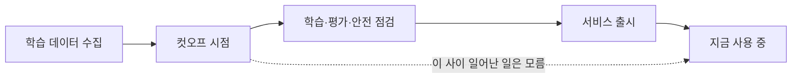
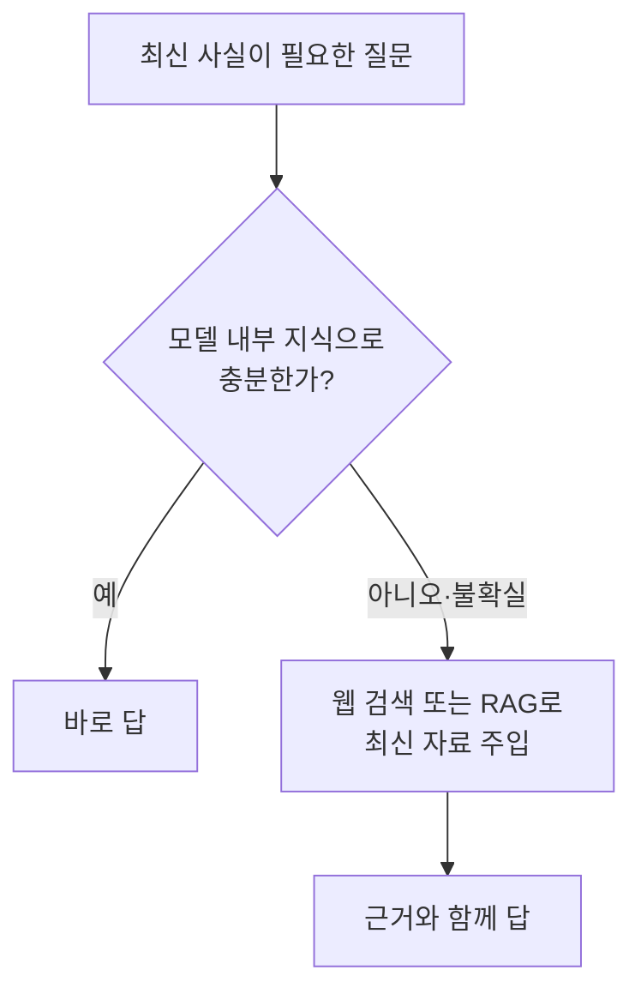

# 지식 컷오프

> 모델이 학습한 자료가 끝나는 시점. 그 이후에 일어난 일은 모델이 "모른다". 최신 정보가 필요하면 웹 검색·RAG 같은 도구로 따로 넣어 줘야 한다.

## 쉽게 말하면
시험 직전에 교과서를 덮고 시험장에 들어간 수험생과 같다. 그날까지의 내용은 알지만 그 뒤 개정된 내용은 모른다. 더 곤란한 점은 수험생이 "내 지식이 언제까지인지"를 정확히 모를 수 있고, 모르는 것을 아는 척 답할 수 있다는 것이다.

## 자세히
- **두 종류의 날짜**: Anthropic 모델 문서는 **학습 데이터 컷오프**(쓰인 데이터의 전체 범위)와 **신뢰할 만한 지식 컷오프**(지식이 가장 풍부하고 믿을 만한 시점)를 구분해 적는다. 2026-11 기준 문서의 Claude 5.5 세대는 둘 다 2026년 6월로 표기된다. 업체에 따라 신뢰 컷오프가 학습 컷오프보다 몇 달 앞서기도 한다.
- **실제 컷오프는 표기와 다를 수 있다**: arXiv 2403.12958 논문은 효과적 컷오프가 공개된 날짜와 자주 다르다고 보고한다. 원인으로 ①새 CommonCrawl 덤프에 옛 자료가 많이 섞여 있고 ②중복 제거가 의미상 중복·유사 문장을 놓친다는 점을 든다. 또 데이터 부분집합마다 컷오프가 다르다.
- **주제별 편차**: 자료가 많이 쌓인 주제는 컷오프 직전까지 알지만, 문서가 적은 주제는 훨씬 전 내용에서 멈춘다. 컷오프 직전 사건은 글이 덜 쌓여 있어 덜 알려진다.
- **보완 방법**: 웹 검색 도구, [RAG](#rag), 프롬프트에 최신 자료 붙여 넣기. 시스템 프롬프트에 오늘 날짜를 넣어 두는 것도 흔한 방법이다.
- **출시와의 간격**: 컷오프와 서비스 출시 사이에는 보통 수개월 간격이 있어, 사용 시점에는 이미 시간이 더 지나 있다.
- **위험**: 오래된 정보를 최신이라고 단정하는 [환각](#hallucination)으로 이어진다(예: 낡은 가격, 지원 종료된 API).

## 그림으로 보기

## 예시
- "이번 달 환율은?" — 컷오프 때 값을 기억해 답할 수 있다. 오늘 날짜와 검색 결과를 함께 주면 정확해진다.
- 라이브러리 최신 버전 사용법을 물을 때, 모델이 옛 문법을 제안하면 공식 문서를 붙여 넣고 "이 문서 기준으로"라고 지시한다.
- 확인용 프롬프트: "네 지식 컷오프 이후 바뀌었을 수 있는 부분을 표시하며 답해 줘."

## 헷갈리는 것과 비교
| 개념 | 차이 |
|---|---|
| 학습 데이터 컷오프 vs 신뢰 지식 컷오프 | 쓴 데이터의 끝 vs 믿을 만한 지식의 끝. 뒤쪽이 더 얕다 |
| [RAG](#rag) | 컷오프 이후·비공개 자료를 외부에서 가져와 보완 |
| [환각](#hallucination) | 모르는데 그럴듯하게 지어냄. 컷오프는 환각의 한 원인 |
| 미세조정 | 새 지식 주입에는 비효율적인 경우가 많고 최신화는 검색이 더 흔함 |

## 더 읽을거리
- [Models overview (Anthropic)](https://platform.claude.com/docs/en/about-claude/models/overview) — 모델별 두 가지 컷오프 정의와 날짜
- [Dated Data: Tracing Knowledge Cutoffs in LLMs (arXiv 2403.12958)](https://arxiv.org/abs/2403.12958) — 효과적 컷오프가 표기와 다른 이유
