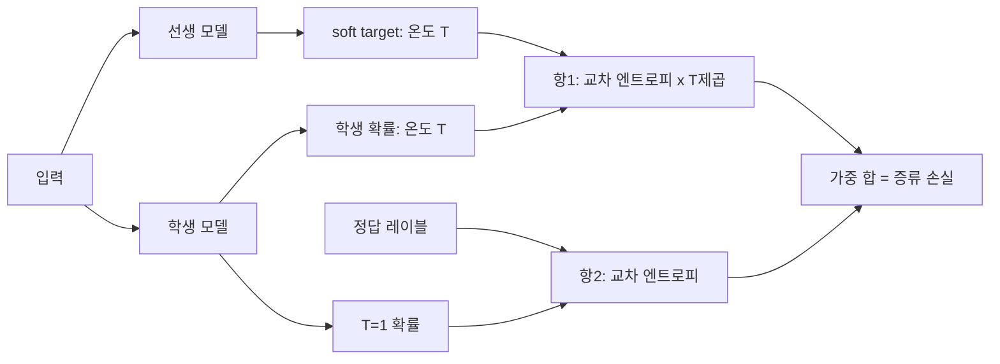

# 증류 손실

> 지식 증류의 손실은 큰 모델(teacher)이 낸 부드러운 확률분포(soft target)를 작은 모델(student)이 따라 하도록 하는 항과, 정답 레이블을 맞히는 항의 가중 평균이다.

## 쉽게 말하면
선생님이 "정답은 고양이"라고만 알려 주면 학생은 그 한 줄만 배운다. 선생님이 "고양이 80%, 호랑이 15%, 개 5%"까지 알려 주면 고양이가 호랑이와 더 닮았다는 관계까지 배운다. 증류는 이 "오답 사이의 비율"을 전수하는 학습이다.

## 자세히
출처: Hinton·Vinyals·Dean(2015) "Distilling the Knowledge in a Neural Network".
- **온도 softmax**: q_i = exp(z_i/T) / Σ exp(z_j/T). T가 1보다 크면 분포가 부드러워진다.
- 학생은 선생의 높은 T 소프트 타깃에 맞춰 같은 T로 학습하고, 학습이 끝나면 T=1로 쓴다.
- **손실**: (1) soft target과의 교차 엔트로피(높은 T) + (2) 정답 레이블과의 교차 엔트로피(T=1)의 가중 평균. 논문은 2번의 가중치를 상당히 낮게 잡았을 때 결과가 좋았다고 한다.
- soft target의 기울기 크기는 1/T²로 줄어들므로, 둘을 함께 쓸 때 **T²를 곱해** 상대 비중을 유지한다.
- T가 클 때 로짓 매칭은 증류의 특수한 경우라고 논문이 보인다.
- 선행: [소프트맥스](#softmax), [교차 엔트로피](#cross-entropy), [증류](#distillation).

## 그림으로 보기


## 예시
```python
loss = a * T*T * KL(softmax(t_logits/T), softmax(s_logits/T)) \
     + (1-a) * CE(s_logits, y)
```
(KL과 교차 엔트로피는 teacher 분포가 고정이면 기울기가 같다. a는 소프트 항 비중.)

## 헷갈리는 것과 비교
| 개념 | 차이 |
| --- | --- |
| 하드 레이블 학습 | 정답 한 개만 사용 |
| 증류 | 선생의 분포 전체 사용 |
| [레이블 스무딩](#label-smoothing) | 사람이 정한 균일 분포로 부드럽게 |

## 더 읽을거리
- [Distilling the Knowledge in a Neural Network (arXiv 1503.02531)](https://arxiv.org/abs/1503.02531) — 원논문, 2.절 Distillation
