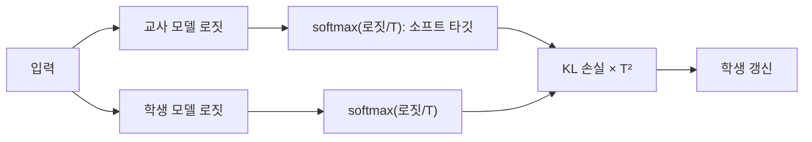
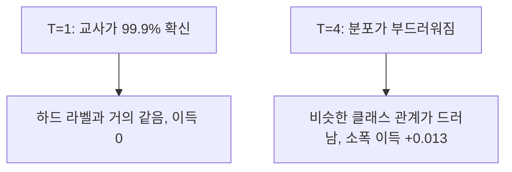

# 지식 증류의 소프트 타깃

> 큰 모델(교사)이 낸 **확률 분포 전체**를 정답처럼 삼아 작은 모델(학생)을 가르치는 방법이다. 정답 라벨 하나보다 "이 숫자는 7이지만 1과도 조금 닮았다" 같은 정보가 더 들어 있다. 온도(T)로 분포를 부드럽게 해야 그 정보가 드러난다.

## 쉽게 말하면
선생님이 "정답은 7"이라고만 알려 주는 것보다 "7이 90%, 1이 8%, 9가 2%"라고 알려 주면 학생은 모양이 비슷한 숫자들의 관계까지 배운다. 그런데 선생님이 너무 자신만만해서 "7이 99.999%"라고만 하면 부가 정보가 사라진다. 그때 "조금 덜 확신하는 말투"(온도)로 바꿔 말하게 하면 숨은 정보가 보인다.

## 자세히
- **개념**(Hinton 외 2015, arXiv 1503.02531 초록 확인): 여러 모델 앙상블의 지식을 배포하기 쉬운 단일 모델로 압축하는 기법. 초록에는 소프트 타깃·온도 설명이 없어 아래 구현은 일반 정의를 따라 직접 만든 것이다.
- **손실(일반적 정의)**: `T²·KL(softmax(교사로짓/T) ‖ softmax(학생로짓/T)) + (1−α)·교차엔트로피(하드 라벨)`. 소프트 타깃에서 KL과 교차엔트로피는 기울기가 같다([KL vs CE](#kl-divergence-vs-ce)). T²를 곱하는 것은 온도가 높을수록 기울기가 작아지는 것을 보정하기 위해서다(일반 정의).
- **직접 실행**(scikit-learn digits 1,797장 중 학습 539장·시험 1,258장. 교사 MLP 은닉 256, 학생 MLP 은닉 **8**(훨씬 작음). 같은 교사로 학생을 150 에폭 학습, **8 시드**, 각 시드마다 교사 재학습):

| 학습 방식 | 학생 시험 정확도(평균 ± 표준편차) |
|---|---|
| (교사: 은닉 256, 하드 라벨) | 0.969 ± 0.001 |
| 학생, 하드 라벨만 | 0.907 ± 0.045 |
| 학생, 교사 소프트 타깃 T=1 | 0.907 ± 0.045 |
| 학생, 소프트 타깃 T=4 | 0.920 ± 0.044 |
| 학생, T=4 + 하드(각 0.5) | 0.917 ± 0.042 |

- **짝지은 비교**(같은 시드끼리): T=4가 하드 라벨만보다 평균 +0.013, 8번 중 6번 앞섰고 표준오차 0.009. T=1은 하드 라벨과 **완전히 같았다**(차이 0.000, 앞선 적 0/8).
- 해석: ① 교사가 학습 데이터를 거의 100% 확신하게 학습되어 **T=1의 소프트 타깃은 사실상 원-핫**이라 정보가 더 없다. T=4로 부드럽게 해야 비로소 클래스 간 유사도가 드러난다. ② 향상은 +1.3%p로 작고 시드별 변동(표준편차 4~5%p)에 비해 증거가 약하다. "증류가 항상 이긴다"가 아니라 "작은 학생·적은 데이터에서 소폭 이득이 있었다" 정도다. 학생이 은닉 8이라 시드별 편차가 컸다.
- **언제 유리한가(제안)**: 학생이 작고 학습 데이터가 적을 때, 교사가 불확실한 예제에서 의미 있는 분포를 줄 때. 교사 확률이 거의 원-핫이면 온도를 올려야 한다.

## 그림으로 보기



## 예시
```python
loss = alpha*T*T*F.kl_div(F.log_softmax(s/T,-1), F.softmax(t/T,-1), reduction="batchmean") \
     + (1-alpha)*F.cross_entropy(s, y)
```
- 큰 문서 분류 모델의 예측을 작은 모델에 증류해 모바일에 배포.
- 교육: T=1, 2, 4, 8로 바꿔 가며 교사 확률 분포가 어떻게 퍼지는지 그래프로 보기.

## 헷갈리는 것과 비교
| 개념 | 차이 |
|---|---|
| 하드 라벨 | 정답 한 개(원-핫) |
| 소프트 타깃 | 교사의 확률 분포 |
| 온도 T | 분포를 부드럽게 하는 계수. 크면 더 평평 |
| [라벨 스무딩](#label-smoothing-loss-floor) | 사람이 만든 균일한 소프트화. 증류는 모델이 만든 소프트 타깃 |

## 더 읽을거리
- [Distilling the Knowledge in a Neural Network](https://arxiv.org/abs/1503.02531) — 앙상블 압축·증류 논문(초록 확인).
- [scikit-learn digits 데이터셋](https://scikit-learn.org/stable/datasets/toy_dataset.html) — 실험 데이터(열어 확인).
