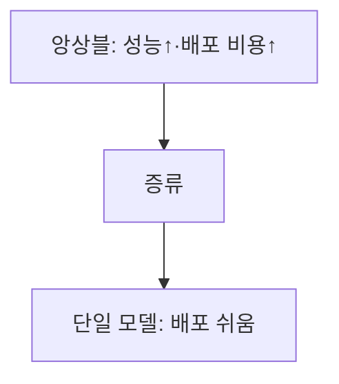

# 지식 증류

> **크고 성능 좋은 모델(또는 앙상블)의 지식을 작고 배포하기 쉬운 모델로 옮기는** 기법. Hinton·Vinyals·Dean(2015, arXiv 1503.02531)이 대중화했다.

## 쉽게 말하면
베테랑 여러 명의 노하우를 한 명의 신입에게 압축해 가르치는 것이다. 신입은 베테랑 팀만큼은 아니어도 가볍고 빠르게 일한다.

## 자세히
- 문제(초록 읽음): 여러 모델의 예측을 평균하는 앙상블은 성능이 좋지만 **배포 비용이 크다.** Caruana 외의 선행 연구를 바탕으로, 앙상블의 지식을 **배포가 훨씬 쉬운 단일 모델**로 압축하는 다른 기법을 제안.
- 결과(초록): 널리 쓰이는 상용 시스템의 **음향 모델을 크게 개선**했고 MNIST에서 "놀라운 결과"를 보고. 전체 모델 앙상블에 더해, 전체 모델이 혼동하는 **세부 클래스를 맡는 전문가 모델**을 제안했다. 전문가 모델은 혼합 전문가 모델과 달리 빠르고 **병렬로 학습**된다고 한다.
- 신호: 교사의 확률 분포를 학습 신호로 쓰는 [소프트 타깃](#soft-targets). 초록에는 이 용어가 없고 본문 일반 지식이다.
- LLM 시대: 교사가 만든 텍스트로 학생을 학습시키는 방식([합성 데이터](#synthetic-data))도 넓은 의미의 증류로 불린다(일반 설명). 작은 모델 성능 사례는 [소형 언어모델](#small-language-model).
- 한계: 교사의 확률 분포에 접근해야 하고 교사의 오류가 전달될 수 있다.

## 그림으로 보기

## 예시
- 큰 분류 모델 여러 개의 평균 예측을 작은 모델 하나가 따라 학습해 모바일에 배포.
- 교육: 팀의 노하우를 문서 한 장으로 압축하는 과정에 빗대어 설명.

## 헷갈리는 것과 비교
| 개념 | 차이 |
|---|---|
| 지식 증류 | 큰 모델→작은 모델로 지식 전달 |
| 양자화 | 같은 모델의 정밀도를 낮춤 |
| [미세조정](#fine-tuning-open-model) | 기존 모델을 새 데이터로 조정 |

## 더 읽을거리
- [Distilling the Knowledge in a Neural Network](https://arxiv.org/abs/1503.02531) — 증류 원 논문(초록 읽음).
