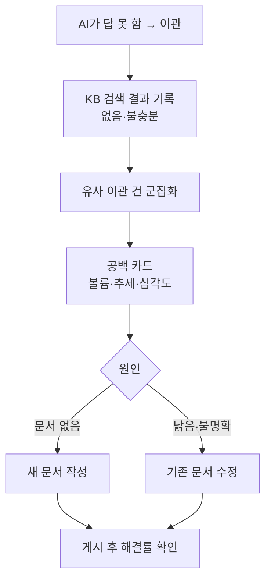

# 지식 공백 이관

> AI가 **지식베이스에 답이 없거나 있어도 문제를 풀지 못해서** 사람에게 넘기는 경우. 이런 이관 건을 묶어 분석하면 "어떤 문서를 새로 쓰거나 고쳐야 하는지" 우선순위를 알 수 있다.

## 쉽게 말하면
도서관 사서가 "그 질문에 맞는 책이 없네요"라며 선배에게 넘기는 일이 반복되면, 서가에 어떤 책이 빠졌는지 목록이 된다. 넘어간 질문이 곧 부족한 문서의 지도다.

## 자세히
출처: Ravenna 문서(Knowledge Gaps 기능, 비공개 베타), eesel.ai 블로그(둘 다 본문 확인, 2026-11-18). 둘 다 해당 제품을 파는 회사의 글이다.
- **감지 신호(Ravenna)**: AI가 해결하지 못해 이관된 티켓, 그때 AI가 지식베이스를 검색했는지와 결과(내용 없음 / 있으나 해결 못 함 / 검색 안 함), 티켓에서 추출한 제품·문제 유형(비슷한 표현이 무관한 주제와 섞이지 않게 정규화), 채널.
- **공백 보고서(Ravenna)**: 공백별 카드(심각도 색상의 티켓 수, 라벨·설명, 추세, 마지막 언급일), "내용 없음"인지 "있지만 부족"인지 분류, 원 티켓 목록, 상태 필터(열림·보관·관찰).
- **심각도 예시(Ravenna 기본값)**: 볼륨 60%(약 150건에서 포화) + 추세 40%(최근 30일 대비 직전 30일 신규 티켓 변화). 75 이상 심각, 50~74 높음, 30~49 중간, 30 미만 낮음. 30일 이상 조용하면 휴면, 90일 이상이면 보관. 감지는 주 1회. 이는 한 제품의 설정이며 표준이 아니다.
- **해결 흐름(Ravenna)**: 공백을 펼쳐 티켓이 주제와 맞는지 확인 → 문서 작성 → 게시 후 AI가 해결하면 "해결됨" 표시, 추세 하락.
- **그 밖의 발굴 방법(eesel)**: 결과 없는 도움말 검색(글이 "직접적 공백 증거"라고 부름), 미해결·재개 티켓과 상담사가 쓴 문서에 없는 답, 문서 댓글·커뮤니티 질문, 상담사가 직접 표시하는 지식 캡처 앱, AI 대화 분석.
- **우선순위(eesel)**: 볼륨, 핵심 기능을 막는 영향, 빨리 쓸 수 있는 쉬운 건, 전략적 중요 제품 영역, 태그·검색·AI 보고서 통합.
- **주의**: 공백이 항상 "문서 없음"은 아니다. 오래된 안내, 불명확한 설명은 새 문서가 아니라 **수정**이 답이다(eesel). Ravenna는 지식베이스 조회가 없었던 티켓은 공백에서 제외하므로 반복 질문이 "관찰" 목록에만 나타날 수 있고, 심각도는 비교 창이 움직여 새 티켓 없이도 바뀔 수 있다고 적는다.
- **운영 연결(제안)**: 이관 사유 분류에서 "지식 공백"을 별도 코드로 둔다([이관 사유 분류](#escalation-reason-taxonomy)). 문서 소유자를 정해 공백에서 문서까지 책임을 이어 준다([출처 문서 소유자](#source-article-ownership)).

## 그림으로 보기

## 예시
- 한 달간 "해외 카드 결제 오류" 이관 120건이 AI의 KB 검색에서 "내용 없음"으로 분류 → 심각도 상위. 문서 작성 후 다음 달 해당 주제 이관 건수가 줄었는지 확인.
- 교육 활용: 이관 로그를 주제별로 묶어 "신규 문서 vs 기존 문서 수정"으로 분류하는 실습.

## 헷갈리는 것과 비교
| 개념 | 차이 |
|---|---|
| 지식 공백 이관 | 문서가 부족해서 넘어간 건 |
| 정책 이관 | 규정상 사람이 처리해야 해서 넘어간 건 |
| [검색 점수 기반 이관](#retrieval-score-handoff) | 근거 신호가 약해 기권하는 방식 |
| [이관 사유 분류](#escalation-reason-taxonomy) | 이관 이유 전체 분류 체계 |

## 더 읽을거리
- [Ravenna: Knowledge Gaps](https://docs.ravenna.ai/documentation/automate/knowledge/knowledge-gaps) — 감지 신호와 심각도 산식(벤더 문서)
- [eesel: Zendesk에서 빠진 문서 찾기](https://www.eesel.ai/blog/zendesk-knowledge-gap-identify-missing-articles) — 발굴 방법과 우선순위(벤더 글)
