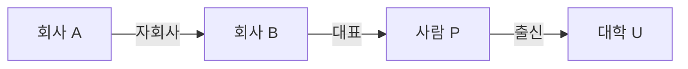
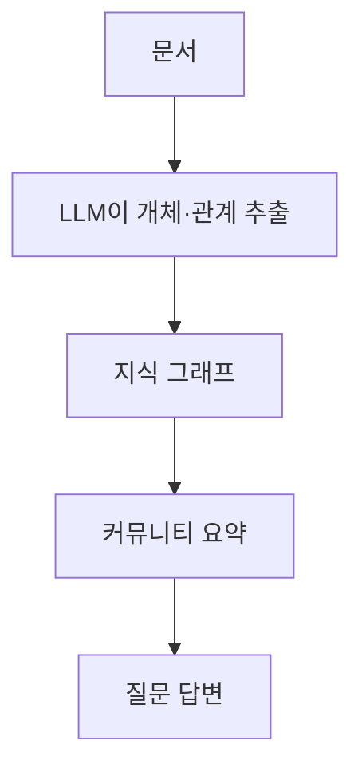

# 지식 그래프

> **개체(사람·회사·개념)를 점으로, 그 사이 관계를 선으로** 저장한 구조. "A는 B의 자회사다"처럼 사실을 연결된 형태로 보관해 관계를 따라 질문할 수 있다.

## 쉽게 말하면
인물 관계도와 같다. 이름 목록만 있는 것보다 "누가 누구와 어떤 관계인가"가 선으로 이어져 있어, 한 사람에서 시작해 친구의 친구를 따라갈 수 있다.

## 자세히
- 구성: **개체(노드)**, **관계(엣지)**, 필요하면 속성·주장(claim). 문서에서 LLM이 개체와 관계를 추출해 만들 수 있다.
- LLM 시대의 활용 — **GraphRAG**(Microsoft, arXiv 2404.16130, 초록 읽음): LLM이 원문에서 개체 지식 그래프를 만들고 밀접한 개체 묶음의 요약을 미리 생성한다. "데이터의 주요 주제는?" 같은 **전역 질문**은 일반 RAG(특정 조각 검색)로 어렵다는 문제를 겨냥한다. 약 100만 토큰 데이터셋에서 일반 RAG 기준선보다 답의 포괄성·다양성이 좋아졌다고 저자들이 보고했다.
- 구현 문서의 인덱싱 단계(Microsoft GraphRAG 문서 열람): ① LLM으로 개체·관계·주장 추출 ② 개체 [커뮤니티 탐지](#community-detection-leiden) ③ 여러 수준의 커뮤니티 요약·보고서 생성 ④ 텍스트 임베딩. 결과는 기본적으로 Parquet 표로 저장된다.
- 장점: 관계·다단계 질문, 출처 추적. 한계: 구축 비용(LLM 호출), 추출 오류, 스키마 관리. 구체적 비용 수치는 이 출처에 없다([인덱싱 비용](#graphrag-indexing-cost)).
- 벡터 검색과의 차이: 벡터는 "비슷한 글", 그래프는 "연결된 사실"에 강하다(일반적 설명).

## 그림으로 보기

## 예시
- 사내 문서에서 "프로젝트–담당자–고객사" 관계를 추출해 "고객사 X와 연결된 모든 담당자는?"에 답하기.
- 교육: 수강생이 자기 업무의 관계도를 그려 보는 활동.

## 헷갈리는 것과 비교
| 개념 | 차이 |
|---|---|
| 지식 그래프 | 개체·관계를 명시적으로 저장 |
| 벡터 검색 | 의미가 비슷한 텍스트 조각을 검색 |
| [커뮤니티 탐지](#community-detection-leiden) | 그래프를 묶음으로 나누는 알고리즘 |

## 더 읽을거리
- [From Local to Global: GraphRAG](https://arxiv.org/abs/2404.16130) — 개체 그래프와 커뮤니티 요약(초록 읽음).
- [GraphRAG 인덱싱 개요](https://microsoft.github.io/graphrag/index/overview/) — 파이프라인 단계(읽음).
