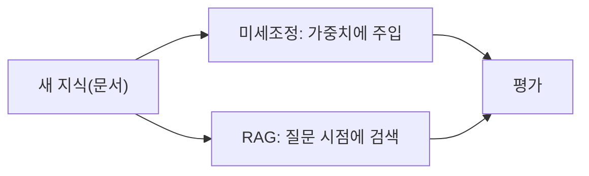

# 지식 주입(knowledge injection)

> 사전학습된 모델에 **새로운 사실이나 도메인 전문 지식을 넣는 일**이다. 미세조정과 RAG가 대표적인 두 방법이다.

## 쉽게 말하면
모델에게 회사 내규를 알려 주는 방법이 "외우게 하기"(미세조정)와 "책을 옆에 펴 두고 풀게 하기"(RAG) 두 가지다.

## 자세히
(Ovadia 외 arXiv 2312.05934 PDF를 직접 읽었다. 7B급 모델 대상 실험.)
- **문제 정의(논문)**: 텍스트 말뭉치 형태의 지식 베이스가 주어졌을 때 사전학습 모델에게 이 지식을 가르치는 최선의 방법은 무엇인가. 두 가지 필요 — 모델 지식은 **정적**이고 특정 도메인의 뉘앙스가 부족하다.
- **두 접근(논문)**: **비지도 미세조정**(라벨 없는 텍스트로 계속 학습)과 **RAG**(검색해 프롬프트에 문서 삽입). 비유로 시험 보는 세 명의 대학생(공부 없이/외워서/참고서를 들고)을 든다.
- **결과(논문)**: 비지도 미세조정은 일부 개선을 주지만 **RAG가 일관되게 앞선다** — 학습 중 본 지식과 완전히 새로운 지식 모두에서. 모델은 비지도 미세조정으로 **새로운 사실 정보를 배우는 데 어려움**을 겪는다.
- **완화책(논문)**: 같은 사실의 **여러 변형(바꿔 쓰기)**에 노출하면 문제가 완화된다([같은 사실의 다양한 표현 학습](#fact-paraphrase-training)).
- **현재 사건 과제 예(논문)**: Mistral 7B에서 기본 0.481 → RAG 0.875, 미세조정 0.504(바꿔 쓰기 학습 0.588).
- **한계**: 지도 미세조정이나 RAG와 결합한 학습은 다루지 않았다.

## 그림으로 보기

## 예시
- 최신 규정 변경이 잦다면 RAG가 우선 후보다. 어조·형식은 미세조정(RAFT 같은 혼합은 [RAFT](#raft) 참고)(제안).

## 헷갈리는 것과 비교
| 방법 | 장단 |
|---|---|
| RAG | 새 지식에 강함(이 논문) |
| 비지도 미세조정 | 새 사실 학습이 어려움 |
| 지도 미세조정(DSF) | 답변 형식 정렬 |

## 더 읽을거리
- [Ovadia et al. (2023)](https://arxiv.org/abs/2312.05934) — 직접 읽음.
