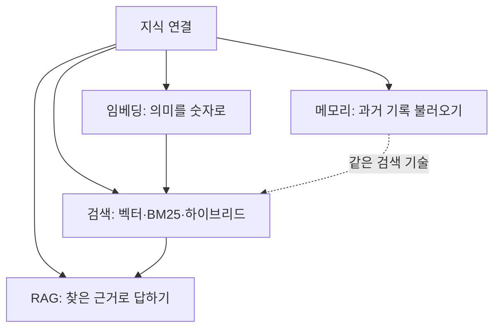
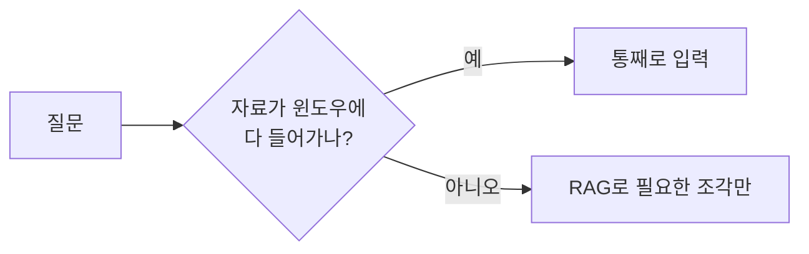

# 검색·지식 연결(RAG·임베딩·메모리)

> 모델이 학습 때 보지 못한 최신·내부 정보를 필요할 때 찾아 붙여 주는 기술 묶음. 핵심 부품은 임베딩, 벡터 검색, RAG, 메모리다.

## 쉽게 말하면
LLM은 두뇌이고, 이 가지는 "도서관과 수첩"이다. 두뇌가 모든 책을 외울 수는 없으니, 필요한 책을 빠르게 찾아오는 색인(임베딩·벡터 검색), 찾아온 페이지를 펴 놓고 답하는 방식(RAG), 어제 한 대화를 적어 두는 수첩(메모리)을 붙인다.

## 자세히
- **임베딩**: 글·이미지를 의미가 가까울수록 가까운 숫자 벡터로 바꾼다([임베딩과 CLIP](#embedding-clip)). 키워드가 달라도 뜻이 비슷하면 찾을 수 있다.
- **검색**: 벡터 DB에서 가까운 조각을 찾는 의미 검색, 정확 일치에 강한 BM25 키워드 검색, 둘을 합친 하이브리드가 있다([하이브리드 검색](#hybrid-search-bm25)).
- **RAG**: 검색 결과를 프롬프트에 넣어 근거 기반으로 답하게 한다([RAG](#rag)). 정확도는 청킹·리랭킹·맥락 추가로 올린다(Anthropic 측정 top-20 실패율 5.7% → 1.9%, [Contextual Retrieval](#contextual-retrieval)).
- **메모리**: 대화나 작업 기록을 저장했다 다음 세션에 불러온다([에이전트 메모리](#agent-memory)). 같은 검색 기술을 "내 과거 기록"에 적용한 것이다.
- 선택 기준: 자료가 [컨텍스트 윈도우](#context-window)에 다 들어가면 통째 입력이 가장 단순하고, 넘치거나 자주 바뀌면 검색을 붙인다.

## 그림으로 보기

## 예시
- 사내 규정 챗봇(RAG), 코드베이스 질의 도우미(코드 조각 임베딩 검색), 상담 봇이 지난 문의를 기억(메모리).
- 질문 습관: "이 문서 근거로만 답하고, 없으면 모른다고 해."

## 헷갈리는 것과 비교
| 개념 | 차이 |
| --- | --- |
| 임베딩 | 의미를 벡터로 만드는 변환(부품) |
| 벡터 DB | 벡터를 저장·검색하는 저장소(부품) |
| RAG | 부품들을 엮어 답변에 근거를 붙이는 전체 구조 |
| 메모리 | 대상이 외부 문서가 아니라 과거 대화·작업 기록 |

## 더 읽을거리
- [Introducing Contextual Retrieval](https://www.anthropic.com/news/contextual-retrieval) — 청킹·BM25·리랭킹 수치
- [Retrieval-Augmented Generation (Lewis 등, 2020)](https://arxiv.org/abs/2005.11401) — RAG 원조 논문
