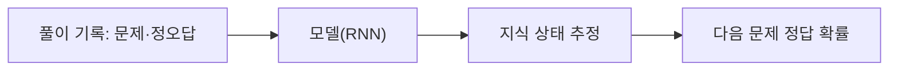
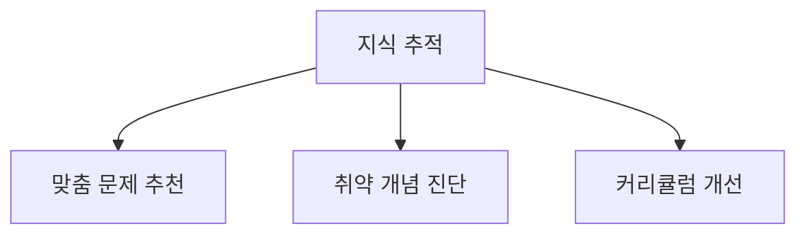

# 지식 추적

> 학습자가 문제를 풀어 나가는 기록으로 **지금 무엇을 알고 있는지를 시간에 따라 추정**하는 교육 AI 기술. 다음 문제를 맞힐 확률을 예측해 맞춤 학습에 쓴다.

## 쉽게 말하면
과외 선생님이 학생의 풀이 기록을 보고 "이 단원은 알고 있고 저 단원은 흔들린다"를 짐작하는 것과 같다. 그 짐작을 계산으로 자동화한 것이 지식 추적이다.

## 자세히
- 정의(Piech 외, *Deep Knowledge Tracing*, arXiv 1506.05908, 초록 읽음): 학생이 교과 과정을 밟는 동안 지식을 모델링하는 오래된 문제.
- 제안: **순환 신경망(RNN)**으로 접근. 이전 방법과 달리 **사람이 직접 코딩한 도메인 지식 없이** 더 복잡한 패턴을 잡을 수 있다고 한다. 여러 지식 추적 데이터셋에서 학생 성과 예측이 **크게 향상**됐다고 보고(초록에 구체 수치 없음).
- 활용: 커리큘럼 설계 지원, 학생 과제의 구조를 해석·발견하기 쉬워진다고 초록이 언급한다. 연습문제 사이의 관계를 발견한다는 명시적 표현은 초록에 없었다.
- 입력 예: (문제, 정오답) 시퀀스. 출력 예: 각 문항·개념의 정답 확률(일반적 설명).
- 한계: 2015년 연구이며 이후 모델은 이 글에서 다루지 않았다. 학습 기록이 충분해야 하고, 예측 정확도가 곧 이해도는 아니다(일반 논평).
- 연결: [선행 개념 그래프](#prerequisite-graph)와 결합하면 "어느 선행 개념에서 막혔는지"를 추적할 수 있다(내 제안).

## 그림으로 보기

## 예시
- 코딩 학습 앱이 수강생의 오답 패턴을 보고 복습할 개념을 추천.
- 교육: 사내 AI 교육에서 퀴즈 결과로 수강생별 보충 자료를 자동 배정하는 설계.

## 헷갈리는 것과 비교
| 개념 | 차이 |
|---|---|
| 지식 추적 | 학습자의 상태를 추정 |
| 성적 평가 | 한 시점의 점수 |
| [선행 개념 그래프](#prerequisite-graph) | 개념 사이의 의존 관계 |

## 더 읽을거리
- [Deep Knowledge Tracing](https://arxiv.org/abs/1506.05908) — RNN 접근(초록 읽음).
