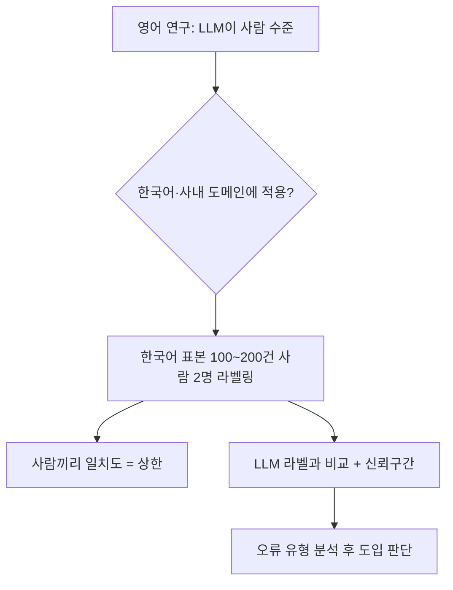
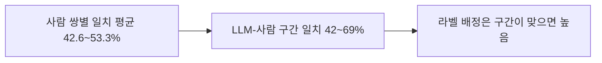

# 한국어 도메인 LLM 라벨링

> 영어 데이터에서 "LLM이 사람 주석자 수준"이라는 결과가 나왔어도 **한국어·사내 용어·전문 도메인**에서는 직접 검증하기 전까지 그대로 믿을 수 없다. 한국어는 어미·보조 용언이 많아 문법 형태만으로 의미를 판단하기 어렵다는 점도 평가 설계에 영향을 준다.

## 쉽게 말하면
영어 시험에서 만점인 번역가가 한국어 법률 문서에서도 만점일지는 모른다. 한국어 사내 약어나 존댓말 뉘앙스가 걸려 있으면 같은 모델도 다르게 행동할 수 있어, 내 문서 몇십 건으로 먼저 시험해 봐야 한다.

## 자세히
- **한국어 SF 소설 연구(Jang & Jung, NLP4DH 2024, 본문 확인)**: 수상 현대 한국 SF 단편 11편에서 **인공 존재의 행동**을 주석하는 과제. 사람 전문가 5명과 Claude 3.5 Sonnet·GPT-4o(제로샷·퓨샷)를 8개 라벨 체계로 비교. 저자들은 영어와 달리 **한국어는 어미와 보조 용언이 다양해 동사의 문법 형태만으로 의도·용법을 판단하기 어렵다**고 보고 품사가 아니라 **행동이라는 의미 단위**로 주석했다.
  - **사람끼리도 낮은 일치도**: 문장 단위 라벨 일치(자카드)는 쌍별 7.5~67.2%, 평균 **42.6%**. 구간까지 보는 퍼지 일치는 쌍별 14.0~76.2%, 평균 **53.3%**. 저자는 문학 해석의 주관성을 확인했다고 요약("약 50%").
  - **LLM과 사람의 구간 일치(표 3, 구간이 2글자 이상 겹치고 사람 5명 중 1명이라도 일치하면 매치)**: 표의 배열상 Claude 3.5 Sonnet 제로샷 1,613건 중 64.8%, 퓨샷 1,270건 중 69.1%, GPT-4o 제로샷 2,917건 중 42%, 퓨샷 2,775건 중 47%가 구간 일치(헤더 일부가 PDF에서 누락되어 모델 순서는 표 레이아웃에서 추정). 모델이 낸 주석 수 자체가 1,270~2,917로 크게 다르다.
  - **결론(저자)**: LLM은 구간 선택에서 사람과 달랐으나 **구간이 맞은 경우 라벨 배정 일치는 높았고**, 행동을 문법 요소가 아닌 의미 단위로 파악하는 데 뛰어났다.
- **이 사례가 말하는 것**: ① 한국어 과제도 LLM이 의미 있는 주석을 낼 수 있다 ② 하지만 **어느 모델·프롬프트인지에 따라 구간 일치가 42~69%** 로 흔들린다 ③ 사람 자체의 일치도(평균 40~50%대)가 낮은 과제에서는 "사람 정답"을 기준으로 삼는 의미가 약하다([일치도 목표](#target-agreement-setting)).
- **한국어 검증 체크리스트(제안)**
  1. 사내 용어·약어·존댓말·혼합 표기(한영, 숫자)가 든 예시를 검증 세트에 일부러 포함.
  2. 한국어 표본 100~200건을 사람 2명이 라벨링해 사람끼리 일치도 확인(상한).
  3. LLM 라벨과 비교해 일치도·정확도에 [신뢰구간](#independent-test-ci)을 붙임.
  4. 오류를 [유형별](#discrepancy-categories-ner)로 분류(경계/라벨/누락).
  5. 모델 버전을 기록([재검증](#model-version-revalidation)).
- **한계**: 위 연구는 문학 해석 한 과제의 결과로 일반 분류·정보 추출과는 다르며, 모델은 2024년 기준이다.

## 그림으로 보기

## 예시
- 사내 CS 문의 분류: "환불/교환/AS" 라벨에 "반품각", "A/S 접수" 같은 사내 표기를 섞은 150건으로 제로샷 LLM을 시험하고, 사람 2명의 일치도(예: κ 0.7)보다 LLM-사람 일치가 낮으면 규칙서를 보강.
- 교육: "영어 벤치마크 결과 ≠ 우리 업무"를 한국어 소규모 파일럿으로 직접 확인하는 습관을 훈련.

## 헷갈리는 것과 비교
| 항목 | 설명 |
|---|---|
| 일반화 한계 | 연구 결과를 내 도메인에 옮길 때의 불확실성 |
| 한국어 도메인 검증 | 그 한계를 한국어·사내 용어로 직접 확인 |
| 사람 일치도 | 검증의 상한 |
| [제로샷 vs 미세조정](#zero-shot-vs-finetuned-annotation) | 방식 선택 |

## 더 읽을거리
- [Evaluating LLM Performance in Character Analysis: Korean SF (NLP4DH 2024)](https://aclanthology.org/2024.nlp4dh-1.34.pdf) — 일치도·구간 일치 수치(PDF 본문 열어 확인).
