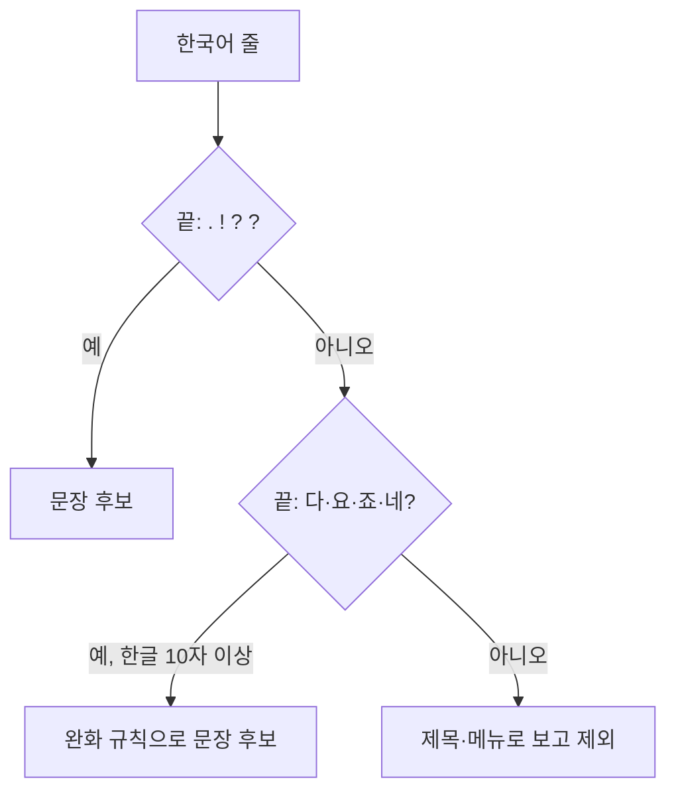
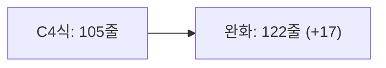

# 한국어 종결 표현

> 한국어 문장은 **마침표 없이 어미(-다, -요, -죠, -네 등)로 끝나는 경우가 많아**, 영어식 "마침표·물음표로 끝나는 줄만 남긴다"는 규칙을 그대로 쓰면 정상 문장이 빠진다. 한국어 필터는 종결 어미를 따로 고려해야 한다.

## 쉽게 말하면
영어는 문장 끝에 거의 항상 마침표가 있지만 한국어 게시글·댓글은 "유난히 담배가 땡긴다"처럼 마침표 없이 어미로 끝내는 일이 흔하다. 마침표만 보고 문장을 고르면 이런 글은 전부 놓친다.

## 자세히
- 직접 확인(Common Crawl `CC-MAIN-2024-10` WET 첫 파일에서 가져온 세 구간(앞·중간·끝 2MB) 안의 **한국어로 식별된 문서 12개**, 한글이 들어간 줄 1,197개 — 표본이 작아 대략적 경향만 본다):
  | 측정 | 값 |
  |---|---|
  | 마침표·느낌표·물음표(`. ! ?`)로 끝난 줄 | **115개 (9.6%)** |
  | 마침표 없이 `-다`·`-요`·`-죠`로 끝난 줄 | 32개 (2.7%) |
  | C4식 규칙(영어 종결 부호 + 공백 기준 5단어 이상) 통과 | 105개 (**8.8%**) |
  | 완화 규칙(끝이 `. ! ? 다 요 죠` + 한글 10자 이상) 통과 | 122개 (**10.2%**) |
- 읽는 법: 한국어 줄의 대부분은 **메뉴·태그·짧은 제목**이라 어느 규칙을 써도 10%만 남는다. 그 안에서 어미 기반 완화 규칙은 C4식 규칙보다 약 17개를 더 살렸다(105 → 122). 살아난 줄 예: `유난히 담배가 땡긴다`, `재떨이마다 소복하다`, `마치 시골집 굴뚝연기와 같다`, `초조하기까지 하다` — 마침표는 없지만 완결된 문장이다.
- 영어 규칙을 한국어에 쓰는 문제 세 가지(앞서 C4 부작용 실험과 연결): ① 종결 부호 기대 ② **공백으로 센 어절 수**가 짧아 5단어 미만이 많음(위 표본 중앙값 2어절) ③ 구어체의 `~`, `ㅋㅋ`, 이모티콘 종결([글자 수 vs 어절 수](#char-count-vs-word-count)).
- 한국어 종결 어미 후보(제안): 평서 `-다/-ㄴ다/-는다`, 존대 `-요/-습니다/-ㅂ니다`, 의문 `-까/-니`, 청유 `-자`, 감탄·구어 `-네/-군/-죠/-지`, 인용 닫는 따옴표 뒤 종결. 어미만으로 문장을 판단하면 `…합니다` 같은 메뉴 문구와 헷갈릴 수 있어 **길이·문장 부호 비율과 함께 판단**한다.
- 더 나은 방법(제안): 문장 분리기(예: 한국어 문장 분리 라이브러리)와 형태소 분석으로 "용언의 종결형으로 끝나는가"를 본다. 이는 이 지도에서 실험하지 않았다.
- 한계: 한국어 문서 12개, 줄 1,197개의 작은 표본이며 웹 일반을 대표하지 않는다.

## 그림으로 보기



## 예시
```python
ENDINGS = ('.', '!', '?', '다', '요', '죠', '네')
ok = line.endswith(ENDINGS) and len(re.findall('[가-힣]', line)) >= 10
```
- 교육: 같은 데이터에 영어식·한국어식 규칙을 적용해 남는 줄을 비교하는 실습.

## 헷갈리는 것과 비교
| 개념 | 차이 |
|---|---|
| 종결 부호 | `. ! ?` 같은 문장 기호 |
| 종결 어미 | 문장을 끝내는 서술어의 어미(-다·-요) |
| [C4 줄 단계 필터](#c4-line-filters) | 영어용 종결 부호 규칙 |

## 더 읽을거리
- [C4 규칙 (T5 논문 arXiv 1910.10683)](https://arxiv.org/abs/1910.10683) — 영어 기준 규칙(읽음).
- 직접 실행: WET 샘플 한국어 줄 1,197개 분석.
