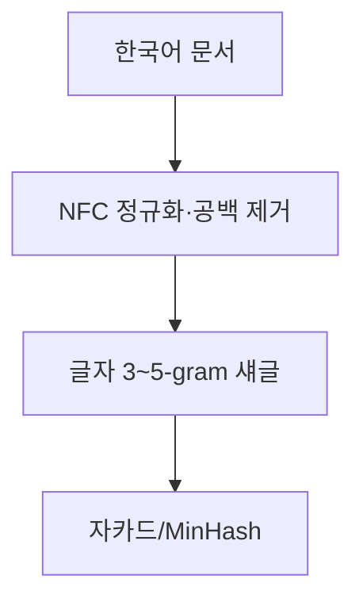
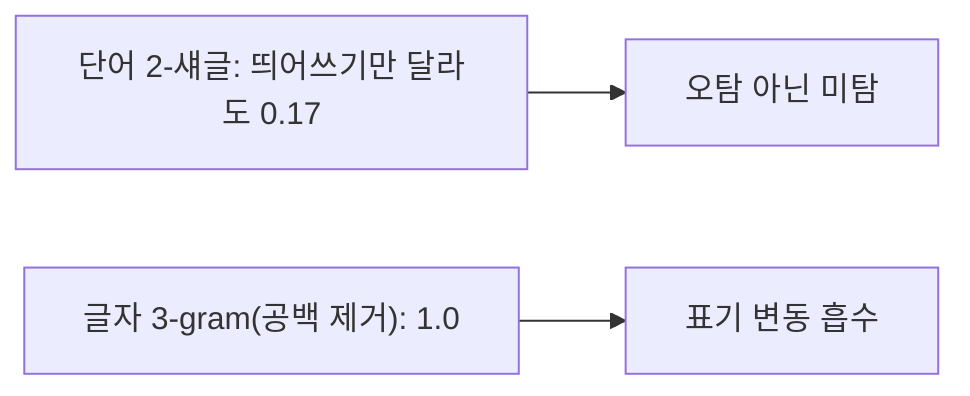

# 한국어 섀글링

> 한국어는 띄어쓰기가 사람마다 달라 **단어 단위 섀글은 같은 문장도 다른 문서로 만든다.** 공백을 제거한 **글자 n-gram**으로 만들면 띄어쓰기 변동에 강하다.

## 쉽게 말하면
같은 문장을 "학습 데이터"라고 쓰는 사람도 있고 "학습데이터"라고 붙여 쓰는 사람도 있다. 단어로 자르면 서로 다른 단어지만, 글자를 세 개씩 이어 보면 거의 같은 조각이 남는다.

## 자세히
- **직접 실험(한국어 문장 3개)**
  - a: "인공지능 모델의 학습 데이터 품질을 점검하는 방법을 설명합니다"
  - b: a에서 **띄어쓰기만** 바꾼 문장 ("학습데이터", "점검 하는")
  - c: a에서 **한 단어만 교체**한 문장 ("설명합니다" → "소개합니다")
  | 비교 | 단어 2-섀글(공백 기준) | 글자 3-gram(공백 제거) | 글자 3-gram(공백 유지) |
  |---|---|---|---|
  | a vs b(띄어쓰기만 다름) | **0.167** | **1.000** | 0.730 |
  | a vs c(한 단어 교체) | 0.750 | 0.724 | 0.778 |
  띄어쓰기만 다른 문장은 단어 섀글 자카드가 **0.17**로 거의 다른 문서가 되지만, 공백을 제거한 글자 3-gram은 **1.0**으로 같다. 반면 실제 내용이 바뀐 c는 세 방식 모두 0.72~0.78로 비슷하게 중간 값이다. 공백 유지 글자 3-gram은 공백 변화가 그대로 조각을 바꿔 0.73이 된다. 공백 제거 3-gram은 a에서 25개 조각, 단어 2-섀글은 7개 조각이다.
- **왜 한국어에서 글자 단위가 안정적인가**: 조사·어미가 단어에 붙고(교착어) 띄어쓰기 규범이 느슨해 같은 내용도 표기가 다양하다. 글자 n-gram은 형태소 분석 없이도 표기 변동을 흡수한다. 한국어 SF 주석 연구에서도 한국어는 어미와 보조 용언이 많아 문법 형태만으로 의도를 판단하기 어렵다고 지적한다([한국어 도메인 라벨링](#korean-domain-llm-annotation)).
- **전처리 규칙(권장)**: ① 공백·줄바꿈 제거(또는 하나로 통일) ② 유니코드 정규화(NFC) ③ 전각/반각·특수문자 통일 ④ 필요하면 숫자·영문 소문자화. 전처리를 바꾸면 자카드가 달라지므로 고정([섀글 크기](#shingle-size-choice)).
- **k 선택**: 한국어 글자 n-gram은 3~5자에서 시작해 사람 판정 쌍으로 분리도가 가장 큰 k를 고른다(앞 글의 절차). k가 작으면 흔한 조사·어미 조합이 겹쳐 오탐이 늘고, 크면 표기 수정에 민감.
- **한계**: 글자 n-gram은 의미가 같지만 어휘가 다른 문장(동의어)을 못 잡고, 위 실험은 문장 3개 예시다. 문서 수준에서는 임계값을 별도로 검증한다([자카드 임계값](#jaccard-threshold-tuning)).
- **형태소 기반 대안**: 형태소 분석기로 어간·품사만 쓰는 방식도 있으나 분석기 의존·속도 비용이 있다(일반 지식, 이 글에서 비교 실험하지 않음).

## 그림으로 보기



## 예시
```python
import unicodedata
def char_shingles(text, k=3):
    t = unicodedata.normalize("NFC", text).replace(" ", "").replace("\n", "")
    return {t[i:i+k] for i in range(len(t) - k + 1)}
J = lambda a, b: len(a & b) / len(a | b)
print(J(char_shingles(a), char_shingles(b)))      # 1.0
```
- 사내 문의 로그의 복사·붙여넣기 중복(띄어쓰기·줄바꿈만 다름)을 잡을 때 글자 n-gram 사용.

## 헷갈리는 것과 비교
| 방식 | 띄어쓰기 변동 | 의미 변화 민감도 |
|---|---|---|
| 단어 n-gram | 약함 | 보통 |
| 글자 n-gram(공백 제거) | 강함 | 보통 |
| 형태소 n-gram | 강함 | 분석기 의존 |
| [섀글 크기](#shingle-size-choice) | k 선택 문제 | - |

## 더 읽을거리
- [Evaluating LLM Performance in Character Analysis: Korean SF (NLP4DH 2024)](https://aclanthology.org/2024.nlp4dh-1.34.pdf) — 한국어 어미·보조 용언 관련 진술(PDF 본문 확인). 위 표는 이 글의 직접 계산.
