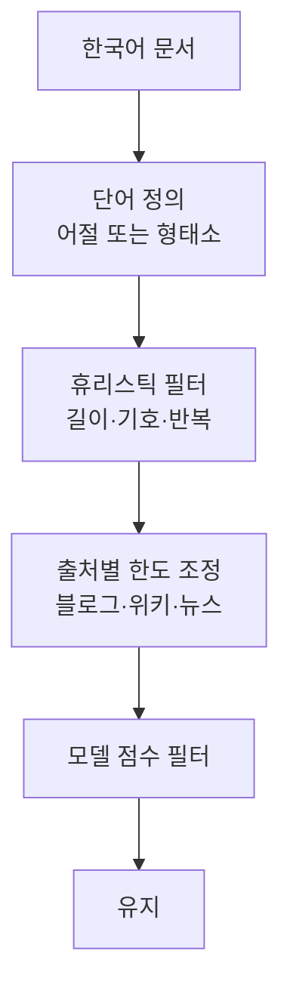
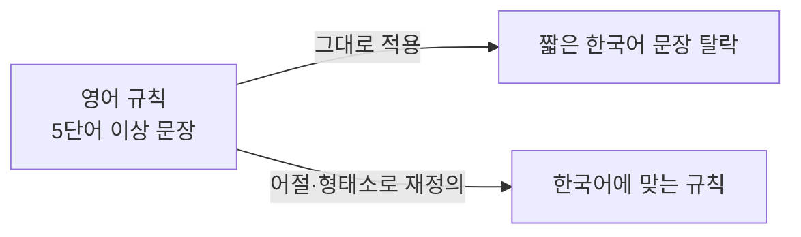

# 한국어 텍스트 필터 설계

> 영어용 품질 필터(5단어 이상, 평균 단어 길이, 불용어 비율, 종결 부호)를 한국어에 쓰려면 **"단어"를 어절로 정의하고 한도를 한국어 분포에 맞게 다시 잡아야** 한다. 한국어는 어절이 짧고, 조사·어미가 붙으며, 문장이 짧게 끝난다.

## 쉽게 말하면
영어 시험의 "한 문장에 단어 5개 이상이면 정상" 같은 채점표로 한국어 답안을 채점하면 "오늘 비 온다."는 3어절이라 틀린 답이 된다. 채점 기준을 그 언어의 글쓰기 습관에 맞춰 바꿔야 한다.

## 자세히
- **FineWeb2의 방식(논문 arXiv 2506.20920 + 저장소 설정 파일 직접 확인)**: Gopher·FineWeb식 필터를 언어마다 개별 조정한다. 한국어 설정(`configs/kor_Hang.yml`, 2026-11-22 확인): 중복 줄 비율 0.374, 중복 5~10-그램 0.201→0.127, 상위 2/3/4-그램 0.282/0.228/0.185, 언어 점수 0.842, 평균 단어 길이 1~6, 비알파 단어 비율 0.791, 줄 끝 부호 비율 0.062, 불용어는 조사·어미 약 21개(의·다·이·는·에·을…). 영어 Gopher 한도(0.30, 5-그램 0.15, 상위 2-그램 0.20 등, [반복 제거 임계값](#repetition-thresholds))와 숫자가 다르다.
- **"단어"의 재정의**: 논문 부록에 따르면 일부 필터는 한도를 고정하되 "단어"를 언어별 토크나이저로 정의하고, 단어 경계가 불안정한 문자 체계에는 언어별 토크나이저가 필요하다. 한국어는 보통 공백 기준 어절이거나 형태소 분석 결과다(어느 쪽을 썼는지는 설정 파일에 드러나지 않아 확인하지 못했다).
- **HyperCLOVA X THINK(arXiv 2506.22403, 직접 확인)**: "한국어 전용 필터링은 거의 연구되지 않았다"고 하며, 기존 영어 규칙을 **한국어 형태소에 맞게 모두 재설계**했다. 기호/단어 비율, 평균 단어 길이, 문장 수, PII 마스킹 비율, 정규화/원본 길이 비율을 재고, 한도는 내부 검수자가 수동 점검으로 정하며 **블로그·위키 같은 출처 도메인별로 다시 조정**한다. 이후 모델 기반 점수(0~5점 평정, fastText·트랜스포머)가 이어진다.
- **직접 실험(2026-11-22)**: 한국어 3문장은 15어절, 어절당 평균 3.2자, 문장당 어절 4~6개. 비슷한 영어 2문장은 17단어, 단어당 평균 4.65자, 문장당 6~11단어. 영어식 "5단어 이상 문장" 규칙이면 "오늘 비 온다."(3어절)는 탈락한다. 어절의 약 절반(7/15)이 조사·어미 불용어로 끝나, 영어식 불용어 "단어 일치" 검사는 어절 전체 대신 끝부분(접미)을 봐야 한다(이 접미 검사는 단순화한 예).
- **설계 체크리스트(제안)**: ① 길이는 어절·글자 수 중 하나로 정의하고 영어 한도를 그대로 쓰지 않기 ② 종결 부호는 `.` `?` `!` 외 `…` `~` `ㅋㅋ` 같은 구어 종결과 개조식 문장 고려 ③ 출처 도메인별 한도 ④ 한도를 정한 뒤 제거 표본 점검([필터 오탐 표본 점검](#filter-false-positive-audit)).
- 한계: 한국어 한도의 근거가 되는 상세 분포 자료는 공개 논문에 거의 없다. FineWeb2의 값은 다른 언어와 같은 절차로 구한 것이지 한국어 전문가 검수 값이 아니다.

## 그림으로 보기

## 예시
- 한국어 뉴스·블로그 코퍼스에 FineWeb2 한국어 설정을 적용한 뒤, 한도 근처에서 걸린 문서 50개를 직접 읽어 오탐 비율을 확인.
- 교육 소재: "영어 기준 AI 도구가 한국어에서 이상하게 동작하는 이유"를 어절 길이 숫자로 설명.

## 헷갈리는 것과 비교
| 개념 | 차이 |
|---|---|
| 한국어 필터 설계 | 한국어 어절·어미에 맞춘 규칙·한도 |
| [다국어 필터 조정](#multilingual-filter-adaptation) | 언어 전반의 조정 원칙(부호·줄 길이) |
| [반복 필터 오탐](#repetition-false-positives) | 정형 문서가 반복 한도에 걸리는 문제 |

## 더 읽을거리
- [FineWeb2 (arXiv 2506.20920)](https://arxiv.org/abs/2506.20920) — 언어별 필터 조정 방법.
- [FineWeb2 한국어 설정 kor_Hang.yml](https://github.com/huggingface/fineweb-2/blob/main/configs/kor_Hang.yml) — 실제 한도 값(직접 확인).
- [HyperCLOVA X THINK Technical Report (arXiv 2506.22403)](https://arxiv.org/abs/2506.22403) — 한국어 형태소 기준 필터 재설계(직접 확인).
