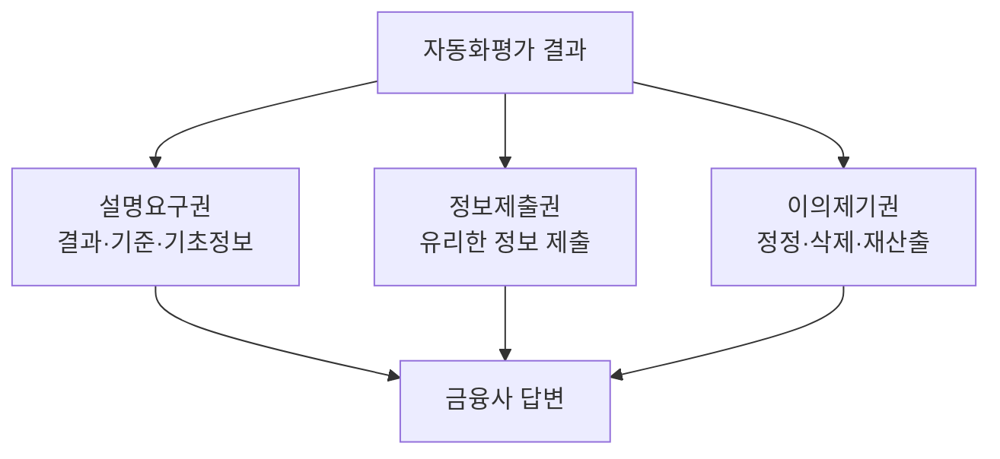

# 한국 자동화평가 설명요구권

> 한국 신용정보법상, AI 등 자동화평가로 신용평가를 받은 사람이 결과·주요 기준·기초정보의 설명을 요구하고 정보 제출·이의제기를 할 수 있는 권리.

## 쉽게 말하면
AI가 내 신용을 낮게 매겼다면 "왜 그런지 설명해 달라", "내 쪽 자료를 봐 달라", "다시 계산해 달라"고 말할 수 있는 세 가지 창구가 법에 있다는 뜻이다.

## 자세히
- 근거: 신용정보법 제36조의2(자동화평가 결과에 대한 설명 및 이의제기). 권리는 설명요구권·정보제출권·이의제기권.
- 설명 대상: 평가 결과, 주요 기준, 평가에 이용된 기초정보의 개요.
- 이의제기: 유리한 정보 제출, 부정확하거나 최신이 아닌 기초정보의 정정·삭제, 결과 재산출 요구.
- 절차·거부 사유는 시행령 제31조의2와 감독규정 서식에 있다(블로그 근거, 원문 확인 필요).
- 시행 시점은 자료마다 달라(2020년 2월 vs 개정법 시행 기사) 정확한 연도를 국가법령정보센터에서 확인해야 한다. 2022년 개정의 구체 내용은 확인하지 못했다.
- 이용 현황(국회입법조사처 인용 기사): 주요 두 회사 합산 설명요구·이의제기가 2018년 7,400건, 2019년 9,900건, 2020년 9,800건 → 이후 6,600건으로 32.4% 감소.
- 개인정보 보호법에도 자동화된 결정에 대한 대응권이 별도로 있다(검색 결과에 제목만 확인).

## 그림으로 보기

## 예시
대출 한도가 낮게 나온 개인이 금융사에 설명을 요구하고 소득 증빙을 제출해 재평가를 요청. 금융사는 법정 서식에 따라 답해야 하며 거부 사유는 제한적이다(블로그 설명).

## 헷갈리는 것과 비교
| 개념 | 차이 |
| --- | --- |
| 한국 설명요구권 | 설명·이의제기 권리, 평가 후 정보주체가 행사 |
| [ECOA·Reg B](#ecoa-reg-b) | 미국, 거절 시 이유 통지 의무(사업자 의무 중심) |
| [설명 가능성](#explainability) | 기술 개념 |

## 더 읽을거리
- [법률신문: 인공지능과 자동화평가 대응권](https://lawtimes.co.kr/news/166997) — 개요
- [개인신용평가 결과 설명 요구·이의제기 (money-store)](https://www.money-store.co.kr/sub_person/person05.html) — 절차 안내(블로그성)
- [국가법령정보센터: 신용정보의 이용 및 보호에 관한 법률](https://www.law.go.kr) — 원문 확인용(이번 실행에서 열지 않음)
