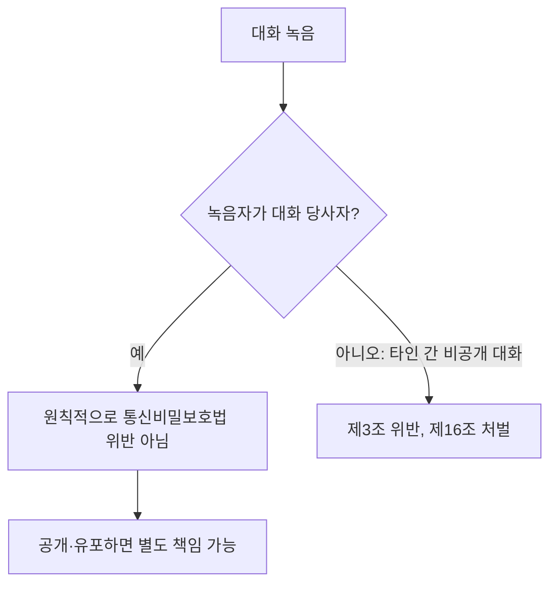

# 한국 통신비밀보호법

> 한국에서 타인 간 대화의 비밀 녹음·청취를 금지하는 법. 대화 당사자가 자신이 참여한 대화를 녹음하는 것은 원칙적으로 처벌 대상이 아니다. (법률 자문 아님)

## 쉽게 말하면
내가 참여한 대화를 기록하는 것은 "내 기억을 남기는 일"로 보고, 내가 없는 자리의 남의 대화를 몰래 녹음하는 것은 "도청"으로 본다. 그래서 한국은 미국 전원 동의 주들과 규칙이 다르다.

## 자세히
출처: 법률 매체·법률 상담 사이트 요약(대법원 판결 PDF 링크는 검색에 있었으나 열지 않음). 조문 원문은 국가법령정보센터(law.go.kr)에서 확인 필요.
- **제3조 1항**: 공개되지 않은 타인 간 대화를 녹음·청취하지 못한다. **제16조 1항**이 이를 위반한 행위를 처벌한다.
- **당사자 녹음**: 대화에 참여한 사람이 상대방 동의 없이 녹음하는 것은 이 규정 위반이 아니라는 것이 대법원 입장이라는 설명. 다만 3인 대화에서 한 명이 녹음한 경우 나머지 두 사람의 발언은 "타인 간 대화"로 볼 수 없다고 본 판결도 있다고 한다.
- **제3자 녹음**: 대화에 참여하지 않은 제3자가 녹음하면 특별한 사정이 없는 한 위반(판례 요약).
- **처벌 수준**: 검색 자료는 "1년 이상 10년 이하 징역과 5년 이하 자격정지"라고 적었다. 현행 조문과 대조해 확인 필요.
- **공개·유포**: 녹음 내용을 SNS 등에 올리면 명예훼손·모욕 등 별도 책임이 생길 수 있다.
- **AI 서비스 적용**: AI 서기·통화 분석 서비스는 서비스 운영자가 대화 당사자가 아닌 제3자가 되는 구조라 해석상 쟁점이 될 수 있으므로 이용자 동의를 받는 것이 안전하다(이 부분은 판례 근거 없이 쓴 실무적 추정이며 전문가 확인 필요).
- 개인정보 처리(음성은 개인정보) 규정은 별도 법의 문제다.

## 그림으로 보기

## 예시
- 직원이 자신이 참여한 회의를 AI로 녹음·요약: 당사자 녹음이라 대체로 문제없다고 보지만 회사 정책·개인정보법 확인.
- 회의실에 AI가 상시 설치돼 참여하지 않은 이들의 대화를 녹음 → 타인 간 대화 문제 가능.

## 헷갈리는 것과 비교
| 개념 | 차이 |
|---|---|
| 한국 규칙 | 당사자 녹음은 허용, 제3자 녹음 금지 |
| 미국 [전원 동의](#all-party-consent) | 주에 따라 모든 당사자 동의 |
| 개인정보법 | 음성 정보 처리 규칙, 별개 |

## 더 읽을거리
- [제3자에게 전달했다면 불법행위 해당 (법률신문)](https://www.lawtimes.co.kr/news/articleView.html?idxno=182425) — 대법원 판결 해설(검색 결과로만 확인)
