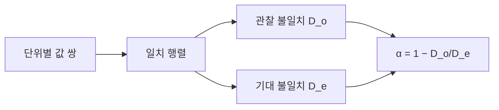
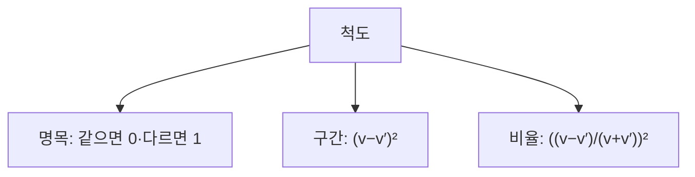

# Krippendorff alpha

> 평가자 수, 결측값, 척도 종류(명목·서열·구간·비율)에 관계없이 쓸 수 있는 일치도 지표. α = 1 − 관찰 불일치 / 우연 기대 불일치. 라벨링 품질 관리에서 흔히 기본 지표로 권해진다.

## 쉽게 말하면
여러 채점자가 일부 답안은 못 채점하고(결측), 어떤 답안은 두 명만 채점해도 "얼마나 합의했나"를 한 숫자로 말할 수 있게 만든 지표다. 사람 대신 "채점 쌍"을 단위로 세기 때문이다.

## 자세히
출처는 위키백과 "Krippendorff's alpha"(열람, 2차 출처)다.
- **식**: α = 1 − D_o/D_e. D_o는 코더 간 관찰된 불일치, D_e는 우연으로 기대되는 불일치. 1은 완벽한 신뢰도, 0은 우연 이상의 신뢰도 없음, 음수는 체계적 불일치.
- **범위**: 임의의 코더 수, 결측 데이터, 임의의 코드 값 수. 소표본에도 보정된다.
- **척도별 차이 함수 δ**: 명목은 같으면 0·다르면 1, 구간은 (v − v′)², 비율은 ((v − v′)/(v + v′))².
- **일치 행렬(coincidence matrix)**: 단위 안에서 값이 짝지어지는 횟수를 누가 코딩했는지 구분 없이 센다. 대각선은 완전한 일치이고 코더들은 서로 교환 가능한 것으로 본다.
- **기준(위키백과)**: 사회과학에서 α ≥ 0.800이면 신뢰할 만하고 0.667 ≤ α < 0.800은 잠정 결론에만 쓰며 0.667 미만은 보통 버린다. 신뢰구간은 부트스트랩이 선호된다.
- **Cohen's kappa와의 차이(문서 주장)**: kappa는 두 코더의 통계적 독립으로 우연 일치를 정의해 코더의 범주 선호에서 오는 불일치를 놓치고 kappa가 부풀 수 있다고 주장한다. alpha는 코딩된 값 전체의 합산 분포로 우연을 정의한다.

## 직접 계산한 가상 예시
문의 8건을 최대 3명이 환불/교환/기타로 분류(일부 결측). 쌍 단위로 명목 alpha를 직접 구현해 계산했다.

| 항목 | 평가자1 | 평가자2 | 평가자3 |
|---|---|---|---|
| 1 | 환불 | 환불 | 환불 |
| 2 | 환불 | 환불 | (결측) |
| 3 | 교환 | 교환 | 환불 |
| 4 | 교환 | (결측) | 교환 |
| 5 | 기타 | 기타 | 기타 |
| 6 | 환불 | 교환 | 교환 |
| 7 | (결측) | 기타 | 기타 |
| 8 | 교환 | 교환 | 교환 |

- 쌍 가능한 값 21개(교환 9, 기타 5, 환불 7), D_o ≈ 0.190, D_e ≈ 0.681 → α ≈ 0.720
- 위키백과 기준으로는 0.667~0.800 구간이라 "잠정 결론에만" 쓸 수준이다. 단위가 8건뿐이라 불확실성이 커서 부트스트랩 구간을 함께 보는 것이 좋다.

## 그림으로 보기

## 예시
- 코더 일부가 결측인 라벨링 프로젝트에서 Cohen·Fleiss를 못 쓰는 경우 alpha를 쓴다.
- 교육 실습: 위 8×3 표에서 쌍을 세어 일치 행렬을 만들어 보고 D_o, D_e를 손으로 계산.

## 헷갈리는 것과 비교
| 개념 | 차이 |
|---|---|
| alpha | 결측·가변 인원 허용, 척도 선택 |
| [코헨 카파](#cohens-kappa) | 두 평가자 |
| [Fleiss kappa](#fleiss-kappa) | 3명 이상, 인원 고정 |
| 단순 일치율 | 우연 보정 없음 |

## 더 읽을거리
- [Wikipedia: Krippendorff's alpha](https://en.wikipedia.org/wiki/Krippendorff%27s_alpha) — 정의와 기준(열람, 2차 출처)
