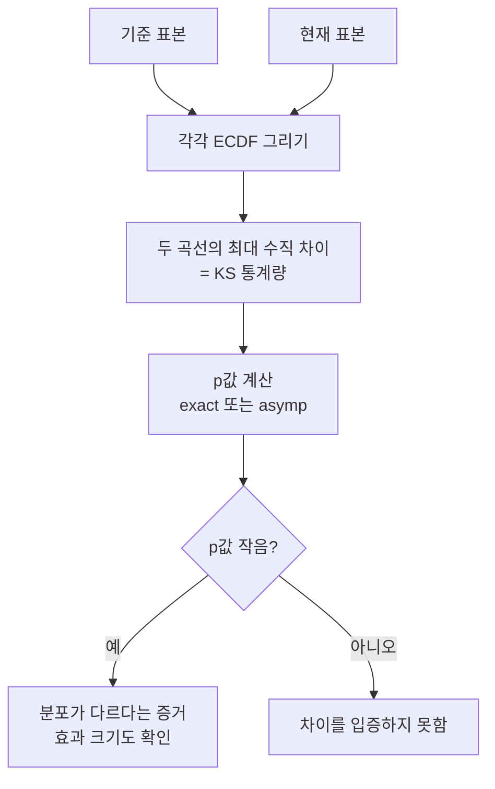

# Kolmogorov-Smirnov 검정

> 두 표본이 같은 연속 분포에서 나왔는지를, **두 경험적 누적분포함수(ECDF) 사이의 최대 차이**로 검정하는 비모수 검정. 드리프트 감지에서 수치형 특성의 기준 대 현재 분포 비교에 흔히 쓰인다.

## 쉽게 말하면
두 집단의 키를 작은 순서대로 줄 세워 "몇 퍼센트가 이 키 이하인가" 곡선을 겹쳐 그렸을 때, 두 곡선이 가장 크게 벌어지는 간격이 KS 통계량이다. 간격이 클수록 두 집단의 분포가 다르다.

## 자세히
출처: SciPy 공식 문서 `scipy.stats.ks_2samp`(열어서 읽음), 이 세션의 직접 실험(scipy 1.17.1).
- **함수**: `scipy.stats.ks_2samp(data1, data2, alternative='two-sided', method='auto')`. 서로 독립이고 크기가 달라도 되는 두 표본의 연속 분포 F(x)와 G(x)를 비교한다.
- **귀무가설(양측, 기본)**: 두 분포가 모든 x에서 같다(F(x)=G(x)). 대립가설은 같지 않다. `'less'`, `'greater'`는 누적분포 부등식에 대한 단측 검정이다. 가설은 관측값이 아니라 **CDF**에 관한 것이다.
- **통계량**: 양측일 때 두 경험적 분포함수의 **최대 절대 차이**. 통계량이 크면 p값이 작아져 귀무가설에 반하는 증거가 된다.
- **p값 방법**: `'exact'`(정확 분포), `'asymp'`(점근 분포, 근사), `'auto'`(기본: 두 표본이 모두 10,000 미만이면 exact, 아니면 asymp).
- **반환**: `statistic`, `pvalue`, 통계량이 측정된 위치(`statistic_location`)와 부호(`statistic_sign`).
- **주의(문서)**: 양측 정확 p값은 1에서 빼서 구하므로 최솟값이 약 1e-16이다. 표본이 크면 수치 오차가 쌓일 수 있어 exact 모드는 한쪽 표본이 수천 건 정도일 때 적합하다.
- **직접 실험(합성, 이 세션)**: 평균이 0.02(표준편차의 2%)만 다른 두 정규 표본. 표본 200건: 통계량 0.1, p=0.2705. 2,000건: 통계량 0.0295, p=0.349. 200,000건: 통계량 0.0081, p≈0.0. 표본이 커지면 통계량(효과 크기)은 작아지는데도 p값은 0에 가까워졌다. 한 번의 난수 시드 결과다([드리프트 통계 검정](#drift-statistical-tests)).
- **한계**: 연속 분포를 가정하므로 동점이 많은 이산 특성에는 부적절할 수 있다(일반 설명, 이번 문서에서 확인한 것은 아님). 한 특성의 주변 분포만 비교하므로 특성 간 관계 변화는 놓친다.

## 그림으로 보기


## 예시
```python
from scipy.stats import ks_2samp
res = ks_2samp(reference_feature, current_feature)
print(res.statistic, res.pvalue)
```
- 점검: p값만 보지 말고 통계량(최대 차이)이 실무적으로 의미 있는 크기인지 본다.

## 헷갈리는 것과 비교
| 개념 | 차이 |
|---|---|
| KS 검정 | 수치형 두 분포의 최대 누적 차이 |
| 카이제곱 검정 | 범주형 빈도 비교 |
| [PSI](#psi) | 구간별 비율 차이의 거리 점수 |
| [드리프트 통계 검정](#drift-statistical-tests) | 표본이 크면 p값이 과민해지는 문제 |

## 더 읽을거리
- [scipy.stats.ks_2samp (SciPy 문서)](https://docs.scipy.org/doc/scipy/reference/generated/scipy.stats.ks_2samp.html) — 함수 정의·방법·주의(열어서 확인)
