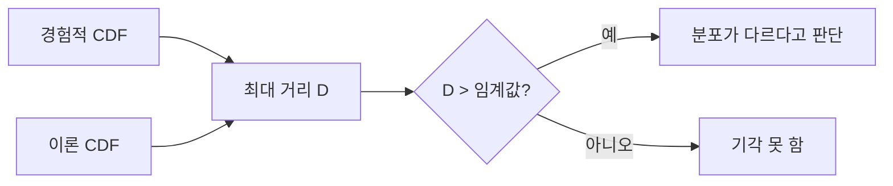
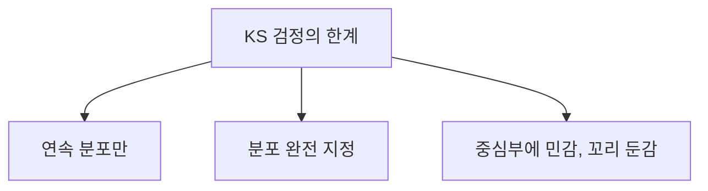

# KS 검정

> 표본이 **정해진 분포에서 왔는지** 확인하는 Kolmogorov-Smirnov 적합도 검정. 경험적 누적분포와 이론 누적분포 사이의 **최대 거리 D**를 통계량으로 쓴다. 두 표본이 같은 분포인지 보는 변형은 분포 이동 탐지에 흔히 쓰인다. (NIST 핸드북 열람 2026-11-28)

## 쉽게 말하면
두 그래프를 겹쳐 놓고 가장 크게 벌어진 지점의 간격을 재는 것이다. 그 간격이 우연이라 보기엔 너무 크면 "분포가 다르다"고 판단한다.

## 자세히
- 가설: 귀무가설 = 데이터가 그 분포를 따른다. 통계량 **D = 경험적 분포함수(ECDF)와 이론 누적분포 F 사이의 최대 거리**. D가 표나 소프트웨어의 **임계값**을 넘으면 기각.
- **연속 분포 한정**: 이항·푸아송 같은 이산 분포에는 적용되지 않는다.
- **분포가 완전히 지정**되어야 한다: 데이터로 모수를 추정하면 임계값이 유효하지 않아 보통 **시뮬레이션**으로 구해야 한다.
- 민감도: 분포의 **중심부**에 더 민감하고 꼬리에는 덜 민감하다. 개선판으로 **Anderson-Darling**, **Cramér-von Mises** 검정이 있고 일반적으로 더 검정력이 높다고 본다.
- 예시(NIST 시뮬레이션, α=0.05, 임계값 0.04301): 정규 데이터는 기각되지 않았고(D≈0.024), 이중 지수·t(3)·로그정규는 기각됐다.
- 두 표본 버전은 이 NIST 페이지에서 다루지 않았다. [공변량 이동 탐지](#covariate-shift)에서 두 표본 KS 검정을 쓴다는 설명은 별도 검색 요약에 근거한다.
- 한계: 표본이 매우 크면 사소한 차이도 유의해질 수 있다(일반 지식).

## 그림으로 보기

## 예시
- 학습 데이터의 문서 길이 분포와 운영 데이터의 문서 길이 분포를 비교해 이동 신호 확인.
- 교육: 정규분포에서 뽑은 표본과 로그정규 표본의 D 값을 직접 계산해 비교.

## 헷갈리는 것과 비교
| 개념 | 차이 |
|---|---|
| KS 검정 | 최대 거리 기반 |
| Anderson-Darling | 꼬리에 더 민감한 개선판 |
| [드리프트 모니터링](#drift-monitoring) | KS를 지표로 쓸 수 있는 운영 활동 |

## 더 읽을거리
- [NIST Handbook: Kolmogorov-Smirnov](https://www.itl.nist.gov/div898/handbook/eda/section3/eda35g.htm) — 정의와 한계(읽음).
