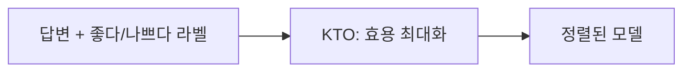
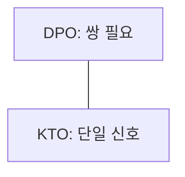

# KTO

> 선호 **쌍**(좋은 답 vs 나쁜 답) 대신 각 답에 **"좋다/나쁘다" 단일 라벨**만 있어도 모델을 정렬하는 방법. 카너먼·트버스키의 전망 이론을 이용한다(Ethayarajh 외, ICML 2024).

## 쉽게 말하면
"A와 B 중 어느 쪽이 나아?"라고 쌍으로 묻는 대신, 답변 하나하나에 엄지 위/아래만 받아도 학습하는 방식이다. 데이터를 모으기가 훨씬 쉽다.

## 자세히
(arXiv 2402.01306 초록 읽음.)
- 관찰: DPO 같은 기존 정렬 목적함수는 사람의 편향(손실 회피 등)을 암묵적으로 담고 있다. 저자들은 이런 손실을 **HALO(human-aware losses)**라 부른다.
- 방법: 카너먼-트버스키 인간 효용 모형을 적용해 선호의 로그우도를 최대화하는 대신 **생성물의 효용을 직접 최대화**한다.
- 데이터: 출력이 바람직한지 아닌지의 **이진 신호**만 필요하다. 짝지은 선호 데이터가 필요 없다.
- 결과(저자 주장): 1B~30B 규모에서 선호 기반 방법과 **동등하거나 더 낫다.**
- 요점: 모든 상황에서 최고인 HALO는 없고, 상황에 맞는 귀납적 편향이 다르다. 자세한 실험 설정과 수치는 본문을 열람하지 못했다.
- 활용: 서비스 로그의 엄지 피드백처럼 쌍이 아닌 데이터를 활용할 때 유용(해석).

## 그림으로 보기

## 예시
- 고객 챗봇 로그에서 "도움이 됐어요/아니에요" 버튼 데이터를 그대로 학습.
- 교육: 엄지 피드백 데이터와 쌍 비교 데이터를 모으는 비용·난이도를 비교.

## 헷갈리는 것과 비교
| 개념 | 차이 |
|---|---|
| KTO | 단일 이진 라벨 |
| [DPO](#dpo) | 선호 쌍(chosen/rejected) |
| [SimPO](#simpo) | 기준 모델 없이 길이 정규화 |

## 더 읽을거리
- [KTO 논문](https://arxiv.org/abs/2402.01306) — 전망 이론 기반 정렬(초록 읽음).
