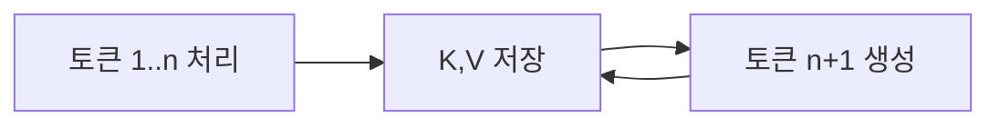

# KV 캐시

> 어텐션이 이미 계산한 앞 토큰들의 Key·Value 값을 메모리에 저장해 두고 다음 토큰 생성에 재사용하는 캐시.

## 쉽게 말하면
책을 읽으며 이미 정리한 앞부분 요약 카드를 계속 들고 다니는 것과 같다. 새 단어를 쓸 때마다 처음부터 다시 읽지 않아도 되지만, 글이 길수록 카드 뭉치가 커져 책상(VRAM)을 차지한다.

## 자세히
- 일반 설명(공식 문서 인용 아님): Transformer가 토큰을 하나씩 생성할 때 이전 토큰의 K·V를 매번 다시 계산하지 않고 저장해 재사용한다. 속도는 빨라지고 메모리는 컨텍스트 길이에 비례해 늘어난다.
- 그래서 긴 컨텍스트나 동시 사용자가 많으면 모델 가중치 외에 KV 캐시가 VRAM을 크게 차지한다.
- 서버 측 [프롬프트 캐싱](#prompt-caching)은 같은 앞부분의 처리 결과를 요청 사이에 재사용하는 서비스 기능이다. 문서는 캐시가 요청 간에 재사용되며 5분/1시간 TTL을 가진다고만 설명하고 내부 구현은 밝히지 않는다.
- 줄이는 방법(일반): 컨텍스트 길이 제한, KV 양자화, 슬라이딩 윈도 어텐션 등.

## 그림으로 보기

## 예시
로컬에서 모델은 올라가는데 컨텍스트를 32K로 늘리자 메모리 부족이 난다면 KV 캐시 증가가 원인일 수 있다. 컨텍스트를 줄이거나 KV 양자화 옵션을 확인한다.

## 헷갈리는 것과 비교
| 개념 | 차이 |
| --- | --- |
| KV 캐시 | 모델 내부 계산 상태 |
| [프롬프트 캐싱](#prompt-caching) | API 수준 비용 절감 기능 |
| 컨텍스트 윈도 | 한 번에 볼 수 있는 토큰 한도 |

## 더 읽을거리
- [Prompt caching (Claude docs)](https://platform.claude.com/docs/en/build-with-claude/prompt-caching) — API 수준 캐싱
- [ggml-org/llama.cpp](https://github.com/ggml-org/llama.cpp) — 로컬 추론에서 메모리 설정을 다루는 도구
