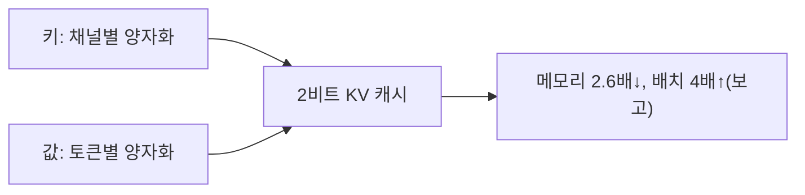
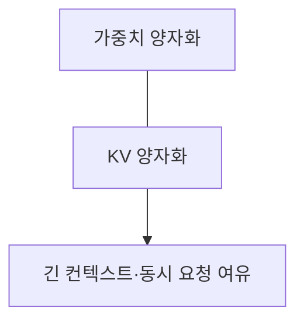

# KV 양자화

> 어텐션에 쓰이는 **KV 캐시를 낮은 비트로 저장**해 메모리를 줄이는 방법. 긴 컨텍스트와 많은 동시 요청의 병목인 메모리를 완화한다.

## 쉽게 말하면
대화 메모장(KV 캐시)을 고해상도 사진 대신 압축 사진으로 저장하는 것이다. 용량이 크게 줄지만 압축 방식이 나쁘면 화질이 떨어진다.

## 자세히
- 대표 연구 **KIVI**(arXiv 2402.02750, 초록 읽음): 튜닝이 필요 없는 **2비트** KV 캐시 압축. **키는 채널별(per-channel), 값은 토큰별(per-token)로 양자화**해야 한다는 관찰이 핵심.
- 보고된 효과: Llama·Falcon·Mistral에서 품질을 거의 유지하면서 가중치 포함 **최대 메모리를 2.6배 절감**, 그 덕에 **최대 4배 큰 배치**, 실제 추론 워크로드에서 **2.35~3.47배 처리량** 향상(저자 보고).
- 왜 중요한가: [VRAM 예산](#vram-budgeting)에서 KV 캐시는 컨텍스트와 동시 요청 수에 비례해 커진다. 예) 8B급 모델의 토큰당 128KiB(bf16) → 32K 컨텍스트 4GiB. 캐시를 2비트로 줄이면 이론상 크게 줄어든다(실제 절감은 위 논문처럼 전체 기준 2.6배).
- 한계: 모델·과제에 따라 품질 영향이 다르다. 초록의 "거의 같은 품질"은 저자 주장이므로 자체 평가가 필요하다. 이 출처는 특정 추론 엔진에서의 설정 방법을 다루지 않는다.
- 연결: 가중치 양자화([Q4_K_M](#quant-naming))와 별개의 축이다. 둘을 함께 쓰면 메모리를 더 줄일 수 있다(일반 설명).

## 그림으로 보기

## 예시
- 긴 문서 질의응답 서비스에서 동시 요청 수를 늘려야 할 때 KV 양자화로 메모리 확보.
- 교육: KV 캐시 크기 계산 후 비트를 16→2로 바꿨을 때 절감량을 표로 비교.

## 헷갈리는 것과 비교
| 개념 | 차이 |
|---|---|
| KV 양자화 | 캐시를 낮은 비트로 저장 |
| 가중치 양자화 | 모델 파라미터를 낮은 비트로 저장 |
| 프롬프트 캐싱 | API가 접두부 계산을 재사용(비용 절감), 서로 다른 개념 |

## 더 읽을거리
- [KIVI 논문](https://arxiv.org/abs/2402.02750) — 2비트 KV 캐시(초록 읽음).
