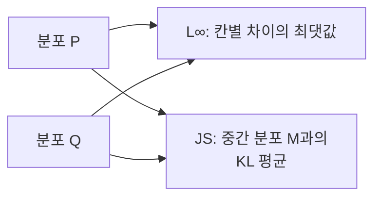
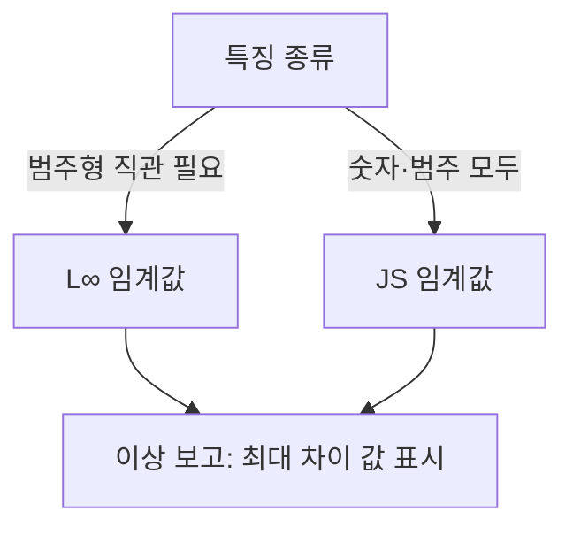

# L-무한대·젠슨-섀넌 거리

> 두 확률 분포(예: 학습 데이터와 서빙 데이터의 범주 비율)가 **얼마나 다른지**를 숫자 하나로 재는 두 가지 방법이다. L-무한대(L∞)는 **가장 크게 차이 나는 칸 하나**를 보고, 젠슨-섀넌(JS) 발산은 **분포 전체의 차이**를 본다. TFDV의 skew·drift 감지 임계값에 쓰인다.

## 쉽게 말하면
두 반의 혈액형 비율을 비교한다. L∞는 "A형 비율이 가장 많이 차이 난 칸은 5%p"라고 한 칸만 말한다. JS는 모든 칸의 차이를 종합해 "전체적으로 이 정도 다르다"고 말한다.

## 자세히
- **TFDV에서의 사용(공식 시작 문서, 직접 확인)**: 범주형 특징의 skew를 `skew_comparator.infinity_norm.threshold = 0.01`로 잡을 수 있다. 문서 예에서 서빙에 `Cash` 값이 많아지자 "L-infinity distance 0.0435984, 임계값 0.01 초과, 최대 차이 값 Cash"라는 이상이 나온다. 문서는 **L∞는 범주형만 감지**하고, `jensen_shannon_divergence` 임계값을 쓰면 **숫자·범주 모두** 감지할 수 있다고 한다. drift 비교기(`drift_comparator`)도 같은 방식이다.
- **L∞ 정의**: 분포 P, Q의 각 값 확률 차이의 절댓값 중 **최댓값**. 직관적이고 해석이 쉽지만 한 칸만 본다.
- **JS 발산(Wikipedia, 직접 확인)**: KL 발산을 **대칭·평활화**한 척도로 두 분포의 중간 분포 M에 대한 각 KL의 평균. KL과 달리 항상 유한하다. 밑이 2인 로그에서 범위는 0~1, 자연로그에서는 상한 ln 2. 제곱근은 거리 척도(JS distance)가 된다.
- **손으로 계산해 본 예(이 글 작성 시 직접 계산, 밑 2)**: P=[0.5, 0.3, 0.2], Q=[0.45, 0.30, 0.25]. L∞=0.05. JS 발산≈0.00296 비트, JS 거리(제곱근)≈0.0544. 완전히 겹치지 않는 P=[1,0], Q=[0,1]은 JS=1.0(상한).
- **선택 지침(해석)**: 범주 몇 개가 크게 바뀌는지 직관이 필요하면 L∞, 분포 전체 변화나 숫자 특징(구간화 후)에는 JS. 임계값은 데이터마다 정하며 TFDV 예의 0.01은 예시일 뿐이다.
- **한계**: 표본이 작으면 비율 추정이 흔들려 임계값을 넘는 일이 우연히 생긴다([슬라이스 표본 크기 주의](#slice-sample-size-caution)).

## 그림으로 보기

## 예시
- 서빙에서 `Cash` 결제 비율이 학습보다 4%p 높아지면 L∞=0.04로 임계값 0.01 초과 → 경보.
- 교육 소재: 같은 두 분포로 L∞와 JS를 손으로 계산해 두 숫자가 다른 이야기를 한다는 점을 비교.

## 헷갈리는 것과 비교
| 개념 | 차이 |
|---|---|
| L∞ | 가장 큰 칸 차이, 범주형 |
| JS 발산 | 전체 분포 차이, 대칭, 유한 |
| KL 발산 | 비대칭, 무한대 가능 |
| [TFDV 스키마 환경](#tfdv-schema-environments) | 같은 도구의 다른 기능 |

## 더 읽을거리
- [TFDV Get started](https://www.tensorflow.org/tfx/data_validation/get_started) — skew·drift 비교기와 L∞ 예(직접 확인).
- [Jensen–Shannon divergence (Wikipedia)](https://en.wikipedia.org/wiki/Jensen%E2%80%93Shannon_divergence) — 정의·범위·거리(직접 확인).
