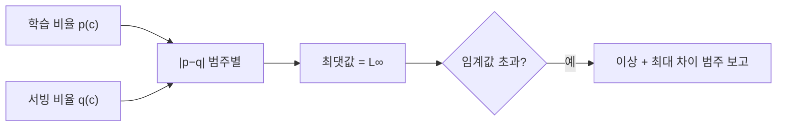
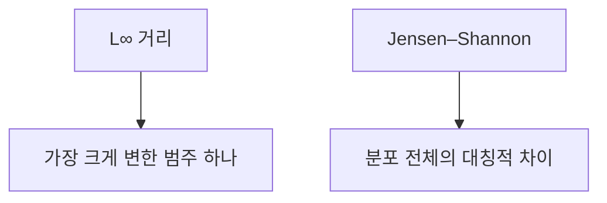

# L∞ 거리(범주형)

> 두 데이터셋에서 범주(값)별 **비율의 차이 중 가장 큰 값 하나**를 거리로 삼는 지표다. "어느 범주의 비율이 가장 크게 달라졌나"를 곧바로 알려 줘서 범주형 특징의 분포 변화(skew·drift)를 보는 데 쓰인다.

## 쉽게 말하면
두 해의 설문에서 응답별 비율을 비교할 때, 모든 응답의 차이를 합치지 않고 **가장 크게 변한 응답 하나**의 변화량만 본다. "무엇이 제일 많이 변했나?"에 한 숫자로 답하는 방식이다.

## 자세히
(TFDV 시작 가이드와 BigQuery `ML.TFDV_VALIDATE` 문서를 직접 읽었다. 아래 계산 예는 이 지도에서 **정의에 따라 직접 만든 가상 수치**이며 파이썬으로 계산을 검증했다.)
- **정의(일반)**: 범주 c별로 두 분포의 비율 p(c), q(c)를 구해 **max_c |p(c) − q(c)|**. 0이면 분포가 같고 최댓값이 클수록 크게 달라졌다. 가장 큰 차이가 난 범주도 함께 알 수 있다.
- **TFDV에서의 사용(문서)**: 스키마의 특징에 `skew_comparator.infinity_norm.threshold = 0.01`처럼 임계값을 지정하면 서빙 데이터에서 `Cash` 비율이 늘어 거리가 **0.0435984**가 됐을 때 "High L-infinity distance between serving and training … above the threshold 0.01. The feature value with maximum difference is: Cash" 이상이 보고된다. 같은 방식으로 `drift_comparator`로 어제·오늘 학습 데이터를 비교한다. 문서는 **L-infinity는 범주형 특징만** 감지하고, 숫자·범주형 모두 보려면 `jensen_shannon_divergence` 임계값을 쓰라고 적는다.
- **BigQuery(문서)**: `ML.TFDV_VALIDATE`의 SKEW 모드에서 범주형은 **L-infinity(기본) 또는 Jensen–Shannon**, 숫자형은 Jensen–Shannon만 쓴다. 기본 임계값은 범주형·숫자형 모두 0.3(범위 [0,1)).
- **직접 만든 계산 예(가상 수치)**: 학습 분포 `{Credit 0.60, Cash 0.30, Prcard 0.00, Other 0.10}`, 서빙 분포 `{Credit 0.50, Cash 0.3436, Prcard 0.0064, Other 0.15}`. 범주별 차이는 Credit 0.1000, Cash 0.0436, Prcard 0.0064, Other 0.0500 → **L∞ = 0.1000(Credit)**. 같은 데이터의 L1(모든 차이의 합)은 0.2000, 로그 밑 2의 Jensen–Shannon 발산은 약 0.0112로 계산된다. 지표마다 값의 스케일이 달라 임계값을 그대로 옮길 수 없다.
- **장점·한계(해석)**: 해석이 쉽고 "어느 범주가 문제인가"가 바로 나온다. 하지만 작은 변화가 많은 범주에 흩어져 있으면(각각 0.01씩 수십 개) 최대값이 작아 놓칠 수 있고, 거리를 줄이는 방향(합치기)도 알려 주지 않는다. 표본이 작으면 최댓값이 잡음에 흔들린다.
- **임계값**: TFDV 예시의 0.01과 BigQuery의 0.3은 도구·예시의 값이며 보편 기준이 아니다([허용 편향 기준](#acceptable-skew-threshold) 참고).

## 그림으로 보기



## 예시
```python
train = {"Credit":0.60,"Cash":0.30,"Prcard":0.0,"Other":0.10}
serve = {"Credit":0.50,"Cash":0.3436,"Prcard":0.0064,"Other":0.15}
diffs = {k: abs(train[k]-serve[k]) for k in train}
linf = max(diffs.values())          # 0.10 (Credit)
```
- 교육 소재: 같은 두 분포에 L∞와 L1을 계산해 어느 쪽이 더 민감한지 비교.

## 헷갈리는 것과 비교
| 지표 | 보는 것 | 적용 |
|---|---|---|
| L∞ | 가장 큰 범주별 비율 차이 | 범주형(TFDV) |
| L1 | 범주별 차이의 합 | 범주형 |
| [Jensen–Shannon 발산](#jensen-shannon-divergence) | 분포 전체의 대칭적 차이 | 숫자·범주형 |
| [skew vs drift](#skew-vs-drift) | 학습↔서빙 vs 날짜 간 비교 | 비교 대상의 구분 |

## 더 읽을거리
- [Get started with TensorFlow Data Validation](https://www.tensorflow.org/tfx/data_validation/get_started) — skew·drift 비교기와 L-infinity 예(직접 읽음).
- [ML.TFDV_VALIDATE (BigQuery)](https://docs.cloud.google.com/bigquery/docs/reference/standard-sql/bigqueryml-syntax-tfdv-validate) — 지표 선택·기본 임계값(직접 읽음).
