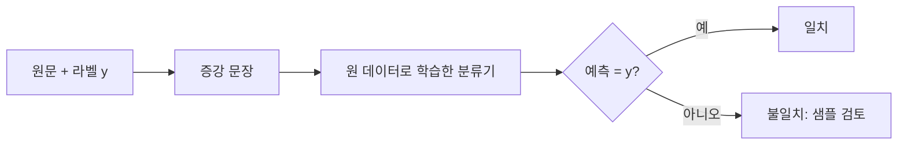
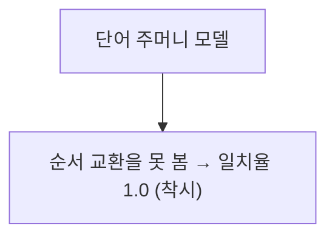

# 라벨 일치율

> 증강한 문장을 **원래 데이터로 학습한 분류기에 다시 넣어, 원래 라벨과 같게 예측하는 비율**이다. 증강이 라벨을 얼마나 보존하는지 숫자로 보는 간단한 점검이다.

## 쉽게 말하면
시험지를 일부러 흐리게 복사해 이미 공부한 학생에게 다시 풀게 한다. 여전히 같은 답을 내면 흐려도 문제의 뜻이 유지된다고 보고, 답이 바뀌면 복사가 너무 심했다고 본다.

## 자세히
- 직접 실행(2026-11-27, scikit-learn 1.9.1, 20 Newsgroups 4개 주제 `rec.sport.hockey`·`sci.space`·`talk.politics.guns`·`comp.graphics`, 헤더·푸터·인용 제거, TF-IDF + 로지스틱 회귀): 시험 1,546문서에서 원 정확도 **0.897**. 그중 **원래도 맞히고 20단어 이상인 1,274문서**만 골라 증강 후 같은 라벨로 예측하는 비율을 측정했다.
  | 증강 | 강도 | 라벨 일치율 |
  |---|---|---|
  | 무작위 삭제(RD) | p=0.1 | 0.993 |
  | RD | p=0.3 | 0.964 |
  | RD | p=0.5 | 0.943 |
  | RD | p=0.7 | **0.892** |
  | 무작위 교환(RS) | α=0.1 | 1.000 |
  | RS | α=0.3 | 1.000 |
- 읽는 법:
  - 단어를 많이 지울수록 일치율이 내려가 p=0.7에서 89%(대략 9건 중 1건은 다른 주제로 예측). **강도를 정할 근거**가 된다([증강 강도 제한](#augmentation-strength-limits)).
  - **RS가 1.000인 것은 안전해서가 아니라 검사 모델의 한계 때문이다.** TF-IDF는 단어 순서를 보지 않는 "단어 주머니"라서 자리를 바꿔도 점수가 변하지 않는다. 순서가 중요한 과제(부정, 인과)에서는 이 점검이 RS의 문제를 놓친다.
- 해석 한계 세 가지(제안 포함): ① **검사 모델이 같은 편향을 가진다** — 학습 데이터의 표면 단서에 의존하는 모델은 의미가 바뀌어도 일치를 낸다 ② 원 모델이 틀린 문서는 제외했으므로 쉬운 문서 위주의 낙관적인 수치 ③ 4개 주제 구분은 쉬운 과제라서 부정어·감성 같은 미세한 라벨에서는 더 낮을 수 있다.
- 사용법(제안): 일치율은 **하한선 점검**으로 쓰고 기준(예: 95%)을 사전에 정해 강도를 고른다. 일치율이 낮은 샘플은 사람이 읽어 확인([텍스트 증강의 라벨 보존](#text-augmentation-label-preservation)). 순서에 민감한 과제는 문맥을 보는 모델(예: 사전학습 모델)이나 사람 평가를 함께 쓴다.

## 그림으로 보기



## 예시
```python
agree = np.mean([clf.predict(vec.transform([aug(t)]))[0] == y for t, y in data])
```
- 교육: "점검 도구의 한계를 아는 것"까지 포함해 가르치는 사례(일치율 1.0이 오히려 경고 신호일 수 있다).

## 헷갈리는 것과 비교
| 개념 | 차이 |
|---|---|
| 라벨 일치율 | 자동 점검, 검사 모델 한계 있음 |
| 사람 검수 | 정확하지만 비쌈 |
| [보호 단어 목록](#protected-keywords) | 변형 대상에서 위험 단어를 제외(예방) |
| [번역 품질과 다양성](#translation-quality-diversity-tradeoff) | 다양성을 키울수록 일치율은 내려가는 경향 |

## 더 읽을거리
- [scikit-learn: 20 Newsgroups](https://scikit-learn.org/stable/datasets/real_world.html#the-20-newsgroups-text-dataset) — 데이터셋 설명.
- 직접 실행: 20 Newsgroups 4주제, TF-IDF+로지스틱 회귀, RD·RS 증강 일치율.
