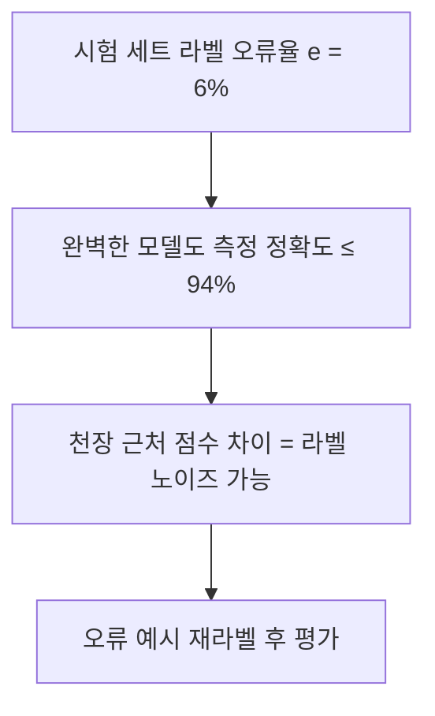

# 라벨 모호함의 상한

> 라벨 자체가 **틀렸거나 모호한 예시**가 시험 세트에 있으면, 모델이 아무리 완벽해도 그 예시에서는 맞힐 수 없어 **측정 가능한 정확도에 천장**이 생긴다. 천장 근처에서는 점수 차이가 모델 실력이 아니라 라벨 노이즈를 반영한다.

## 쉽게 말하면
정답지에 오답이 5% 섞여 있으면 만점 학생도 95점이다. 그리고 95점과 94점을 비교하는 일은 학생 실력이 아니라 "정답지 오타를 누가 우연히 맞혔는가"를 비교하는 것이 된다.

## 자세히
- **시험 세트 라벨 오류의 규모(Northcutt 외, arXiv 2103.14749, 초록 확인)**: 컴퓨터 비전·자연어·오디오의 10개 널리 쓰이는 데이터셋 시험 세트에 **평균 최소 3.3%의 라벨 오류**가 있다고 추정. ImageNet 검증 세트는 **최소 6%** 가 라벨 오류.
- **천장 계산(직접)**: 시험 세트의 라벨 오류율이 e이면, 모든 오류 예시에서 라벨과 다른 "정답"을 낸 완벽한 모델의 측정 정확도는 최대 1 − e. 오류가 무작위(이진)라면 앞서 계산한 대로 관측 정확도 = a(1−e)+(1−a)e. e=6%이면 ImageNet 같은 과제에서 **진짜 정확도 100% 모델도 측정 정확도 약 94%** 가 상한이다(오류 예시에서 모델이 "진짜 정답"을 내면 라벨과 불일치).
- **순위가 뒤집히는 사례(같은 논문)**: 오라벨 비율이 **6%만 올라가도** ImageNet에서 ResNet-18이 더 큰 ResNet-50보다 낫게 나오고, CIFAR-10에서는 **5%만 올라가도** VGG-11이 VGG-19보다 낫다. 저자들은 오라벨이 많은 실제 데이터에서는 용량이 작은 모델이 더 실용적일 수 있고, 원래 시험 정확도 대신 **올바르게 라벨된 시험 세트**로 모델을 평가하는 편이 낫다고 제안한다. (이는 [체계적 라벨 오류](#systematic-vs-random-label-errors)의 순위 역전 경고와 연결됨.)
- **라벨 모호함의 원인**
  1. **오류**: 라벨러 실수, 규칙서 오류.
  2. **본질적 모호함**: 사람도 의견이 갈리는 예시(문학 해석, 감성의 강도). 한국어 SF 주석 연구에서 사람끼리 일치도가 약 50%였던 예가 있다([한국어 도메인 라벨링](#korean-domain-llm-annotation)).
  3. **다중 정답 가능**: 이미지에 여러 객체, 질문에 여러 합리적 답.
  4. **라벨 정의 변화**: 규칙서 개정([규칙서 품질](#guideline-quality-assurance)).
- **대응**
  1. 시험 세트 라벨을 표본 점검해 오류율 e를 추정하고 천장(1−e)을 보고한다.
  2. 다중 라벨러·합의 라벨, 모호 예시는 "불확실" 라벨로 분리하거나 소프트 라벨(분포)로.
  3. 모델이 **높은 확신으로 라벨과 불일치**하는 예시를 우선 재검수([오류 중 라벨 오류 비중](#label-error-share-of-errors)).
  4. 점수 차이가 천장 근처 몇 %p일 때는 [신뢰구간](#independent-test-ci)과 라벨 노이즈 크기를 함께 비교.
- **한계**: 3.3%·6%는 해당 데이터셋 시험 세트에서의 추정으로 내 데이터에 일반화하지 않는다.

## 그림으로 보기

## 예시
- 사내 분류 시험 세트 500건을 사람 2명이 재검수해 18건(3.6%)의 라벨이 틀렸다면, 정확도 96% 이상은 해석에 주의한다는 표기를 보고서에 넣는다.
- 모델이 확신 0.99로 라벨과 불일치하는 상위 50건을 먼저 검수 → 라벨 오류 비중이 높은지 확인.

## 헷갈리는 것과 비교
| 개념 | 설명 |
|---|---|
| 라벨 오류 | 정답 라벨이 틀림 |
| 라벨 모호함 | 정답이 하나로 정해지지 않음 |
| 베이즈 오류 | 입력 정보의 한계로 인한 오류([베이즈 오류](#bayes-error)) |
| 라벨 모호함의 상한 | 측정 정확도의 천장(1−e) |

## 더 읽을거리
- [Pervasive Label Errors in Test Sets Destabilize ML Benchmarks (arXiv 2103.14749)](https://arxiv.org/abs/2103.14749) — 10개 데이터셋 평균 3.3%·ImageNet 6% 이상(초록 열어 확인).
