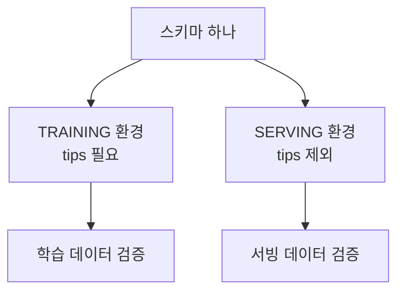
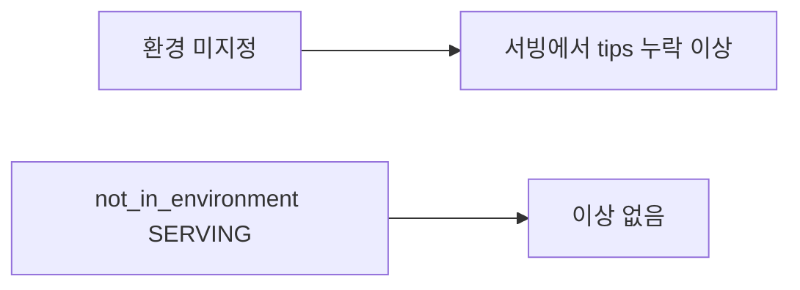

# 라벨 열 처리

> 학습 데이터에는 있지만 **서빙(예측) 시점에는 없는 라벨(정답) 열**을 서빙 데이터 검증에서 오류로 잡지 않도록 처리하는 패턴이다. TFDV는 스키마 환경(TRAINING/SERVING)으로 이를 구분한다.

## 쉽게 말하면
시험지에는 정답란이 있지만, 실전 문제지에는 정답란이 없다. 실전 문제지를 검사하면서 "정답란이 없다"고 불량으로 판정하면 안 된다. 어떤 검사에서는 정답란이 필요하고 어떤 검사에서는 없어야 한다는 것을 알려 줘야 한다.

## 자세히
(TFDV 공식 시작 가이드의 "Schema Environments" 절을 직접 읽었다.)
- **문제(문서)**: 기본적으로 파이프라인의 모든 데이터셋은 **하나의 스키마**를 따른다고 가정한다. 하지만 레이블로 쓰는 특징은 학습 때는 필요(그래서 검증 대상)하지만 서빙 데이터에는 없다. 환경을 지정하지 않으면 서빙 데이터 검증에서 **이상(anomaly)** 으로 나온다. 문서 예의 레이블은 `tips`다.
- **해결(문서)**: 스키마의 특징에 `default_environment`, `in_environment`, `not_in_environment`로 **환경 집합**을 연결한다.
  ```python
  # 모든 특징은 기본적으로 TRAINING·SERVING 양쪽 환경
  schema.default_environment.append('TRAINING')
  schema.default_environment.append('SERVING')
  # 'tips'는 SERVING 환경에 없음
  tfdv.get_feature(schema, 'tips').not_in_environment.append('SERVING')
  serving_anomalies_with_env = tfdv.validate_statistics(
      serving_stats, schema, environment='SERVING')
  ```
- **의미**: 같은 스키마 하나로 학습 데이터는 `TRAINING` 환경에서, 서빙 데이터는 `SERVING` 환경에서 검증한다. 서빙 환경에서는 `tips`가 요구되지 않으므로 누락 이상이 사라진다.
- **왜 이런 방식인가(해석)**: 스키마를 두 벌 만들면 둘이 어긋날 위험이 있다. 한 스키마에 환경별 예외를 표시하면 정의가 한곳에 있어 [온라인·오프라인 특징 동등성](#online-offline-feature-parity)의 정신과 맞는다.
- **주의(일반 원칙)**: ① 서빙에 없어도 되는 열은 **라벨 같은 학습 전용 열**뿐이어야 한다. 서빙에 있어야 하는 특징을 실수로 제외하면 진짜 누락을 못 잡는다 ② 예외가 쌓이면 스키마가 느슨해지므로 예외 목록을 검토한다 ③ 라벨이 서빙 데이터에 섞여 들어오면 누수(leakage) 신호일 수 있다(해석).

## 그림으로 보기



## 예시
- 택시 요금 모델: 학습엔 `tips`(레이블)가 있지만 예측 요청에는 없다 → `tips`를 SERVING 환경에서 제외하고 `environment='SERVING'`으로 검증.
- 교육 소재: "시험지 정답란이 없다고 불량 처리하면 안 되는 이유".

## 헷갈리는 것과 비교
| 개념 | 차이 |
|---|---|
| 라벨 열 처리 | 학습 전용 열을 서빙 검증에서 제외 |
| [스키마 환경](#schema-environments) | 환경별 스키마 차이를 표현하는 메커니즘 |
| [스키마 고칠까 데이터 고칠까](#schema-vs-data-fix-decision) | 이상 발견 후의 판단 |
| [환경 예외 관리](#environment-exception-hygiene) | 예외가 쌓이지 않게 하는 규칙 |

## 더 읽을거리
- [Get started with TensorFlow Data Validation — Schema Environments](https://www.tensorflow.org/tfx/data_validation/get_started) — 환경 지정과 `not_in_environment` 예(직접 읽음).
