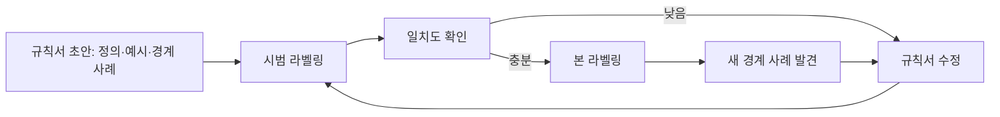
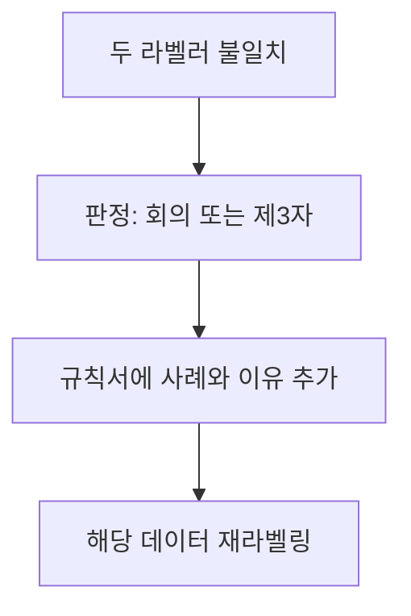

# 라벨링 규칙서

> 라벨러가 같은 데이터를 보고 같은 정답을 붙이도록 정의·예시·애매한 경우의 판단 기준을 적은 문서다. 일치도가 낮을 때 대개 원인은 라벨러가 아니라 이 규칙서의 빈틈이다.

## 쉽게 말하면
심판 규정집과 같다. "이게 반칙인가?"를 심판마다 다르게 판단하면 경기가 엉망이 된다. 규정집에 정의와 그림 예시, 헷갈리는 장면의 판정 기준을 적어 두고, 경기 중 새 장면이 나오면 규정집을 고쳐서 다음부터 같이 판정한다.

## 자세히
(검색 결과로 찾은 실무자 가이드들과 MITRE 위협 정보 센터의 TRAM 프로젝트 가이드를 직접 열어 확인. 벤더·실무 글이라 휴리스틱으로 읽는다.)
- **담을 내용(TRAM 가이드 확인)**: 목적을 ground truth 확보로 적고 후속 용도에 얽매이지 않는다 / 태그와 단위를 정의 / **긍정 예시와 부정 예시(왜 해당하지 않는지)** / 애매한 경우 논의 / 읽기·라벨링·검토 단계 구분. 검색 결과 가이드들도 클래스마다 한 단락씩 정의와 비슷하지만 아닌 것, 경계 사례를 적으라고 한다.
- **살아 있는 문서**: 시범 라벨링 중, 심지어 본 작업 중에도 예시와 경계 사례를 추가하며 고친다(TRAM).
- **시범 라운드(pilot)**: 소수 문서로 연습하고 일치도를 확인해 더 연습할지 본 작업으로 갈지 정한다. 시범 중에는 자유롭게 논의해도 되지만, 이중 라벨링 본 작업에서는 서로 독립적으로 붙여야 일치도를 계산할 수 있다(TRAM).
- **이중 라벨링과 판정**: 최소 두 명이 독립 라벨링해 일치도를 계산하고, 불일치는 회의나 제3자 판정자가 하나의 정답으로 조정한다. 이 결과를 지침 개선에 쓴다. 두 번째 라벨러는 품질을 높이지만 셋째·넷째로 갈수록 이득이 줄어든다는 연구(Carrell 등 2016)를 가이드가 인용한다.
- **일치도는 진단 도구**: 일관되게 갈리는 항목은 지침의 빈틈이라는 해석이 많다. 반대로 모두가 같은 잘못된 지침을 따르면 일치도가 높아도 체계적 오류가 남는다(검색 결과). 지표 선택은 [라벨링 품질 관리](#data-labeling-qa) 참고.
- **정기 보정(calibration)**: 공통 문서 소수를 주기적으로 모두가 독립 라벨링해 일관성을 점검한다. TRAM은 짧은 문서는 20건 이상, 긴 문서는 5~10건마다 품질 확인을 권한다(해당 프로젝트의 수치이며 보편 기준 아님). 수치적 일치도 임계값은 이 가이드에 없다.
- **에스컬레이션 경로**: 규칙에 없는 사례를 추측하지 말고 표시 → 판정 → 지침 갱신 → 해당 데이터 재라벨링의 순환(검색 결과).
- **LLM 라벨러에도 적용**: LLM에 라벨링을 시킬 때도 이 규칙서가 곧 프롬프트의 핵심이 된다(제안).

## 그림으로 보기

## 예시
- 고객 문의 분류 규칙서: "환불 문의 = 결제 취소·금액 반환 요청. 배송 지연 항의는 제외(→ 배송). '환불해 달라고 했는데 배송이 늦어서'처럼 둘이 섞이면 → 주된 요청 우선" 같은 줄을 클래스마다 둔다.
- 라벨러가 "모르겠다"를 고를 수 있는 선택지를 두고, 그 비율이 높은 클래스를 규칙서 개선 대상으로 삼는다(제안).

## 헷갈리는 것과 비교
| 개념 | 차이 |
|---|---|
| 라벨링 규칙서 | 라벨러를 위한 기준 문서 |
| [라벨링 품질 관리](#data-labeling-qa) | 일치도 측정·골드 문제로 결과 점검 |
| [데이터 라벨링](#data-labeling) | 정답 붙이기 전체 과정 |
| 모델 카드·데이터시트 | 완성된 모델·데이터를 설명하는 문서 |

## 더 읽을거리
- [TRAM: Data Annotation Best Practices Guide](https://github.com/center-for-threat-informed-defense/tram/wiki/Data-Annotation-Best-Practices-Guide) — 시범·이중 라벨링·판정·지침 갱신(직접 열어 확인).
- [Koji: Data Annotation Quality Guide](https://www.koji.so/docs/data-annotation-quality-guide) — 지침·일치도·골드 과제(검색 결과 기준, 벤더 글).
