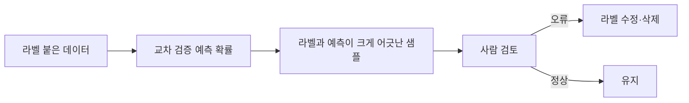
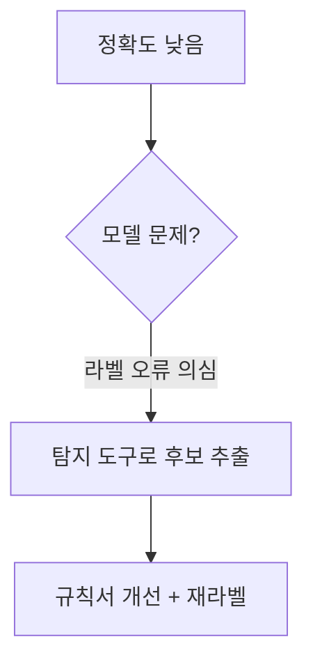

# 라벨 오류 탐지

> 학습·평가 데이터에 잘못 붙은 정답(라벨)을 자동으로 후보로 골라내는 일이다. 모델의 예측 확률과 라벨이 어긋나는 샘플을 의심 후보로 올리고, 사람이 확인한다. 대표 오픈소스는 cleanlab이다.

## 쉽게 말하면
채점 기준표 자체에 오타가 섞여 있으면 똑똑한 학생도 틀린 답을 "정답"으로 배운다. 학생(모델)이 모두 같은 문제에서 기준표와 다르게 답한다면 학생이 틀린 게 아니라 기준표가 틀렸을 가능성이 있다. 이런 문제를 모아서 출제자에게 다시 보라고 하는 것이 라벨 오류 탐지다.

## 자세히
- **얼마나 흔한가(논문 초록 직접 확인)**: Northcutt·Athalye·Mueller의 "Pervasive Label Errors in Test Sets Destabilize Machine Learning Benchmarks"(arXiv:2103.14749, v1 2021-03, v4 2021-11)는 컴퓨터 비전·NLP·음성의 널리 쓰이는 시험 세트 10개에서 라벨의 **평균 최소 3.3%**가 틀렸다고 추정한다(초기 버전은 약 3.4%로 표기). ImageNet 검증 세트에서는 최소 6%.
- **방법**: Confident Learning으로 오류 의심 샘플을 고르고 크라우드 작업자가 검증했다. 의심 후보 중 평균 51%가 실제 오류로 확인됐다(v4 기준, 초기 버전은 54%).
- **함의**: 라벨이 노이즈를 품은 시험 세트에서는 정확도가 오해를 부른다. 저자들은 교정된 시험 세트로 평가하라고 제안한다. 노이즈를 감안하면 용량이 작은 모델이 큰 모델을 이길 수 있다(예: 교정 ImageNet에서 오류 비율이 약 6%p 늘면 ResNet-18이 ResNet-50을 앞섬, 교정 CIFAR-10에서 약 5%p 늘면 VGG-11이 VGG-19를 앞섬).
- **cleanlab 사용(공식 문서 확인)**: `CleanLearning.find_label_issues(data, labels)`가 학습 안 된 scikit-learn 호환 모델을 받아 의심 샘플 불리언 마스크와 샘플별 라벨 품질 점수를 낸다. `Datalab(...).find_issues(features=..., pred_probs=...)`와 `report()`로 다른 데이터 문제도 함께 점검. 필요한 입력은 모델의 예측 확률이나 특징 임베딩이며, **표본 밖(out-of-sample)** 예측 확률이 더 좋아 교차 검증 예측을 권한다. 표 형식·텍스트·이미지·음성 분류, 다중 라벨, 개체명 같은 시퀀스, 여러 라벨러가 붙인 데이터를 지원한다.
- **주의**: 탐지된 후보의 절반가량만 진짜 오류일 수 있으므로 자동 삭제하지 말고 사람이 검토한다. 모델이 약한 클래스는 오탐이 늘 수 있다(일반적 한계).

## 그림으로 보기



## 예시
```python
# cleanlab 개념 예 (공식 문서의 함수명 기반)
from cleanlab.classification import CleanLearning
cl = CleanLearning(clf=my_sklearn_model)
issues = cl.find_label_issues(X, labels)   # 의심 샘플 표시
```
고객 문의 분류 데이터에서 의심 후보 상위 100건을 상담 리더가 검토해 라벨 정의가 겹치는 클래스 쌍을 찾는다.

## 헷갈리는 것과 비교
| 개념 | 차이 |
|---|---|
| 라벨 오류 탐지 | 잘못 붙은 정답 후보 찾기 |
| [라벨링 품질 관리](#data-labeling-qa) | 라벨러 간 일치도·골드 문제 등 사전 예방 |
| 이상치 탐지 | 입력 특징이 이상한 샘플 찾기 |
| [데이터 중심 AI](#data-centric-ai) | 이 작업을 핵심 실무로 삼는 접근 |

## 더 읽을거리
- [Pervasive Label Errors in Test Sets (arXiv:2103.14749)](https://arxiv.org/abs/2103.14749) — 시험 세트 라벨 오류 3.3%와 벤치마크 순위 영향(초록 직접 확인).
- [cleanlab 문서](https://docs.cleanlab.ai/stable/index.html) — find_label_issues·Datalab 사용법(직접 열어 확인).
