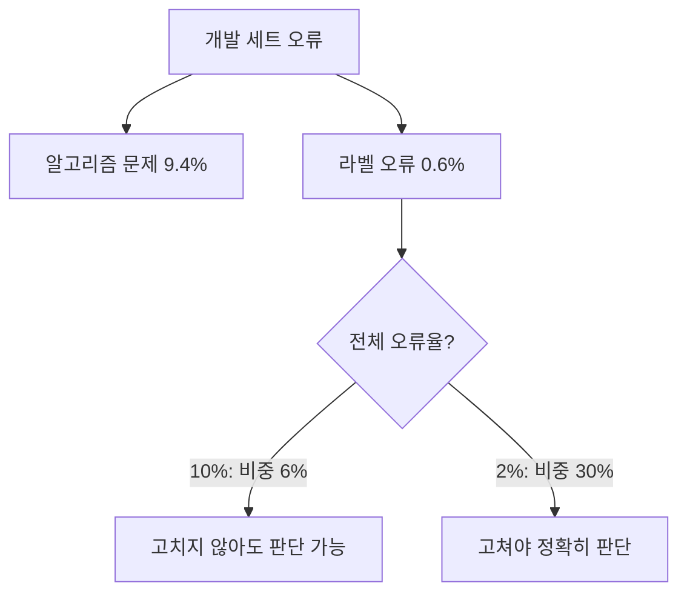
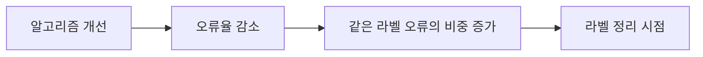

# 오류 중 라벨 오류 비중

> 개발 세트에서 틀린 예시 중 **정답 라벨 자체가 틀린 비율**. 전체 오류율이 낮아질수록 같은 수의 라벨 오류가 오류 중에서 차지하는 비중이 커져, 어느 순간 라벨을 고치는 것이 알고리즘 개선만큼 중요해진다.

## 쉽게 말하면
채점 기준표에 오타가 0.6%만큼 있다. 학생 평균이 90점일 때는 "10점 감점 중 0.6점이 채점표 오류"라 별 문제가 아니다. 평균이 98점이 되면 "2점 감점 중 0.6점이 채점표 오류"라 실력을 제대로 못 잰다.

## 자세히
- **정의(Ng, Machine Learning Yearning 초안 16장, 본문 확인)**: "오분류"란 알고리즘이 보기 전에 이미 사람 라벨러가 y를 틀리게 붙인 경우. 오류 분석 표에 "Mislabeled" 열을 추가해 비율을 추적한다. 예: 이미지 98 "배경의 고양이를 라벨러가 놓침", 이미지 100 "고양이 그림, 실제 고양이 아님", 오류 100개 중 6%.
- **판단 기준**: 개발 세트의 목적은 알고리즘 A·B 중 어느 쪽이 나은지 빠르게 판단하게 돕는 것. 라벨 오류가 이 판단을 방해할 정도면 고칠 가치가 있다.
- **Ng의 두 시점 비교**
  | 시점 | 전체 오류 | 라벨 오류로 인한 오류 | 다른 원인 | 라벨 오류 비중 |
  |---|---|---|---|---|
  | 초기 | 10% (정확도 90%) | 0.6% | 9.4% | **6%** |
  | 개선 후 | 2.0% (정확도 98%) | 0.6% | 1.4% | **30%** |
  초기엔 "오류가 10%인지 9.4%인지 몰라도 괜찮다". 개선 후엔 "오류가 1.4%에 가까운지 2%에 가까운지"를 가려야 하는데 이는 상대적으로 큰 차이라 **라벨을 고칠 가치가 생긴다.**
- **계산법**: 라벨 오류 비중 = (오류 예시 중 라벨이 틀린 개수) ÷ (오류 예시 수). 전체 오류율 중 라벨 기여분 = 오류율 × 비중(2.0% × 30% = 0.6%).
- **실무 규칙**
  - 오류율이 떨어질수록 같은 라벨 오류 건수의 비중이 커진다.
  - 개발 세트를 고치면 **시험 세트도 같은 방식으로** 고쳐 같은 분포를 유지한다(Ng).
  - 학습 세트 라벨 오류는 딥러닝이 어느 정도 견디지만(Ng은 임의 오류에 견고하다고 언급) 체계적 오류는 위험하다([체계적 vs 무작위 라벨 오류](#systematic-vs-random-label-errors)).
- **추정의 불확실성**: 라벨 오류 비중은 검토한 오류 수에 따라 흔들린다 → [범주 비율 구간](#category-share-confidence-interval).

## 그림으로 보기



## 예시
```python
err = df[df.pred != df.label]
sample = err.sample(100, random_state=0)        # 검수 대상 100개 무작위
# 사람이 sample에 mislabeled 열을 채움
share = sample.mislabeled.mean()                # 오류 중 라벨 오류 비중
label_err_rate = err_rate * share               # 전체 오류율 중 라벨 기여분
```
- 고객 문의 분류 개발 세트에서 틀린 예시 100개 중 27개의 정답 태그가 모호/오기 → 새 모델 비교 전에 라벨부터 재검수.

## 헷갈리는 것과 비교
| 개념 | 설명 |
|---|---|
| 라벨 오류 | 정답 y가 틀림 |
| 모델 오류 | 예측이 틀림 |
| 모호한 예시 | 사람도 판단 갈림 |
| [개발 세트 라벨 오류 수정 기준](#mislabeled-dev-set-threshold) | 고칠지 말지의 기준 |

## 더 읽을거리
- [Andrew Ng, Machine Learning Yearning(초안 PDF) 16장](https://home-wordpress.deeplearning.ai/wp-content/uploads/2022/03/andrew-ng-machine-learning-yearning.pdf) — 라벨 오류 정리 판단·수치 예(열어 확인).
