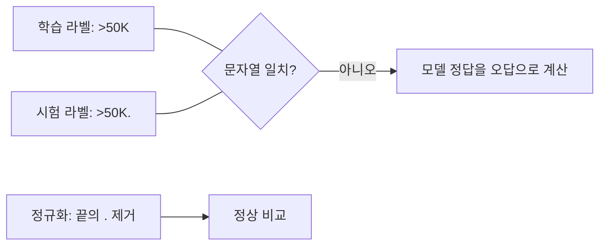
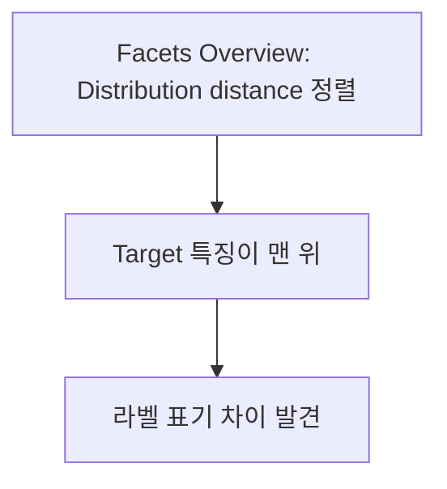

# 라벨 표기 불일치

> 학습 데이터와 시험 데이터의 **라벨이 사소하게 다르게 적혀 있는 문제**다(예: 학습은 `>50K`, 시험은 `>50K.`처럼 마침표 하나 차이). 눈에 잘 안 띄지만, 정확히 일치를 요구하는 평가에서는 정답이 하나도 안 맞는 것으로 계산될 수 있다.

## 쉽게 말하면
학교 시험 정답지에는 "서울"이라고 적었는데 학생 답안은 "서울 "(뒤에 공백)이라 자동 채점기가 모두 오답 처리하는 것과 같다. 내용은 같지만 표기가 달라 일치하지 않는다.

## 자세히
(Facets 공식 사이트 pair-code.github.io/facets의 Overview 예시를 WebFetch로 직접 확인하고, 아래 영향은 이 세션에서 pandas/numpy로 **직접 만든 장난감 실험**으로 확인했다. 사이트는 정확도에 미치는 영향을 논하지 않는다고 확인했다.)
- **발견 사례(사이트)**: UCI Census Income 데이터의 학습·시험 셋을 Facets Overview로 비교한다. **"Sort by"에서 "Distribution distance"를 고르면** 두 데이터셋에서 가장 다른 특징이 위로 올라온다. 그러면 **"Target"이 첫 범주형 특징**으로 나타나고, 차트에서 **학습 데이터는 `>50K`, 시험 데이터는 `>50K.`(끝에 마침표)**로 적혀 있음이 드러난다. 사이트는 이를 "간과하기 쉬운 불일치"로 제시한다.
- **영향(직접 만든 장난감 실험)**: 1,000개 표본에서 학습 라벨 `>50K`/`<=50K`, 시험 라벨 `>50K.`/`<=50K.`로 두고, 약 85% 맞히는 가짜 예측기를 만들었다.
  | 평가 방식 | 정확도 |
  |---|---|
  | 문자열 **정확 일치**(표기 불일치 그대로) | **0.000** |
  | 끝의 `.` 제거 후 비교 | 0.857 |
  라벨 어휘의 교집합은 **공집합**이었다. 즉 모델이 멀쩡해도 **측정 지표는 0**이 될 수 있다. (이 수치는 설계한 장난감 상황이며 실제 Census 모델의 결과가 아니다.)
- **더 위험한 경우(해석)**: 라이브러리가 알 수 없는 라벨을 자동으로 오류 처리하지 않고 **조용히 틀린 것으로 세거나 무시**하면, 낮은 점수의 원인을 모델 탓으로 오해한다.
- **예방(제안)**: ① 학습/시험 라벨의 **고유값 집합을 출력해 비교**한다(`set(train) == set(test)`). ② 데이터 점검 도구(Overview, TFDV 도메인 검사)에서 범주 목록을 확인한다. ③ 라벨을 정수·열거형으로 **정규화한 매핑 파일**을 한 곳에서 관리한다. → [TFDV 추론 스키마 검토](#tfdv-infer-schema-review)

## 그림으로 보기

## 예시
- 시험 CSV의 라벨이 `Yes`/`YES`로 섞여 있어 한쪽만 맞는 것으로 평가됨 → 대소문자 통일.
- 교육 활동: 학습/시험 라벨 목록을 `set`으로 비교하는 한 줄 코드를 직접 작성해 보기.

## 헷갈리는 것과 비교
| 개념 | 차이 |
|---|---|
| 라벨 표기 불일치 | 같은 뜻의 라벨이 다른 문자열 |
| 라벨 오류(노이즈) | 라벨의 의미가 틀림 |
| [Facets Overview](#facets-overview) | 이런 불일치를 눈으로 발견하는 도구 |
| [TFDV skew 비교기](#tfdv-skew-comparator) | 분포 차이를 임계값으로 감지(어휘 불일치와 다른 층) |

## 더 읽을거리
- [Facets 사이트 (pair-code.github.io/facets)](https://pair-code.github.io/facets/) — Census 예시에서 `>50K` vs `>50K.` 발견(직접 확인). 정확도 수치는 이 노드의 직접 만든 장난감 실험이다.
