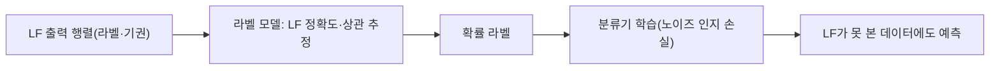
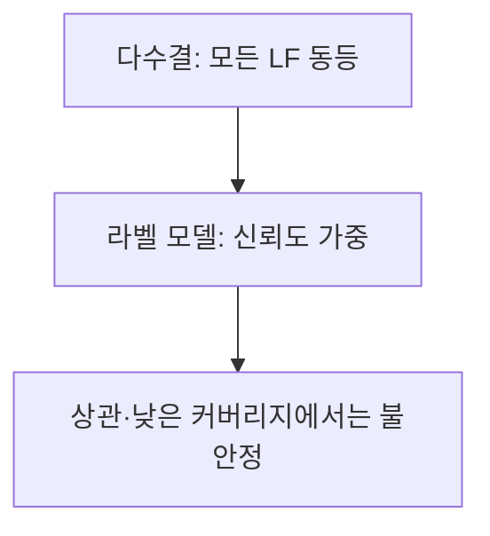

# 라벨 모델(노이즈 정리)

> 정답 없이 여러 라벨링 함수(LF)의 투표 패턴만으로 각 LF의 정확도(와 상관)를 추정하고, 그 정확도를 반영해 LF 출력들을 하나의 확률 라벨로 합치는 모델이다. 단순 다수결보다 신뢰할 만한 LF에 더 큰 가중을 준다.

## 쉽게 말하면
심사위원 5명이 채점할 때, 누가 믿을 만한지 모르는 상태에서 "대부분의 문제에서 다수와 같은 답을 내는 심사위원은 신뢰도가 높다"는 식으로 서로의 일치 정도로 신뢰도를 추정한 뒤, 신뢰도가 높은 사람의 표에 가중치를 주는 것과 같다.

## 자세히
(데이터 프로그래밍 논문 arXiv 1605.07723과 Snorkel 논문 arXiv 1711.10160 초록을 직접 열어 확인하고, 간단한 모형을 직접 구현해 실행.)
- **원리(논문 초록)**: LF를 **생성 모델**로 모델링해 LF의 **정확도와 상관**을 추정함으로써 학습 세트를 "노이즈 제거(denoise)"한다. 정답 라벨 없이 LF 출력만 사용. 또한 판별 모델의 손실을 **노이즈 인지(noise-aware)** 형태로 바꾸면 로지스틱 회귀·LSTM 같은 모델이 노이즈 라벨로 학습할 수 있다. 여러 설정에서의 이론적 복원 결과도 보고.
- **결과(초록)**: 2014 TAC-KBP 슬롯 채우기 과제에서 우승 점수가 나올 수준, LSTM 기준선을 **거의 6 F1 포인트 개선**. Snorkel 논문에서는 사용자 연구에서 전문가가 **2.8배 빠르게** 모델을 만들었고 평균 예측 성능이 45.5% 향상, 손으로 만든 큰 데이터셋 모델과 평균 3.60% 이내.
- **직접 구현(간단한 단일 계수 EM, 정답 없이 LF 출력만 사용)**: LF 4개(실제 정확도 0.894·0.683·0.608·0.547)를 1,000건에 적용. 모델이 추정한 정확도는 **0.814·0.693·0.610·0.591** — 정답 없이도 순서와 크기를 꽤 따라갔다. 이 추정으로 합친 라벨의 정확도는 **0.702**(1개 이상 LF가 말한 99% 데이터), 단순 다수결은 **0.693**(동률 제외 76.6%). 즉 이 장난감 설정에서는 이득이 작다. LF가 서로 독립이고 정확도 차이가 클수록 이득이 크다. 이 구현은 Snorkel의 실제 라벨 모델(상관 구조 포함)과 다르다.
- **한계(제안)**: LF가 서로 상관되어 같이 틀리면 정확도가 과대 추정된다. LF가 적고 커버리지가 낮으면 추정이 불안정하다. 확률 라벨이므로 학습 때 소프트 라벨로 쓰거나 임계값으로 하드 라벨을 만든다. 사람이 라벨한 개발 세트로 합친 라벨의 정확도를 반드시 점검한다.
- 이어서 합쳐진 라벨로 일반 모델(분류기)을 학습하고, 분류기가 LF가 못 본 데이터까지 일반화하는 것이 목표다([약한 지도](#weak-supervision)).

## 그림으로 보기



## 예시
```python
# Snorkel 사용 형태(참고, 이 환경에서는 직접 실행하지 않음)
from snorkel.labeling.model import LabelModel
label_model = LabelModel(cardinality=2)
label_model.fit(L_train, n_epochs=500, seed=123)
probs = label_model.predict_proba(L_train)
```
- 사내 문의 분류: LF 12개 → 라벨 모델로 확률 라벨 → 분류기 학습 → 사람이 라벨한 300건으로 검증.

## 헷갈리는 것과 비교
| 개념 | 차이 |
|---|---|
| 라벨 모델 | LF 정확도를 추정해 확률 라벨 생성 |
| 단순 다수결 | 모든 LF를 동등하게 투표 |
| [LF 커버리지와 충돌](#lf-coverage-conflict) | 라벨 모델 전에 LF를 진단 |
| [Confident Learning](#confident-learning) | 이미 있는 라벨의 오류를 찾음 |

## 더 읽을거리
- [Data Programming (arXiv 1605.07723)](https://arxiv.org/abs/1605.07723) — 생성 모델로 노이즈 제거(초록 확인).
- [Snorkel (arXiv 1711.10160)](https://arxiv.org/abs/1711.10160) — 사용자 연구 결과(초록 확인).
