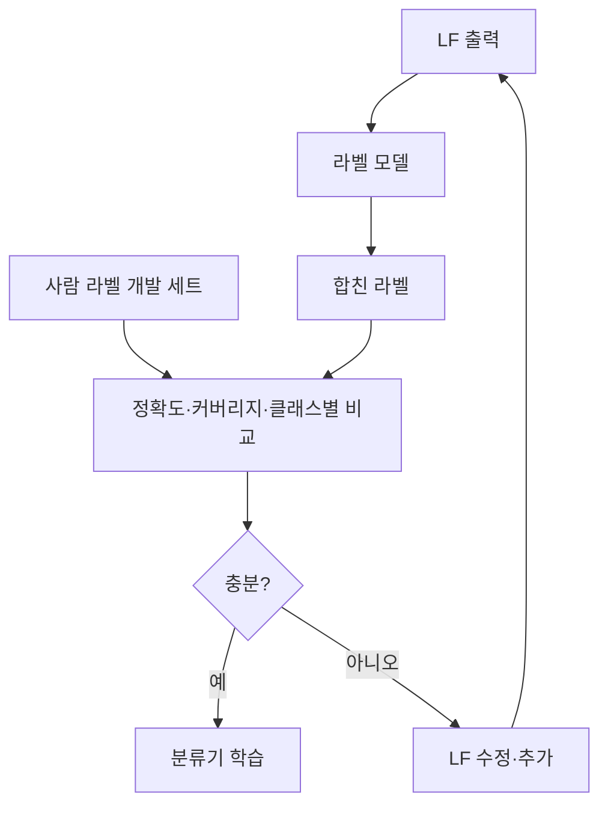
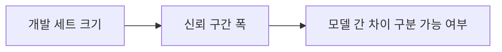

# 합친 라벨 검증

> LF들을 라벨 모델로 합쳐 만든 약한 라벨이 실제로 쓸 만한지, **사람이 직접 라벨한 소량의 개발(검증) 세트**로 재어 보는 단계다. 정답 없이 만든 라벨은 이 점검 없이는 얼마나 믿을지 모른다.

## 쉽게 말하면
여러 사람이 대충 채점한 점수를 합쳐 학생들의 성적표를 만들었다면, 그중 일부 학생의 답안을 선생님이 정확히 다시 채점해 맞는지 비교해 보는 것이다. 몇 명을 다시 채점하느냐에 따라 "맞는 정도"를 얼마나 확신할 수 있는지가 달라진다.

## 자세히
(Snorkel 스팸 튜토리얼 소스와 LFAnalysis 문서를 직접 열어 확인하고, 표본 크기 효과는 직접 시뮬레이션.)
- **튜토리얼의 방식**: 라벨 모델은 정답 없이 학습하고(`LabelModel(cardinality=2)`, `fit` 500 에폭), 사람이 라벨한 **보류된 테스트 세트**에 `score(...)`로 정확도만 잰다. 같은 세트에서 `MajorityLabelVoter`(다수결)와 비교해 라벨 모델이 나은지 본다. 학습 세트에는 정답이 없어서 LF별 경험적 정확도(`LFAnalysis`)를 계산할 수 없다. 튜토리얼은 단순화를 위해 dev/validation 분할을 생략했다고 밝히며, 실무에서는 별도 분할을 둔다고 적는다.
- **기권 처리**: 어떤 LF도 라벨을 못 붙인 데이터는 `filter_unlabeled_dataframe`로 빼는데, 이런 데이터는 "감독 신호가 없고 성능을 해칠 수 있다"고 튜토리얼이 설명한다. 그래서 **정확도를 말할 때는 커버리지를 같이** 적는다. 직접 계산 예: 70%에 정확도 0.85로 라벨을 붙이고 나머지는 50% 찍기로 채우면 전체는 0.745로 낮아진다.
- **표본 크기와 신뢰 범위(직접 시뮬레이션, 진짜 정확도 0.80, 2,000회 반복)**
  | 개발 세트 크기 | 측정값 5~95% 범위 | 평균 95% 구간 폭(Wilson) |
  |---|---|---|
  | 30 | 0.67~0.90 | 0.27 |
  | 100 | 0.73~0.86 | 0.15 |
  | 300 | 0.76~0.84 | 0.09 |
  | 1,000 | 0.78~0.82 | 0.05 |
  30건이면 정확도가 0.67이든 0.90이든 우연히 나올 수 있다. 라벨 모델과 다수결의 차이가 몇 %p밖에 안 나면 작은 개발 세트로는 구분이 안 된다.
- **점검 항목(제안)**: ① 정확도와 커버리지 함께 ② 클래스별 정확도·재현율(소수 클래스가 묻히지 않게) ③ 다수결 대비 개선폭 ④ 확신 구간(Wilson 등) ⑤ 개발 세트를 LF 설계에 보고 고쳤다면 최종 평가는 **별도 테스트 세트**로(개발 세트가 오염됨).
- **다음 단계**: 합친 라벨의 정확도가 충분하면 분류기를 학습시키고, 부족하면 LF를 [제거·보강](#lf-pruning)한다.

## 그림으로 보기

## 예시
- 사내 문의 분류에서 합친 라벨 정확도를 재려고 문의 300건을 직접 라벨 → 약 ±4.5%p 범위로 점검(위 표 기준 0.09 폭).
- 교육 소재: "정답 없이 만든 라벨을 믿어도 되나?"에 "소량이라도 사람 라벨로 재야 한다"로 답하기.

## 헷갈리는 것과 비교
| 개념 | 차이 |
|---|---|
| 합친 라벨 검증 | 합친 결과를 사람 라벨로 평가 |
| [약한 지도의 검증 세트](#weak-supervision-validation-set) | 그 검증 세트를 어떻게 만들고 관리하는지 |
| [LF 커버리지와 충돌](#lf-coverage-conflict) | LF 간 일치 지표(정답 불필요) |
| [라벨 모델](#label-model-denoising) | 합치는 모델 자체 |

## 더 읽을거리
- [Snorkel 스팸 튜토리얼 소스](https://github.com/snorkel-team/snorkel-tutorials/blob/master/spam/01_spam_tutorial.py) — 라벨 모델 평가·다수결 비교·기권 필터(직접 확인).
- [Snorkel LFAnalysis 문서](https://snorkel.readthedocs.io/en/master/packages/_autosummary/labeling/snorkel.labeling.LFAnalysis.html) — 개발 세트 `Y`가 있을 때의 정확도 함수.
