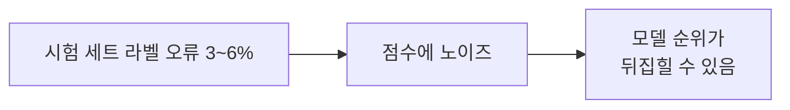
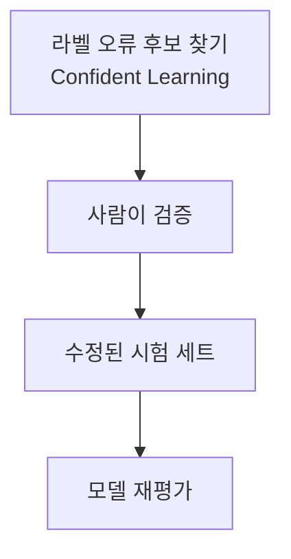

# 벤치마크 라벨 노이즈

> 모델을 비교하는 벤치마크의 시험 세트에도 잘못된 라벨이 섞여 있고, 그 비율이 조금만 달라져도 "어느 모델이 더 좋은가"라는 순위가 뒤집힐 수 있다는 문제다.

## 쉽게 말하면
정답지에 오타가 있는 시험으로 두 학생을 비교하는 상황이다. 오타가 적을 땐 실력순이 맞지만, 오타가 늘면 "오타에 맞춰 답을 쓴 학생"이 높은 점수를 받는다. 시험지가 틀렸는지 먼저 의심해야 한다.

## 자세히
(arXiv 2103.14749 초록 직접 확인 + 검색 결과로 보충.) Northcutt, Athalye, Mueller, NeurIPS 2021 데이터셋·벤치마크 트랙.
- 컴퓨터 비전·자연어·오디오의 널리 쓰이는 데이터셋 **10개**의 시험 세트를 분석. 후보는 [Confident Learning](#confident-learning)으로 찾고 크라우드소싱으로 사람이 검증했다(검색 결과: 후보의 약 54%가 실제 오류로 확인).
- **오류율**: 평균 **최소 3.3%**(초판 초록은 3.4%였으나 개정판이 하한 3.3%로 수정). **ImageNet 검증 세트의 최소 6%**.
- **순위 뒤집힘**: 라벨을 바로잡은 ImageNet에서 잘못 라벨된 시험 샘플 비율이 약 6%p 늘면 ResNet-18이 ResNet-50을 앞선다. 바로잡은 CIFAR-10에서는 약 5%p 늘면 VGG-11이 VGG-19를 앞선다.
- 해석(검색 결과 요약, 원문 본문 미열람): 정리된 라벨에서는 순위가 대체로 유지되지만, 현실 데이터처럼 노이즈가 많으면 용량이 작은 모델이 더 낫게 나올 수 있다. 시험 세트의 라벨 품질을 먼저 점검하라는 권고.
- 교훈(제안): 리더보드 1~2% 차이는 라벨 오류 범위 안일 수 있다. LLM 벤치마크도 정답 라벨 오류가 보고된 사례가 많다([벤치마크 오염](#benchmark-contamination)과 별개 문제).

## 그림으로 보기

## 예시
- 사내 분류 모델 A(92.1%) vs B(91.5%): 시험 세트 라벨 오류가 3%라면 0.6%p 차이는 의미가 약하다. 먼저 의심 라벨 상위 100건을 재검수한다.
- 교육 활용: "벤치마크 숫자를 그대로 믿지 말자" 사례로 쓴다.

## 헷갈리는 것과 비교
| 개념 | 차이 |
|---|---|
| 벤치마크 라벨 노이즈 | 시험 정답지 자체의 오류 |
| 학습 데이터 라벨 노이즈 | 학습 라벨의 오류(모델은 어느 정도 견딤) |
| [벤치마크 오염](#benchmark-contamination) | 시험 문제가 학습에 새어 들어감 |
| [데이터 누수](#data-leakage) | 분할 설계 문제 |

## 더 읽을거리
- [Pervasive Label Errors in Test Sets Destabilize Machine Learning Benchmarks (arXiv 2103.14749)](https://arxiv.org/abs/2103.14749) — 초록(열어 확인).
- [Confident Learning 논문](https://arxiv.org/abs/1911.00068) — 후보 탐지 방법(열어 확인).
