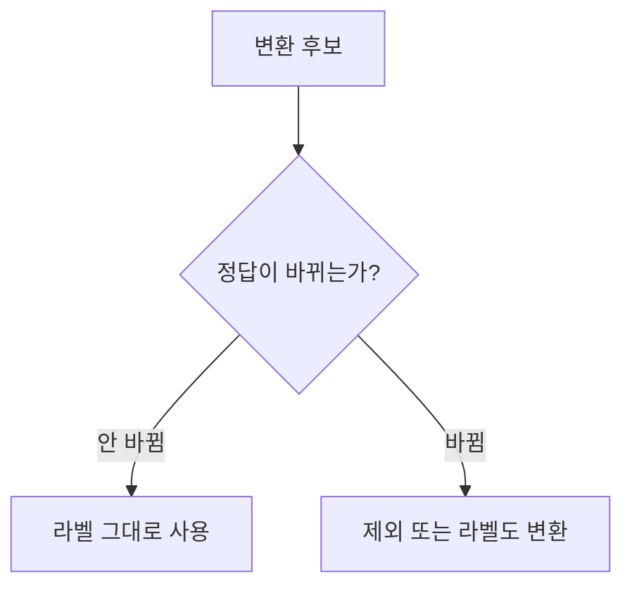

# 라벨 보존 변환

> 데이터 증강에서 변형 후에도 정답 라벨이 바뀌지 않는 변환만 쓴다는 원칙이다. 같은 변환도 데이터 종류에 따라 안전할 수도, 정답을 망가뜨릴 수도 있다.

## 쉽게 말하면
고양이 사진을 뒤집어도 고양이지만, 숫자 6을 180도 돌리면 9가 된다. "안전한 변형"은 정답을 그대로 둬도 되는 변형이다. 정답이 바뀌는 변형에 원래 라벨을 붙이면 모델에게 거짓말을 가르치는 셈이다.

## 자세히
(survey 내용은 검색 결과 요약이며 해당 문장을 직접 열어 확인하진 못함. 아래 실험은 직접 실행.)
- **안전성은 변환×데이터×강도의 문제(Yang 등 서베이, arXiv 2206.06544 — 검색 결과 인용)**: 큰 각도 회전은 특히 텍스트·숫자 데이터에서 위험(SVHN의 '6'과 '9'). 일반 분류·탐지에서는 좌우 뒤집기가 라벨을 보존하지만 숫자·문자 데이터에서는 위험. 약 1~30도의 약한 회전이 대부분의 이미지 분류에서 도움이 된다는 인용이 있다(원문 미확인). 이 서베이의 초록은 자동 증강(AutoDA)의 변환 집합·탐색·평가 구성을 다룬다고 확인.
- **직접 실행(scikit-learn digits 8×8, 로지스틱 회귀, 기준 정확도 0.961)**:
  - 시험 세트의 '6'을 180도 회전해 넣으니 **87%가 '9'로 예측**됐고 '6'으로 예측된 것은 0%. 반대로 '9'를 회전하면 79.6%가 '6'.
  - 180도 회전본을 **원래 라벨 그대로** 학습에 섞으면 시험 정확도가 0.961 → **0.887**로 떨어졌다(소규모 장난감 실험).
- **대응**: ① 숫자·문자·방향 의존 데이터에서는 뒤집기·큰 회전 제외 ② 변환을 라벨 의미별로 허용 목록으로 관리 ③ 변형 샘플 일부를 사람이 점검 ④ 회전별로 새 라벨을 붙이는 자기지도 라벨 증강(arXiv 1910.05872: 원래 라벨에 입력 변환 라벨을 결합해 하나의 과제로 학습한다는 초록 확인)처럼 불변성 요구를 느슨하게 만드는 방법도 있다.
- 예: 의료 영상에서 좌우 뒤집기는 심장 위치(좌/우)를 바꿔 해부학적으로 틀린 영상을 만들 수 있다(제안). 텍스트에서는 동의어 치환이 감성·의도를 바꿀 수 있다([번역 왕복](#back-translation)).
- **라벨을 일부러 섞는 증강**(MixUp 등)은 이 원칙의 예외로 소프트 라벨을 쓴다([MixUp·CutMix](#mixup-cutmix)).

## 그림으로 보기

## 예시
| 데이터 | 안전한 변환 | 위험한 변환 |
|---|---|---|
| 일반 사물 사진 | 좌우 뒤집기, 약한 회전, 밝기 | 과한 자르기(대상 잘림) |
| 손글씨 숫자 | 약한 이동·잡음 | 뒤집기, 180도 회전(6↔9) |
| 흉부 X선 | 밝기·약한 이동 | 좌우 뒤집기 |
| 감성 문장 | 문장 재번역(점검 후) | 부정어 삭제·치환 |

## 헷갈리는 것과 비교
| 개념 | 차이 |
|---|---|
| 라벨 보존 변환 | 정답이 같은 변형만 |
| 라벨 변경 증강 | MixUp처럼 라벨도 함께 섞음 |
| [탐지용 증강](#augmentation-for-detection) | 박스·마스크도 같이 변환 |
| [증강본 그룹 누수](#augmentation-group-leak) | 분할 순서 문제(변환 안전성과 별개) |

## 더 읽을거리
- [A Survey of Automated Data Augmentation Algorithms… (arXiv 2206.06544)](https://arxiv.org/abs/2206.06544) — 초록만 열어 확인, 안전성 문장은 검색 결과 인용.
- [Self-supervised Label Augmentation via Input Transformations (arXiv 1910.05872)](https://arxiv.org/abs/1910.05872) — 입력 변환을 라벨로 결합(초록 확인).
