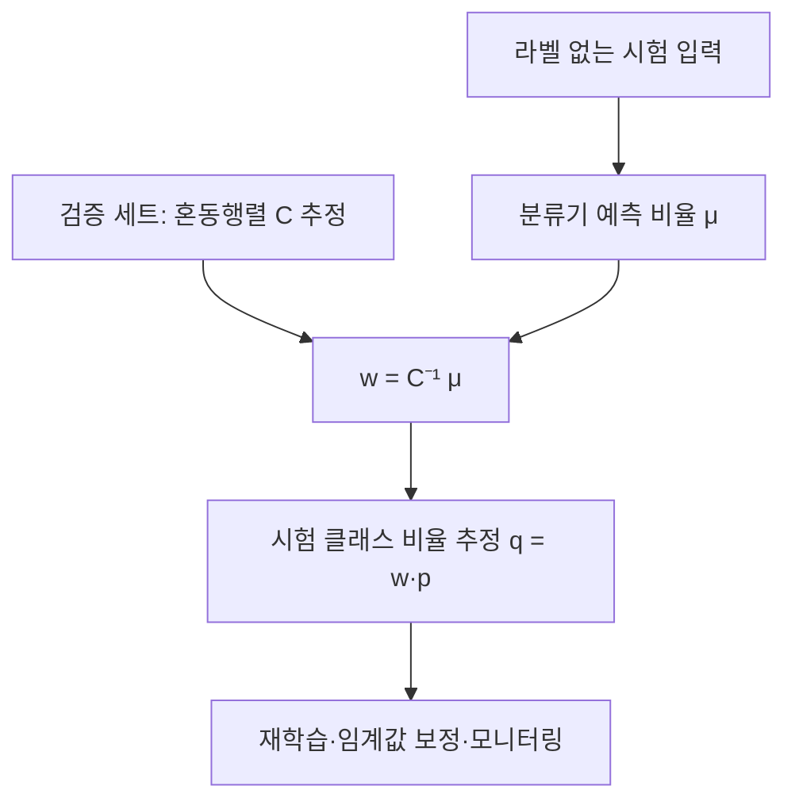
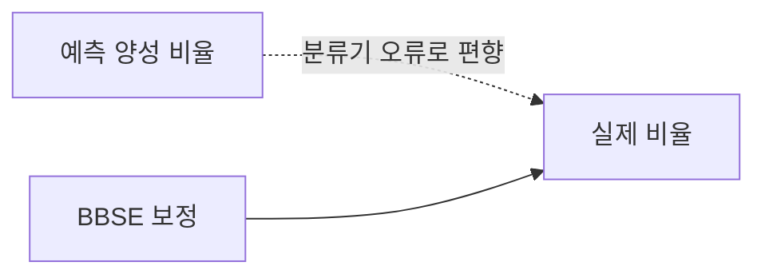

# 라벨 변화 추정

> 시험(운영) 환경에서 **클래스 비율(예: 병의 유병률)이 학습 때와 달라졌지만 각 클래스 안의 입력 모양은 그대로**일 때, 시험 라벨 없이 **새 클래스 비율을 추정**하는 문제다. 학습된 분류기를 "블랙박스"로 두고 그 혼동행렬만으로 추정하는 BBSE가 대표 방법이다.

## 쉽게 말하면
한 병원의 폐렴 비율이 5%일 때 만든 진단 모델을 유행 시기의 병원에 쓰면 실제 비율은 15%일 수 있다. 환자의 증상 모양은 같고 환자 비율만 달라진 것이다. 모델이 "양성"이라고 말한 비율만 보면 모델의 실수 때문에 틀린 비율을 얻으므로, 모델의 실수 패턴(혼동행렬)을 이용해 보정해 실제 비율을 추정한다.

## 자세히
(Lipton·Wang·Smola, ICML 2018의 「Detecting and Correcting for Label Shift with Black Box Predictors」(arXiv 1802.03916) 초록과 서론을 PDF로 직접 확인하고, 추정은 직접 시뮬레이션했다.)
- **설정(논문)**: 의학 진단처럼 질병(목표)이 증상(관측)을 일으키는 경우에 맞춰 **라벨 변화**를 다룬다 — 라벨 주변분포 p(y)는 바뀌고 p(x|y)는 바뀌지 않는다. 학습 라벨 데이터와 **라벨 없는 시험 데이터**만 있다.
- **BBSE(Black Box Shift Estimation)**: 임의의 블랙박스 예측기 f를 써서 각 클래스의 가중치 w_l = q(y_l)/p(y_l)(시험/학습 클래스 비율)을 추정한다. 학습(검증) 데이터에서 추정한 **혼동행렬이 가역**이면 되고, 예측기가 **편향되거나 부정확하거나 보정되지 않아도 작동**한다(더 좋은 예측기는 더 좁은 추정을 준다). 논문은 일관성 증명, 오차 한계, **이동 검출용 통계 검정**, 분류기 교정 방법을 제시하고 고차원 자연 이미지 데이터에서 정확한 추정과 예측 개선을 보였다고 한다. 핵심 식은 `w = C⁻¹ μ`(C: 예측×실제 혼동행렬 결합 확률, μ: 시험에서 예측 클래스 비율)이다.
- **직접 시뮬레이션(이진, 분류기 민감도 0.70·특이도 0.90, 학습·검증 양성 비율 0.10, 검증 1,000건으로 혼동행렬 추정, 시험 2,000건, 2,000회 반복 평균 절대오차)**
  | 진짜 시험 양성 비율 | 예측 양성 비율(기대) | 오차: 예측 비율 그대로 | 오차: BBSE |
  |---|---|---|---|
  | 0.10 | 0.160 | 0.060 | **0.018** |
  | 0.20 | 0.220 | 0.020 | 0.021 |
  | 0.30 | 0.280 | 0.020 | 0.025 |
  | 0.50 | 0.400 | 0.100 | **0.036** |
  예측 비율은 분류기 오류로 **편향**된다(양성 0.10일 때 0.16, 0.50일 때 0.40으로 보임). 편향이 큰 구간(0.10, 0.50)에서 BBSE가 오차를 크게 줄였고, 편향이 우연히 상쇄되는 구간(0.20~0.30)에서는 예측 비율이 비슷하거나 약간 낫다. BBSE는 편향을 없애는 대신 혼동행렬 추정 오차가 분산으로 들어간다.
- **다중 클래스 주의(직접 시도)**: digits 10개 클래스에서 5개 주성분만 쓰는 약한 분류기로 시험(클래스 0~4를 3배 많게) 비율을 BBSE로 추정했더니 **L1 오차 0.142로 예측 비율 그대로(0.113)보다 나빴다**(한 번의 실행, 검증 약 430건). 검증 데이터가 작으면 혼동행렬 추정이 불안정해지므로 **검증 표본 크기와 추정 구간**이 중요하다. 분류기가 거의 완벽한 경우(정확도 약 97%)는 예측 비율과 BBSE가 사실상 같았다.
- **쓰는 법(제안)**: ① 시험 입력의 라벨 없는 샘플에 분류기를 적용해 예측 비율 μ 계산 ② 검증 세트로 혼동행렬 C를 추정(충분히 크게) ③ w=C⁻¹μ로 클래스 가중치 추정, 음수·극단값은 0으로 자르거나 완화 ④ 추정 비율 보고 + 부트스트랩 구간 ⑤ 학습 손실에 w를 곱해 재학습하거나 임계값·사전 확률 보정 ⑥ 라벨 변화 가정(p(x|y) 불변)을 도메인 지식으로 점검.
- **한계**: p(x|y)가 바뀌는 공변량·개념 변화에는 적용되지 않는다([공변량 변화와 재가중](#covariate-shift-reweighting)). 혼동행렬이 가역이 아니면(클래스 구분이 안 되는 경우) 불가능하다.

## 그림으로 보기

## 예시
- 폐렴 분류 모델을 유행기 병원에 적용: 라벨 없는 영상에 모델을 돌려 양성 예측 비율 28%를 얻고, 검증에서 민감도·특이도로 보정해 실제 유병률을 추정, 이후 임계값을 조정.
- 교육 소재: "AI가 양성이라고 한 비율 ≠ 실제 양성 비율" — 위 표로 편향을 체험(의료·품질 검사 교육).

## 헷갈리는 것과 비교
| 개념 | 차이 |
|---|---|
| 라벨 변화 추정 | 클래스 비율 p(y) 변화를 추정 |
| [공변량 변화와 재가중](#covariate-shift-reweighting) | 입력 분포 p(x) 변화 |
| [분포 변화 유형](#distribution-shift-types) | 공변량·라벨·개념 변화 분류 |
| 사전 확률 보정 | 베이즈 사후 확률을 새 사전으로 조정(BBSE의 추정치를 입력으로 사용 가능) |

## 더 읽을거리
- [Detecting and Correcting for Label Shift with Black Box Predictors (arXiv 1802.03916)](https://arxiv.org/abs/1802.03916) — BBSE, 가역 혼동행렬 조건, 검출 검정(PDF 앞부분 직접 확인).
