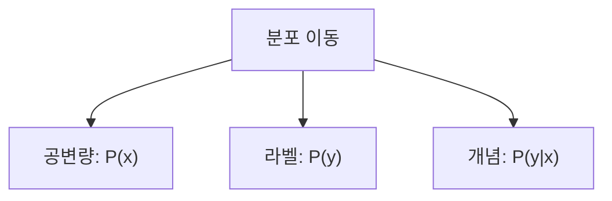

# 라벨 이동

> 배포 시 **라벨(정답 클래스)의 비율 P(y)가 바뀌지만, 각 클래스 안의 입력 분포 P(x|y)는 그대로**인 분포 이동. [공변량 이동](#covariate-shift)과 반대 관계로 설명되기도 한다.

## 쉽게 말하면
같은 병원 검사지인데 독감 시즌에는 독감 환자 비율이 훨씬 높아진다. 독감 환자의 증상 모양 자체는 같지만 "독감일 확률"이 달라져 예측 기준이 어긋난다.

## 자세히
(검색 요약 기준, 1차 논문은 열람하지 않았다.)
- 정의: 한 논문 표기로 `p(x|y) = q(x|y)`이면서 `p(y) ≠ q(y)`. 다른 출처는 P(y)가 바뀌고 P(x|y)는 바뀌지 않는, 공변량 이동의 반대로 설명한다.
- [분포 이동](#distribution-shift)의 세 갈래 중 하나이며, 용어 정의는 논문마다 조금 달라 읽는 논문의 관례를 확인해야 한다.
- 탐지: 배포 라벨이 없으면 일반적으로 탐지가 어렵고 추가 가정이 필요하다. 순차 탐지기·마팅게일 기반 방법이 분류 문제에서 개념 이동과 라벨 이동을 따로 탐지한다는 요약이 있다.
- 점검 질문(내 정리): 최근 클래스 비율이 학습 데이터와 크게 달라졌는가? 각 클래스의 입력 특성은 비슷한가? 임계값을 비율 변화에 맞춰 재조정해야 하는가?
- 한계: 이 글은 개념 정의 수준이며 보정 알고리즘은 다루지 않았다.

## 그림으로 보기

## 예시
- 스팸 필터: 캠페인 기간에 스팸 비율이 급증하지만 스팸 메일의 문체 자체는 같음.
- 교육: 가상 병원 데이터로 클래스 비율이 바뀔 때 정확도·정밀도가 어떻게 변하는지 계산.

## 헷갈리는 것과 비교
| 개념 | 차이 |
|---|---|
| 라벨 이동 | P(y) 변화, P(x\|y) 동일 |
| [공변량 이동](#covariate-shift) | P(x) 변화, P(y\|x) 동일 |
| 개념 이동 | 입력-출력 관계 변화 |

## 더 읽을거리
- [Towards Practicable Sequential Shift Detectors](https://arxiv.org/pdf/2307.14758) — 순차 탐지(검색 결과 확인).
