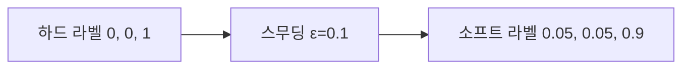
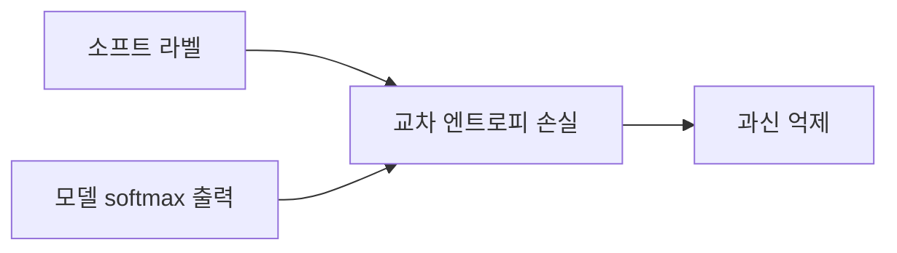

# 레이블 스무딩

> 정답 라벨을 [0,0,1]처럼 100%로 두지 않고 [0.05,0.05,0.9]처럼 살짝 낮춰, 모델이 지나치게 확신하지 않게 하는 정규화 기법.

## 쉽게 말하면
시험에서 "무조건 정답은 이것뿐"이라고만 가르치면 학생이 오만해진다. "대체로 이것이지만 다른 가능성도 조금 있다"고 가르치면 새 문제에도 겸손하게 대처한다.

## 자세히
- 방법: 정답 클래스 확률 1−ε, 나머지 클래스에 ε를 나눠 준다. ε은 보통 0.1 정도를 많이 쓴다(일반적 관행이며 이미지 분류 논문 Inception v3(arXiv:1512.00567)에서 쓰였다고 알려져 있다. 이번에 그 원문에서 정의를 직접 확인하지는 못했다).
- 효과: 과신(overconfidence)을 줄이고 일반화를 돕는다. [교차 엔트로피](#cross-entropy)에서 정답 로짓을 무한정 키우려는 압력을 약하게 한다.
- 부작용: 보정(calibration)이 좋아지기도 하지만, 지식 증류 teacher로 쓰면 정보가 줄 수 있다는 보고가 있다(주장, 미검증).
- 번역·이미지 분류·음성 인식에 흔히 쓴다.

## 그림으로 보기

## 예시
- PyTorch: `nn.CrossEntropyLoss(label_smoothing=0.1)`
- 분류기가 학습 데이터 라벨이 일부 틀려 있을 때 영향이 줄어든다.

## 헷갈리는 것과 비교
| 개념 | 차이 |
|---|---|
| 레이블 스무딩 | 정답 분포를 부드럽게 |
| 드롭아웃 | 뉴런을 무작위로 끔 |
| [온도](#softmax) | 추론 시 확률을 조절 |

## 더 읽을거리
- [Rethinking the Inception Architecture](https://arxiv.org/abs/1512.00567) — 레이블 스무딩이 소개된 논문(초록만 확인).
